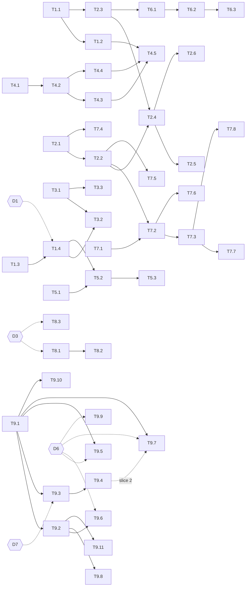

# Master plan: plan-sop-ui-automation improvements

**Date:** 2026-10-08 · **Baseline:** `main` @ `f3d48bb` · **Scope:** whole repo, focus on `playwright-e2e/` and `.github/workflows/`
**Inputs:**
- [Repo health review (2026-10-06)](repo_health_review_2026-10-06.md): items M1–M5 and G1–G5.
- [Test report dashboard and triage plan](../../playwright-e2e/docs/strategy/Test-Report-Dashboard-and-Triage-Plan.md): triage Phases 0–2 and part of Phase 3 are already merged.
- New items found while re-verifying both against `main` on 2026-10-08 (marked **new** below).

## 1. Goals

1. **A run can't damage shared environments by accident.** No command or typo runs the destructive DataSetup specs.
2. **A red or green signal means what it says.** Failing checks fail tests; runs that need action are red; PRs can't add known anti-patterns.
3. **Tests don't step on each other.** Every spec that creates data cleans it up and uses names unique to its run.
4. **Every spec runs somewhere on a schedule, or is listed with a reason.**
5. **The framework is cheaper to change:** one place per CI step, per endpoint and per locator pattern, and no legacy suite to maintain.

## 2. Baseline (re-verified 2026-10-08; "Now" column re-measured 2026-11-11 on `origin/main` @ `339751f`)

| Measure | Value (2026-10-08) | Now (2026-11-11) | How it was measured |
|---|---|---|---|
| Specs | 237 | 245 (after T9.6 removed the two replaced OnDemandMaas specs) | `find playwright-e2e/tests -name "*.spec.ts"` |
| Specs not in any suite JSON | 57 (13 Planning Space, 29 PO UI run by folder scripts, 10 DataSetup, 4 Performance, 1 Visual) | 72: 25 Planning Space (13 never scheduled, 11 retired assumption context, 1 redundant), 26 PO UI (20 nightly through folder scripts), 10 DataSetup, 4 Performance, 4 `_framework`, 2 backend (retired assumption context), 1 Visual. PS `folder_map` lanes run on manual dispatch only | glob match of `tests/TestSuites/*.json` and `VisualSuites/*.json`; `npm run validate:suites` |
| Workflows / lines | 15 / 7,097 | 17 / 8,290; the 6 active Playwright test workflows hold 4,704, the 4 disabled ones 1,615 | `wc -l .github/workflows/*.y*ml` |
| Workflows with a run verdict | 3 (PO backend, PO UI, PS UI), mode `report` (repo variable `PW_VERDICT_MODE` not set) | 4 with a verdict (+ Visual); performance and custom tests have an outcome gate. Every one is still `report`: no `PW_VERDICT_MODE*` variable is set | `gh variable list` |
| Workflows triggered by `pull_request` | 0 (only CodeQL and Copilot review, both GitHub-managed) | `pr-checks` (`Quality Checks`, `Secrets Scan`). Not yet a required check: `main` has no required status checks (D4) | `grep pull_request .github/workflows`; `gh api .../branches/main/protection/required_status_checks` |
| ESLint | 990 baseline violations across 69 files (756 XPath, 234 waitForTimeout, 0 floating promises) | 67 suppressions in 26 files: 58 `no-wait-for-timeout` in specs, 9 XPath in `util/test.util.ts` | `eslint-suppressions.json` |
| `tsc --noEmit` errors | 0 | 0 | `npm run typecheck` |
| XPath lines in page objects | 741 (`planning.page.ts` 180) | 0 | `grep -E "['\"\`]\(?//\|xpath=" pageobjects/**/*.ts` |
| `waitForTimeout` | 131 in page objects, 102 in specs | 0 in page objects, 57 lines in specs | grep |
| Non-retrying `.isVisible(` in page objects | 213 | 158 (components included) | grep |
| `compareTwoValues(` calls in specs | 2,414 lines (2026-10-16); 43 in 28 specs never reach an assertion | 2,396 lines | grep; static pass in Phase 3 README |
| Specs with `afterAll` cleanup | PS 26/126, PO UI 4/29, backend 31/45 | PS 40/132, PO UI 8/26, backend 31/45 | grep |
| Specs naming data with `Math.random` | 32 | 0 (1 spec uses it for a view id, a lint warning) | grep |
| Test data JSON with `_schema` | 71 of 374 | 413 of 413, enforced by `validate:suites` | grep |
| `: any` in specs | 366 (`noImplicitAny: false`) | 360 (`noImplicitAny: true`) | grep |
| Legacy WDIO files in `e2e/` | 704; its 4 workflows are `disabled_manually` | Retired, not deleted (D3). A 4th disabled workflow, `playwright-po-iop-suite.yaml` (Playwright), isn't covered by D3 | `git ls-files e2e`, `gh api .../actions/workflows` |
| Third-party actions pinned by tag, not SHA | `peaceiris/actions-gh-pages@v3` (×10), `aliencube/microsoft-teams-actions@v0.8.0` (×2) | None: all pinned by SHA (`actions-gh-pages` v4.1.0) | grep |
| Dependabot version config / PR template | neither exists (only GitHub's default security updates) | Both exist. Dependabot covers GitHub Actions only; npm waits for the JFrog registry secret | `ls .github` |

## 3. How the two earlier plans map onto this one

| Source item | Status on `main` | Where it goes |
|---|---|---|
| M2 unknown `SUITENAME` runs every spec | Open, and worse than reported: the four `DeleteAll*` specs (migration target realm) are in no suite, so they only run through this fallback | T1.1, T1.2 |
| M1 CI green on failure | Partly done: the triage verdict supersedes "fail the job" for the 3 functional workflows, but it runs report-only, and the visual, performance and custom workflows have none. The PO backend batch bugs (`EXTRA_ARGS` word splitting, `&`/`wait` exit codes) are still there | T1.3, T1.4 |
| M4 no PR gate | Open | T2.1–T2.5 |
| M3 `compareTwoValues` never fails | Open, narrower than reported. The helper is a soft check by design and specs hard-assert the collected booleans at the end; about 2,100 calls already fail their test. The gaps are 43 checks that never reach an assertion, and final assertions that do not name the failed check | T3.1–T3.3 |
| M5 data isolation | Open | T4.1–T4.5 |
| G5 workflow duplication | Open | T5.1–T5.3 |
| Triage Phase 3 remainder (E7 SUT versions, E8 environment health) and Phase 4 (quarantine automation) | Open | T5.4 |
| G4 every spec on a schedule | Open; `AddLanePopup` still missing from the PS workflow `folder_map` | T6.1–T6.3 |
| **new** visual follow-ups from PR #734 (loader-only snapshot, Unified Empty State baseline, panel test titles) | Open | T6.4 |
| G1 POM clean-up | Mostly fixed (XPath 491 → 0, sleeps 102 → 0 in the six POMs; `.isVisible(` left) | T7.1–T7.3, T7.7 |
| **new** locator changes found only when a nightly test fails; library test IDs missing from the UI inventories | Open | T7.6 |
| G3 typed config | Fixed (PR #900) | T7.4 |
| Also noted: `_schema`, `noImplicitAny`, QA/PSR coverage | `_schema` and `noImplicitAny` fixed (T7.5); QA/PSR coverage open | T7.5, T6.3 |
| Also noted: 67 specs importing `test` from `@playwright/test` | Fixed (the 4 left are Performance specs that launch their own browser, documented as exceptions) | T7.5 |
| Also noted: secret scan | Clean; keep it that way | gitleaks in T2.4 |
| G2 retire WDIO | Open | T8.1 |
| **new** docs and agent instructions out of date (README still presents WDIO; the healer agent says traces are off by default, but the config uses `retain-on-failure`) | Open | T8.2 |
| **new** third-party actions on mutable tags, no Dependabot version updates, no PR template, triage unit tests (`npm run test:triage`) not run in CI | Open | T2.4, T2.5 |

Checked and **not** carried over: the bearer-token log in `util/api.util.ts` is already redacted unless `REDACT_BEARER_TOKEN=false`, and `PSSmokeBatch.json`'s relative paths do resolve (32 tests in 9 files).

## 4. Phases (priority order)

| # | Phase | Priority | Why this position | Tasks | Effort |
|---|---|---|---|---|---|
| 1 | [Run safety](../Phases/phase_1_run_safety/README.md) | P0 | A typo can delete shared data today. Small, local fixes. | 5 | ~3 days |
| 2 | [PR quality gate](../Phases/phase_2_pr_quality_gate/README.md) | P0 | Protects every later phase's PRs and stops the counts from growing | 6 | ~5 days |
| 3 | [Assertion integrity](../Phases/phase_3_assertion_integrity/README.md) | P1 | Biggest gap in test value, but it turns tests red, so it needs Phase 1's verdict decision and triage capacity | 3 | ~1 week + triage |
| 4 | [Test data isolation](../Phases/phase_4_test_data_isolation/README.md) | P1 | Removes the main cause of order-dependent failures and the need for bulk deletes | 5 | 2–3 weeks |
| 5 | [CI consolidation and triage completion](../Phases/phase_5_ci_consolidation_and_triage/README.md) | P2 | One place per CI step before more gates are added to every workflow | 4 | ~1.5 weeks |
| 6 | [Coverage completeness](../Phases/phase_6_coverage_completeness/README.md) | P2 | Specs that never run give false confidence | 4 | ~1.5 weeks |
| 7 | [Framework maintainability](../Phases/phase_7_framework_maintainability/README.md) | P3 | Long-running clean-up; Phase 2's lint baseline tracks it | 8 | ongoing |
| 8 | [Legacy and docs](../Phases/phase_8_legacy_and_docs/README.md) | P3 (T8.1 can move earlier once D3 is answered) | Low risk, needs a team decision | 3 | ~2 days |
| 9 | [Mocked UI-contract tier](../Phases/phase_9_mocked_ui_contract_tier/README.md) | P1 (T9.1, T9.3–T9.5), P2 rest | Added 2026-10-27 from the [PS UI nightly runtime plan](../../playwright-e2e/docs/strategy/PS-UI-Nightly-Runtime-Plan.md) §6 (item C4). Independent of Phases 3–8; T9.1 can start now, the migrations wait for D6 | 10 | ~3 weeks |

Order differs from the review's suggestion (M2 → M1 → M3 → M4 → M5) in one place: **M4 before M3**. The PR gate is mechanical and makes Phase 3's many spec edits safer, while M3 turns real failures red and is best started once the verdict mode (decision D1) is settled.

The graph shows every dependency declared in the task headers (`Depends on:`). Dotted edges are decisions from section 6. A task can start when every arrow into it comes from a `Done` task or an answered decision; tasks with no path between them can run in parallel (for example T4.3 and T4.4, or Phase 4 alongside Phases 2 and 3). If a task header and this graph disagree, the header wins: fix the graph in the same change.

## 5. Task index

| Task | Title | Priority | Effort | Implement | Depends on | Status |
|---|---|---|---|---|---|---|
| [T1.1](../Phases/phase_1_run_safety/tasks/T1.1_suite_selection_fail_fast.md) | Fail fast on unknown suites; remove dead defaults | P0 | S | role-playwright-automation | none | Done |
| [T1.2](../Phases/phase_1_run_safety/tasks/T1.2_guard_destructive_specs.md) | Guard destructive DataSetup specs | P0 | S | role-playwright-automation | T1.1 | Done |
| [T1.3](../Phases/phase_1_run_safety/tasks/T1.3_po_backend_batch_command_fixes.md) | Fix PO backend batch command and exit codes | P0 | S | role-devops-engineer | none | Done |
| [T1.4](../Phases/phase_1_run_safety/tasks/T1.4_run_verdict_enforcement.md) | Enforce the run verdict; cover visual and performance runs | P0 | M | role-devops-engineer | T1.3, D1 | Done |
| [T1.5](../Phases/phase_1_run_safety/tasks/T1.5_qa_migration_entry_points.md) | Keep QA migration out of local entry points | P1 | S | role-devops-engineer | none | Done |
| [T2.1](../Phases/phase_2_pr_quality_gate/tasks/T2.1_typecheck_clean_and_script.md) | Zero type errors and a `typecheck` script | P0 | S | role-playwright-automation | none | Done |
| [T2.2](../Phases/phase_2_pr_quality_gate/tasks/T2.2_eslint_with_baseline.md) | ESLint with a recorded baseline | P0 | M | role-playwright-automation | T2.1 | Done |
| [T2.3](../Phases/phase_2_pr_quality_gate/tasks/T2.3_suite_validator_script.md) | Suite validator script | P0 | S | role-playwright-automation | T1.1 | Done |
| [T2.4](../Phases/phase_2_pr_quality_gate/tasks/T2.4_pr_checks_workflow.md) | `pr-checks` workflow | P0 | S | role-devops-engineer | T2.2, T2.3 | Done |
| [T2.5](../Phases/phase_2_pr_quality_gate/tasks/T2.5_supply_chain_and_repo_governance.md) | Pin actions, Dependabot, PR template, branch protection | P1 | S | role-devops-engineer | T2.4 | Done |
| [T2.6](../Phases/phase_2_pr_quality_gate/tasks/T2.6_framework_self_tests_in_pr_checks.md) | Run the `_framework` self-tests in `pr-checks` | P1 | S | role-devops-engineer | T2.4 | Done |
| [T3.1](../Phases/phase_3_assertion_integrity/tasks/T3.1_failed_check_ledger.md) | Failed-check ledger: name failed checks, flag unasserted ones | P1 | S–M | role-playwright-automation | none | Done |
| [T3.2](../Phases/phase_3_assertion_integrity/tasks/T3.2_unasserted_check_rollout.md) | Fix the measured unasserted checks; make the guard fail by default | P1 | S–M | role-playwright-healer | T3.1, T1.4 | In progress (slice 1 of 2) |
| [T3.3](../Phases/phase_3_assertion_integrity/tasks/T3.3_fix_unasserted_checks_and_guidance.md) | Fix the known unasserted checks; document the pattern | P1 | S–M | role-playwright-automation | T3.1 | Not started |
| [T4.1](../Phases/phase_4_test_data_isolation/tasks/T4.1_unique_name_utility.md) | `uniqueName()` utility; replace `Math.random` names | P1 | S | role-playwright-automation | none | Done |
| [T4.2](../Phases/phase_4_test_data_isolation/tasks/T4.2_created_entities_fixture.md) | `createdEntities` cleanup fixture | P1 | M | role-playwright-automation | T4.1 | Done |
| [T4.3](../Phases/phase_4_test_data_isolation/tasks/T4.3_migrate_planning_space_specs.md) | Migrate Planning Space data-creating specs | P1 | L | role-playwright-automation | T4.2 | In progress (slices 1–5 of 6) |
| [T4.4](../Phases/phase_4_test_data_isolation/tasks/T4.4_migrate_po_ui_specs.md) | Migrate PO UI data-creating specs | P1 | M | role-playwright-automation | T4.2 | Not started |
| [T4.5](../Phases/phase_4_test_data_isolation/tasks/T4.5_scope_bulk_cleanup_and_concurrency_check.md) | Scope DataSetup bulk deletes; prove two runs don't collide | P1 | M | role-playwright-automation | T4.3, T4.4, T1.2 | Not started |
| [T5.1](../Phases/phase_5_ci_consolidation_and_triage/tasks/T5.1_setup_playwright_composite_action.md) | `setup-playwright` composite action | P2 | S | role-devops-engineer | none | Not started |
| [T5.2](../Phases/phase_5_ci_consolidation_and_triage/tasks/T5.2_reusable_report_workflow.md) | Reusable report, verdict and Teams workflow | P2 | M | role-devops-engineer | T5.1, T1.4 | Not started |
| [T5.3](../Phases/phase_5_ci_consolidation_and_triage/tasks/T5.3_migrate_workflows.md) | Move each workflow onto the shared pieces | P2 | M | role-devops-engineer | T5.2 | Not started |
| [T5.4](../Phases/phase_5_ci_consolidation_and_triage/tasks/T5.4_triage_evidence_and_quarantine.md) | Triage E7/E8 evidence and quarantine automation | P2 | M | role-devops-engineer | none | In progress (slice 2 of 3) |
| [T6.1](../Phases/phase_6_coverage_completeness/tasks/T6.1_register_orphan_specs.md) | Register or explain the 57 unregistered specs | P2 | S | role-sdet-architect | T2.3 | Not started |
| [T6.2](../Phases/phase_6_coverage_completeness/tasks/T6.2_tags_and_projects.md) | Tags and Playwright projects instead of name matching | P2 | M | role-playwright-automation | T6.1 | Not started |
| [T6.3](../Phases/phase_6_coverage_completeness/tasks/T6.3_environment_coverage_matrix.md) | Environment coverage matrix and tag-aware docs | P2 | S | role-sdet-architect | T6.2 | Not started |
| [T6.4](../Phases/phase_6_coverage_completeness/tasks/T6.4_visual_suite_follow_ups.md) | Visual suite follow-ups from PR #734 | P2 | S | role-playwright-automation | none | Not started |
| [T7.1](../Phases/phase_7_framework_maintainability/tasks/T7.1_rank_unstable_pom_methods.md) | Rank unstable POM methods from triage data | P3 | S | role-playwright-healer | none | Done |
| [T7.2](../Phases/phase_7_framework_maintainability/tasks/T7.2_planning_page_refactor.md) | `planning.page.ts`: locators, waits, component split | P3 | L | role-playwright-automation | T7.1, T2.2 | Done (PRs #786, #797 merged) |
| [T7.3](../Phases/phase_7_framework_maintainability/tasks/T7.3_other_large_poms.md) | The other five large POMs | P3 | L | role-playwright-automation | T7.2 | Done (XPath and sleeps at 0 in all five; `.isVisible(` and caller failures moved to T7.8) |
| [T7.4](../Phases/phase_7_framework_maintainability/tasks/T7.4_typed_environment_config.md) | Typed environment config replacing `setup.js` | P3 | M-L | role-playwright-automation | T2.1 | Done |
| [T7.5](../Phases/phase_7_framework_maintainability/tasks/T7.5_testdata_schema_and_strictness.md) | Test data `_schema` backfill and TypeScript strictness | P3 | S–M | role-playwright-automation | T2.2 | Done |
| [T7.6](../Phases/phase_7_framework_maintainability/tasks/T7.6_locator_drift_detection.md) | Locator drift detection (test-ID check, nightly page fingerprints) | P3 | M | role-playwright-automation, role-devops-engineer | T7.2 slice 2 | Not started |
| [T7.7](../Phases/phase_7_framework_maintainability/tasks/T7.7_remaining_small_poms.md) | XPath and sleeps in the remaining small page objects | P3 | M | role-playwright-automation | T7.3 | Done |
| [T7.8](../Phases/phase_7_framework_maintainability/tasks/T7.8_failure_driven_pom_waits.md) | Failure-driven POM wait hardening (`.isVisible(` checks, caller failures) | P2 | M | role-playwright-healer | T7.3 | Not started |
| [T8.1](../Phases/phase_8_legacy_and_docs/tasks/T8.1_retire_wdio_suite.md) | Retire the legacy WDIO suite | P3 | S | role-devops-engineer | D3 | Done |
| [T8.2](../Phases/phase_8_legacy_and_docs/tasks/T8.2_docs_and_agent_instructions_accuracy.md) | Docs and agent instructions accuracy pass | P3 | S | role-sdet-architect | T8.1 | Not started |
| [T8.3](../Phases/phase_8_legacy_and_docs/tasks/T8.3_retire_sauce_po_workflow.md) | Retire the Sauce Labs PO UI workflow | P3 | S | role-devops-engineer | D3 | Done |
| [T9.1](../Phases/phase_9_mocked_ui_contract_tier/tasks/T9.1_har_utility_and_scenario_filter_pilot.md) | HAR record/replay utility and the ScenarioBatch 003 pilot | P1 | M | role-playwright-automation | none | Done (PR #930) |
| [T9.2](../Phases/phase_9_mocked_ui_contract_tier/tasks/T9.2_synthetic_route_helpers.md) | Synthetic response helpers for states a HAR can't record | P2 | S–M | role-playwright-automation | T9.1 | In progress (`mockJson`, `mockStatus`, `mockDelay` exist from PR #941; no `mockFromHar`) |
| [T9.3](../Phases/phase_9_mocked_ui_contract_tier/tasks/T9.3_mocked_lane_and_pr_run.md) | `PSMockedBatch` nightly lane and PR run | P1 | M | role-devops-engineer | T9.1, D7 | In progress (nightly lane running; PR job waits for D7) |
| [T9.4](../Phases/phase_9_mocked_ui_contract_tier/tasks/T9.4_weekly_har_refresh_and_drift_report.md) | Weekly HAR refresh and drift report | P1 | M | role-devops-engineer, role-playwright-automation | T9.1, T9.3 | Not started |
| [T9.5](../Phases/phase_9_mocked_ui_contract_tier/tasks/T9.5_scenario_filter_permutations.md) | Move Scenario filter permutations (003, 006) to the mocked tier | P1 | M | role-playwright-automation | T9.1, D6 | Done (PR #932) |
| [T9.6](../Phases/phase_9_mocked_ui_contract_tier/tasks/T9.6_ondemand_maas_states.md) | OnDemandMaas status and empty states | P2 | M | role-playwright-automation | T9.2, D6 | In progress (Milestone 1 merged in PR #941; replaced real 003 and 008 removed) |
| [T9.7](../Phases/phase_9_mocked_ui_contract_tier/tasks/T9.7_card_render_specs.md) | Mock the card tests that depend on live data or states | P2 | M | role-playwright-automation | T9.1, D6; slice 2 also T9.4 | In progress (slice 1 of 3; re-scoped 2026-11-06) |
| [T9.8](../Phases/phase_9_mocked_ui_contract_tier/tasks/T9.8_loaders_empty_unauthorized_states.md) | Loader, empty, error and unauthorized states | P2 | S | role-playwright-automation | T9.2 | Not started |
| [T9.9](../Phases/phase_9_mocked_ui_contract_tier/tasks/T9.9_label_checks_to_component_tests.md) | Hand PowerBar and ViewSearch label checks to MFE component tests | P3 | S | role-sdet-architect | D6 | Not started |
| [T9.10](../Phases/phase_9_mocked_ui_contract_tier/tasks/T9.10_scenario_sync_status_mocked.md) | *(record)* Mocked scenario sync status and ScenarioBatch trim | P2 | S | role-playwright-automation | T9.1 | Done (PRs #1008, #1010) |
| [T9.11](../Phases/phase_9_mocked_ui_contract_tier/tasks/T9.11_mocked_visual_baselines.md) | Deterministic visual validation on mocked data | P1 | M | role-playwright-automation | T9.1, T9.2 | In review (PR #1042: 7 of 13 visual specs mocked, CI 7/7) |

## 6. Decisions needed

| Id | Question | Needed by | Recommendation | Answer |
|---|---|---|---|---|
| D1 | When does `PW_VERDICT_MODE` switch to `enforce`? | T1.4 | After 10 consecutive nights where every red verdict was a real, new problem. Until then, report-only. | Keep global `PW_VERDICT_MODE=report` until UI registries are filled. Staged per-suite rollout enabled via `PW_VERDICT_MODE_<SUITE>`. PO Backend is 99.3% clean (1 migration defect to register) and can switch first; PS UI (59 unexplained) and PO UI (22 unexplained) require known-issue cataloging before enforcement. |
| D2 | For `compareTwoValues`: soft assertion inside the helper (one change, many new failures) or spec-by-spec migration? | T3.1 | Inside the helper, behind `PW_COMPARE_SOFT_ASSERT`, switched on suite by suite (T3.2) | 2026-10-16 (user): neither. `compareTwoValues` is a soft check on purpose: specs keep each result and hard-assert them all at the end, so one run reports every check and still fails. Keep that pattern; add a per-test ledger that names failed checks and flags unasserted ones (`PW_UNASSERTED_CHECKS`, T3.1–T3.2), and fix the 43 known gaps (T3.3). 2026-11-06 (user): after measuring 22 nightly runs (13 of 7,434 passing executions hid a failed check, 4 root causes), T3.2 drops the per-suite waves: fix the causes, read 3 nights of `warn`, then make `fail` the default once. |
| D3 | Can `e2e/` (WDIO) be deleted? Does anyone still run it locally? | T8.1 | Yes, after tagging `legacy-wdio-final` | 2026-10-09 (user): don't delete. Keep `e2e/` and the three WDIO workflows (`complete-qa-suite`, `po-qa-suite`, `ps-iop-suite-windows`), marked retired and not in use (T8.1). 2026-11-11: applied to the disabled Sauce Labs PO UI workflow `playwright-po-iop-suite.yaml` too (T8.3). |
| D4 | Who can set branch protection to require `pr-checks`? | T2.5 | A repo admin, once the check has been green on 5 PRs | Admin request documented in `planning/Phases/phase_2_pr_quality_gate/branch_protection_request.md`; requires status checks `Quality Checks` and `Secrets Scan` (emitted by `.github/workflows/pr-checks.yaml`, jobs `checks` and `secrets-scan`) on `main` after 5 green PR runs. Assigned to `@BY-Product-Development/cbp-planning-space-owners-admins`. 2026-11-11: not enforced yet. `pr-checks` has passed on PRs from many branches, but `main` has no required status checks (only the `copilot_code_review` rule); send the request again. |
| D8 | Is the assumption context gone for good? Delete the retired assumption-context specs (17, kept "for reference" by #973 and #1021), their test data, `TEST_IGNORE` entries and assumption-only POM methods, or keep them archived? | T3.3, T6.1, T4.5 | Ask the product owner. If gone, delete them (git history keeps them); if unsure, move them to a folder the config excludes | Open |
| D5 | Keep the four `DeleteAll*` migration-target specs (behind a guard) or delete them? | T1.2 | Keep, behind `ALLOW_DESTRUCTIVE=true`, until T4.5 makes them unnecessary | 2026-11-11 (user's go-ahead on T1.2, as written): keep all five `_TARGET` specs (with `ProcessOrchestration/Test_002_DeleteProceduresStartingWithTestprocessforMig`) behind the config guard and `assertDestructiveRunAllowed`. Revisit in T4.5, and under D8 for `Test_006_DeleteAllAssumptionKpis` |
| D6 | Is a mocked UI-contract tier acceptable if one real E2E test per feature stays? (runtime plan Q5) | T9.5, T9.6, T9.7, T9.9 | Recommended: accept it for the permutation and state tests listed in the Phase 9 README; never for the "not candidates" list | 2026-10-27 (user): yes. Move the permutation and state tests to the mocked tier and keep one real E2E test per feature (T9.5 first, with the `PSMockedBatch` nightly lane from T9.3) |
| D7 | Can PR runs reach INTEROP (PS UI login secrets and network in `pr-checks`)? | T9.3 | Recommended: allow it as an optional path-filtered job until it is green on 10 PRs; otherwise run the tier as a nightly lane only | Open (not answered yet) |

## 7. Progress by phase

| Phase | Done / total | Notes |
|---|---|---|
| 1 Run safety | 5 / 5 | All done. T1.2 done 2026-11-11: `tests/DataSetupBatch/**` needs `ALLOW_DESTRUCTIVE=true` (config and Sauce config), `DataSetup*` suites fail without it, and the five migration-realm deletes also refuse in `beforeAll`. Its nightly-DataSetup criterion waits for a CI run. T1.5 done 2026-11-11 (QA migration out of local entry points). Phase exit "a nightly that needs attention is visibly red" still depends on verdict enforcement (D1) |
| 2 PR quality gate | 6 / 6 | Tasks T2.1–T2.6 done (T2.6 2026-11-11: `_framework` self-tests in `pr-checks`). Phase exit still open: `main` has no required status checks (D4, re-checked 2026-11-11), and npm Dependabot waits for the admin JFrog registry secret |
| 3 Assertion integrity | 1 / 3 | T3.1 done (`PW_UNASSERTED_CHECKS=warn` is the default); T3.2 and T3.3 are unblocked. T3.2 re-scoped 2026-11-06 from nightly data (decision D2) |
| 4 Test data isolation | 2 / 5 | T4.1, T4.2 done; T4.3 in progress (slices 1–5 of 6) |
| 5 CI consolidation and triage | 0 / 4 | T5.4 in progress (slice 2 of 3): E8 environment health probe (#970) and E7 SUT versions (#974) merged 2026-11-05; slice 3 (quarantine run) left |
| 6 Coverage completeness | 0 / 4 | |
| 7 Framework maintainability | 6 / 8 | T7.1 done. T7.5 done 2026-10-26 (`_schema` in all 402 test data files and enforced by `validate:suites`; `noImplicitAny` on). T7.2 done (PRs #786, #797 merged). T7.4 done (PR #900: typed `configs/env` for QA, INTEROP, PSR, STAGE). T7.3 done 2026-11-11: cards (#887), global-settings (#841), scenario (#886), sca (#875) and scope (#852) merged with 0 XPath and 0 sleeps; the `.isVisible(` count target (not going down, ~70 in the five POMs) and the open caller failures moved to T7.8, which works from triage failures rather than a count. T7.6 added. T7.7 added for the 10 smaller POMs with XPath or sleeps; planning-listing, portal, assumption, odm, planning, login, drillthrough and constraint done (last batch PR #910), identity-and-access and mfe retired; T7.7 done 2026-10-26 (the last `waitForDelay` sleeps in `pageobjects/` became condition waits). T7.8 also takes T7.2's unticked planning-component `.isVisible(` target. Still without an owner: the spec/util lint baseline (58 sleeps in 26 spec files, 9 XPath in `util/test.util.ts`, 2026-11-11) |
| 8 Legacy and docs | 2 / 3 | T8.1 done (WDIO retired, not deleted, per D3). T8.3 done 2026-11-11: the disabled Sauce Labs PO UI workflow marked retired under D3 |
| 9 Mocked UI-contract tier | 3 / 10 | Added 2026-10-27. T9.1 (#930) and T9.5 (#932) merged; T9.3 lane runs nightly; T9.6 Milestone 1 merged (#941), and its mocked OnDemandMaas Test_008 failed on the 2026-11-05 nightly (2 of the last 7). T9.7 re-scoped 2026-11-06 from about 30 card tests to about 9: most charts already use static `mockcards`, and Line, Table and Tabbed fail on view setup, which stays out of mocking. ScenarioBatch Test_003 dropped Assumption and Test_008 left the nightly (Assumption scenarios no longer supported). T9.10 records #1008 and #1010 (mocked scenario sync status), merged outside the plan. 2026-11-11: the real OnDemandMaas 003 and 008, replaced by mocked specs, were deleted (T9.6). D6 answered yes (2026-10-27); D7 still open |

## 8. Risks

| Risk | Mitigation |
|---|---|
| T3.2 and T1.4 turn many nights red at once and the team stops looking | Measured 2026-11-06: only 4 root causes hide a failed check today. Fix them and read 3 nights of `warn` before making `fail` the default; stop and reassess if more than a handful of new causes appear; register known product defects first; keep the verdict report-only until D1 |
| Workflow changes break the nightly runs | Every workflow task compares a `workflow_dispatch` run before and after, on the task branch, before merging |
| Refactors (T7.x) change test behaviour | Never rename or re-sign a POM method that has callers; add new methods and deprecate the old ones; run the area's suite before and after |
| Plan drifts from the code | Each task starts by re-running its evidence check (stage 1 in `planning/README.md`) |
| Agents widen scope | One task per branch; anything new becomes a new task file |

## 9. Decision log
| Date | Decision | By |
|---|---|---|
| 2026-10-08 | Plan created from the repo health review, the triage plan, and a re-verification of `main` @ `f3d48bb` | |
| 2026-10-08 | D1 answered: Global `PW_VERDICT_MODE` remains `report`; staged per-suite variables (`PW_VERDICT_MODE_<SUITE>`) added to enable progressive switch as registries are filled. Visual added to verdict; performance and custom runs gated via `PW_OUTCOME_GATE`. | `role-sdet-architect` |
| 2026-10-08 | D4 answered: Branch protection request documented for `@BY-Product-Development/cbp-planning-space-owners-admins` to require `Quality Checks` and `Secrets Scan` (emitted by `pr-checks.yaml`) on `main` after 5 green PR runs. | `role-devops-engineer` |
| 2026-10-09 | D3 answered: retire, don't delete. `e2e/` and the three WDIO workflows stay in the repo, marked retired and not in use; no `legacy-wdio-final` tag is needed. | user |
| 2026-10-26 | T7.5 turns `noImplicitAny` on in `tsconfig.json` for the whole project, rather than through a separate `tsconfig.strict.json` covering `util/`, `pageobjects/` and `configs/`. On `main` @ `7415f6e` the flag gives only 3 errors, so the staged rollout isn't worth it. Its 4 plain `@playwright/test` imports stay as documented Performance exceptions. | `role-sdet-architect` (plan review) |
| 2026-10-26 | T7.5 as built: `validate:suites` errors on any test data JSON without `_schema`, not only on files a PR changes, since the backfill leaves none; `skipLibCheck: true` because `@types/mssql` pulls in tedious declarations that need ES2021/ES2022 globals the es2019 target lacks. | `role-sdet-architect` (T7.5 review) |
| 2026-10-27 | Phase 9 (mocked UI-contract tier, T9.1–T9.9) added from the PS UI nightly runtime plan §6. Later the same day D6 was answered yes by the user: the mocked tier may replace real permutation tests, provided one real E2E test per feature stays. D7 is still open, so T9.3 starts with the nightly lane only. HAR routes go on the browser context because the MFE relays API calls to the portal (`apim:relay:request`); login, portal and MFE stay live; replay is strict (`notFound: 'abort'`). D6 and D7 added. | user, `role-sdet-architect` |
| 2026-11-11 | Plan review against `origin/main` @ `339751f`, quick wins applied (user's go-ahead): T7.3 closed and its `.isVisible(` and caller work moved to new T7.8 (failure-driven, not a count). Added and done: T1.5 (QA migration out of local entry points), T2.6 (`_framework` self-tests in `pr-checks`), T9.10 (record of #1008 and #1010). T9.6 removed the two real OnDemandMaas specs its mocked specs replaced. §2 gained a "Now" column. Stale facts corrected in T1.2, T4.3, T5.1 and T5.3, and the Phase 5 line target re-based. D8 added; D4 follow-up and D5 status noted. Phase 9 now requires at least one real E2E test per feature and context, not exactly one. | user, `role-sdet-architect` |
| 2026-11-11 | T1.2 done: `tests/DataSetupBatch/**` runs only with `ALLOW_DESTRUCTIVE=true` (main and Sauce configs; `DataSetup*` suites fail without it; the five migration-realm deletes also refuse in `beforeAll`). The flag is set only on the PS UI DataSetup step, the custom-tests `allow-destructive` input and the `pr-checks` list step. D5 answered (keep behind the guard). T8.3 done: D3 applied to the disabled Sauce Labs PO UI workflow (retired, not deleted). | user, `role-sdet-architect` |
