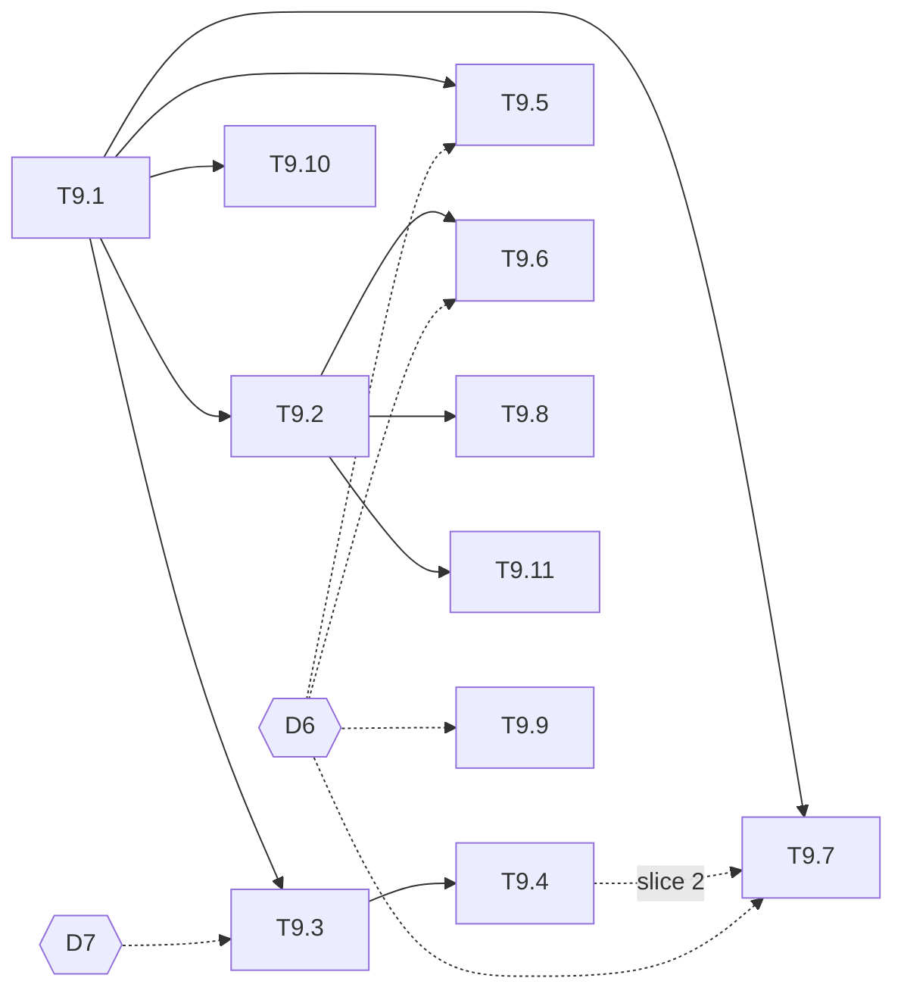

# Phase 9: Mocked UI-contract tier (HAR record and replay)

**Priority:** P1 (T9.1, T9.3–T9.5) and P2 (the rest) · **Effort:** ~3 weeks, in small PRs · **Lead personas:** `role-playwright-automation`, `role-devops-engineer` · **Reviewer:** `role-sdet-architect` (a different session from the implementer)
**Navigation:** [Planning hub](../../README.md) · [Master plan](../../Master/master_plan.md) · Previous: [Phase 8](../phase_8_legacy_and_docs/README.md)
**Source:** [PS UI nightly runtime plan](../../../playwright-e2e/docs/strategy/PS-UI-Nightly-Runtime-Plan.md) §6 (mocking) and §7 item C4, written 2026-10-25 from run 40137337578.

## Goal
About 70 Planning Space UI tests (about 90 until T9.7 was re-scoped on 2026-11-06) that only check *how the UI shows data* (filter combinations, status states, empty and error states, card rendering) run against recorded API responses instead of live, shared data. They become deterministic, need no shared state, can run fully in parallel, and can run on pull requests. One real end-to-end test per feature stays in the nightly, so the nightly still finds environment, data and product problems.

## Why
- The two longest Planning Space files on 2026-10-24 were ScenarioBatch `Test_003_ScenarioVisibilityFilter` (7.3 min, 15 tests) and `Test_006_ScenarioUsersFilter` (7.8 min, 12 tests). Most of their tests apply one filter value to the same list. Each file also creates a private and a public child scenario per context first, so a filter test fails whenever that setup does. (`Test_003` dropped its Assumption context on 2026-10-27: Assumption scenarios are no longer supported.)
- OnDemandMaas 003, 004, 007 and 008 (21 tests) check states that are hard to force on a real cluster. 003 and 008 fail every night.
- A few card tests depend on states or live data that a mock makes reliable: Tree no-data and error, and Maas Chart labels (T9.7, about 9 tests). The other chart specs stay real: they only check that a chart exists, mostly on the static `lui/mockcards` service. Line, Table and Tabbed fail on changed view setup, which this phase doesn't mock away (nightly 42118709010, 2026-11-05).
- Error, empty and unauthorized states can only be produced reliably by mocking the response.
- The repo has no mocking today. On `main` @ `4d5cf28`, `playwright-e2e` has no `routeFromHAR`, `page.route(` or `context.route(` call.

**Rule for the whole phase: mock to remove permutations, not to make the nightly green.** Views missing from All Views, "Not able to load pivot table", scenario creation errors, the DEF-04 "Setting up your page" hang and partial view duplication are environment, data or product problems. They stay in real E2E tests, and no task in this phase mocks them away.

## How the tier works (verified 2026-10-27 against `plan-sop-planning-mfe` and `playwright-e2e`)

```text
Browser context (one per spec file, cached by configs/fixtures.ts)
├─ Portal page (real: login, IAM, CDN assets)
│   └─ MFE iframe (real bundle from the CDN)
│        └─ useApi().url.post(...) ── postMessage "apim:relay:request" ──┐
│                                                                        ▼
└─ Portal performs the HTTP call ── context.routeFromHAR(url: '**/simulations/search**')
                                     ├─ replay: answer from testdata/<ENV>/har/<area>/<name>.har
                                     └─ record: go to INTEROP, write the answer into the HAR
```

- **Login stays real.** Storage state comes from global setup, the portal and MFE load from the real CDN. Only the data APIs a spec names are answered from a HAR. Everything else goes to the network as today.
- **Routes go on the browser context, not the page.** The MFE (`@jda/lui-portal-utilities` 3.95) relays API calls to the portal with `apim:relay:request` messages, and the portal makes the HTTP call. Context routes see requests from every frame, so the frame that actually sends the request does not matter.
- **The URL pattern is narrow on purpose** (for example `**/simulations/search**`). A wide pattern would also record IAM and CDN traffic, with tokens in it, and would replay stale bundles.
- **Matching** (Playwright 1.62 `routeFromHAR`): URL with query string plus method, and the POST body for POST requests. The Manage Scenarios table sends `POST {simulations}/search?limit=1000&offset=0&filter=visibility="<key>";sourceType=<type>` with body `{ "sourceIds": [<process>] }` (`src/pages/ScenarioTable/ScenarioTable.tsx:499`). Each filter value is a different URL, so each gets its own HAR entry, and the server-side filtering is recorded rather than re-implemented.
- **Replay is strict.** `notFound: 'abort'`: a request the HAR doesn't hold fails, so the UI shows its error state and the test fails, instead of silently falling back to live data.
- **The MFE's own cache.** `portalCacheWrapper` keeps responses in IndexedDB for 30 minutes (stale while revalidate). Each spec file gets a new browser context, and storage state holds only cookies and localStorage, so it starts with an empty IndexedDB. A spec must not reuse a context across HAR files.
- **HAR files** live at `playwright-e2e/testdata/<ENV>/har/<area>/<name>.har`, next to the test data they belong to. When recording, `util/har.util.ts` redacts them as soon as the context closes: sensitive headers removed, and tokens and emails replaced with the same rules as `util/api-calls.util.ts` `redactApiText`. If any token is still left after that, writing the HAR fails.
- **Drift control.** A weekly record job refreshes the HARs from INTEROP and opens a PR with the diff (T9.4). The backend API suites (`ProcessOrchestrationBackend`) stay the contract check for the recorded shapes. One real E2E test per feature stays in the nightly.

## Three tiers (where each kind of check belongs)

| Tier | Where | What it covers | When it runs |
|---|---|---|---|
| Component (Vitest + Testing Library) | `plan-sop-planning-mfe` (333 test files), `plan-sop-lui` (297) | Rendering, chips, menus, labels | Dev repo PRs |
| UI contract (this phase) | This repo, `tests/PlanningSpace/Mocked/`, suite `PSMockedBatch` | The deployed MFE against recorded or synthetic API responses | Its own nightly lane, and PRs once D7 is answered |
| Real E2E | This repo, nightly lanes | One golden path per feature and context, every cross-service flow | Nightly |

**Not candidates (stay real):** DrillThrough (context passes portal → MFE → MaaS), Supply Chain Actions procedures, Scope saved and default filters (persistence), Views mapping, hidden views and view settings (PO configuration shown in PS), DuplicateView (backend clone), LiveBlocks and Collaboration (real-time third party), LastAccessedContext (persistence), DataSetup.

## Tasks

| Task | Title | Implement | Depends on | Status |
|---|---|---|---|---|
| [T9.1](tasks/T9.1_har_utility_and_scenario_filter_pilot.md) | HAR record/replay utility and the ScenarioBatch 003 pilot | role-playwright-automation | none | Done (PR #930) |
| [T9.2](tasks/T9.2_synthetic_route_helpers.md) | Synthetic response helpers for states a HAR can't record | role-playwright-automation | T9.1 | In progress (`mockJson`, `mockStatus`, `mockDelay` exist from PR #941; no `mockFromHar`) |
| [T9.3](tasks/T9.3_mocked_lane_and_pr_run.md) | `PSMockedBatch` nightly lane and PR run | role-devops-engineer | T9.1, D7 | In progress (nightly lane running; PR job waits for D7) |
| [T9.4](tasks/T9.4_weekly_har_refresh_and_drift_report.md) | Weekly HAR refresh and drift report | role-devops-engineer, role-playwright-automation | T9.1, T9.3 | Not started |
| [T9.5](tasks/T9.5_scenario_filter_permutations.md) | Move Scenario filter permutations (003, 006) to the mocked tier | role-playwright-automation | T9.1, D6 | Done (PR #932) |
| [T9.6](tasks/T9.6_ondemand_maas_states.md) | OnDemandMaas status and empty states | role-playwright-automation | T9.2, D6 | In progress (Milestone 1 merged in PR #941; replaced real 003 and 008 removed 2026-11-11) |
| [T9.7](tasks/T9.7_card_render_specs.md) | Mock the card tests that depend on live data or states | role-playwright-automation | T9.1, D6; slice 2 also T9.4 | In progress (slice 1 of 3; re-scoped 2026-11-06) |
| [T9.8](tasks/T9.8_loaders_empty_unauthorized_states.md) | Loader, empty, error and unauthorized states | role-playwright-automation | T9.2 | Not started |
| [T9.9](tasks/T9.9_label_checks_to_component_tests.md) | Hand PowerBar and ViewSearch label checks to MFE component tests | role-sdet-architect | D6 | Not started |
| [T9.10](tasks/T9.10_scenario_sync_status_mocked.md) | *(record)* Mocked scenario sync status and ScenarioBatch trim | role-playwright-automation | T9.1 | Done (PRs #1008, #1010) |
| [T9.11](tasks/T9.11_mocked_visual_baselines.md) | Deterministic visual validation on mocked data | role-playwright-automation | T9.1, T9.2 | In review (PR #1042: 7 of 13 visual specs mocked, CI 7/7) |



T9.1 comes first and proves the approach on one spec. T9.2 and T9.3 can then run in parallel. T9.5 is the first migration because it gives the biggest time saving (two longest files). Only T9.7's Maas Chart slice waits for the weekly refresh, because it is the one card HAR holding live data. Its Tree slice records nothing and can start now.

## Decisions this phase needs (also in the master plan, section 6)
- **D6 (answered yes, 2026-10-27):** Is a mocked UI-contract tier acceptable if one real E2E test per feature stays? (runtime plan Q5). T9.1 can run before the answer, because it only adds a spec and changes no existing one. T9.5–T9.7 and T9.9 remove real tests, so they wait for it.
- **D7:** Can PR runs reach INTEROP? The mocked tier still logs in for real and loads the portal and MFE from INTEROP, so a PR run needs the PS UI secrets and network access in `pr-checks`. If the answer is no, the tier runs only as a nightly lane, which still saves the nightly time and gives determinism.

## Exit criteria
- `PSMockedBatch` runs as its own nightly lane in under 5 minutes, with 0 retries needed over 10 nights.
- The ~70 candidate tests run in the mocked tier. Each feature keeps at least one real E2E test per context in the nightly (listed per task), and more where they check a distinct gateway or integration. *(Was "exactly one" until 2026-11-11.)*
- The weekly refresh job has opened at least two refresh PRs. Its drift report names the changed fields.
- `grep -rE "eyJ[A-Za-z0-9_-]{10,}\.|[Bb]earer [A-Za-z0-9]" playwright-e2e/testdata/*/har` finds nothing.
- The nightly PS UI test minutes drop by at least the time of the moved tests (measured with the runtime plan's §10 method).
