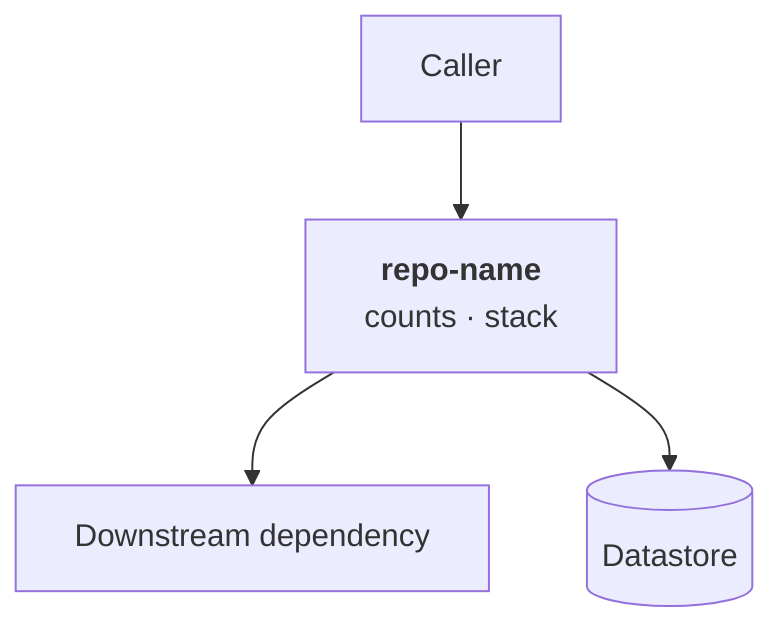
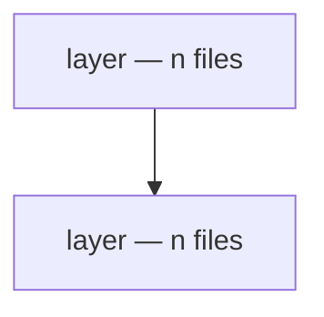
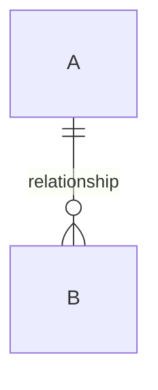
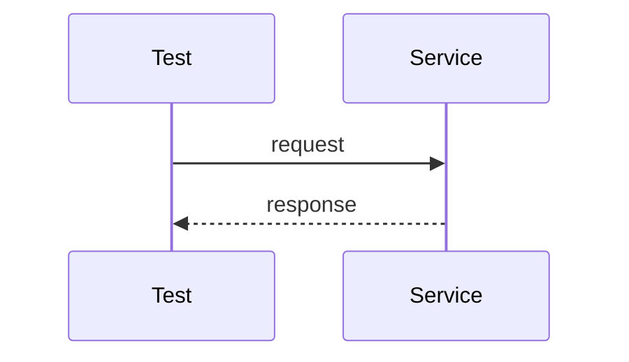
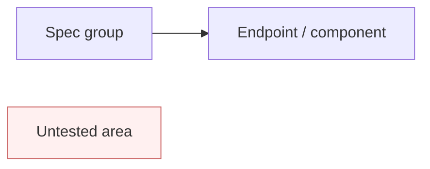

# Architecture — <repo-name>

Diagrams use Mermaid so they render in GitHub and VS Code. Keep them derived from source, not idealised.

## 1. Context
Where this repo sits in the platform: who calls it, what it calls.

## 2. Internal structure
Real packages/folders with file counts — not a generic layer cake.

## 3. Domain model
Entities and relationships, or component/state structure for a frontend.

## 4. Key flow
The sequence automation most needs to understand — usually the async one.

## 5. Automation touchpoints
Which specs hit which part, and what is uncovered.

## Conventions used in these diagrams
| Convention | Meaning |
| --- | --- |
| Red fill `#fff0f0` | Untested area, risk, or anti-pattern |
| Blue fill `#eef6ff` | Notable/modern subsystem worth calling out |
| Green fill `#eef8ee` | Correct pattern to follow |
| Grey fill `#f5f5f5` | Legacy or superseded |
| Solid arrow | Synchronous call |
| `--)` or dotted | Async, fire-and-forget, or packaged-into |
| `-.-x` | Prohibited path |

Related: [overview.md](overview.md) · [test-hooks.md](test-hooks.md)
