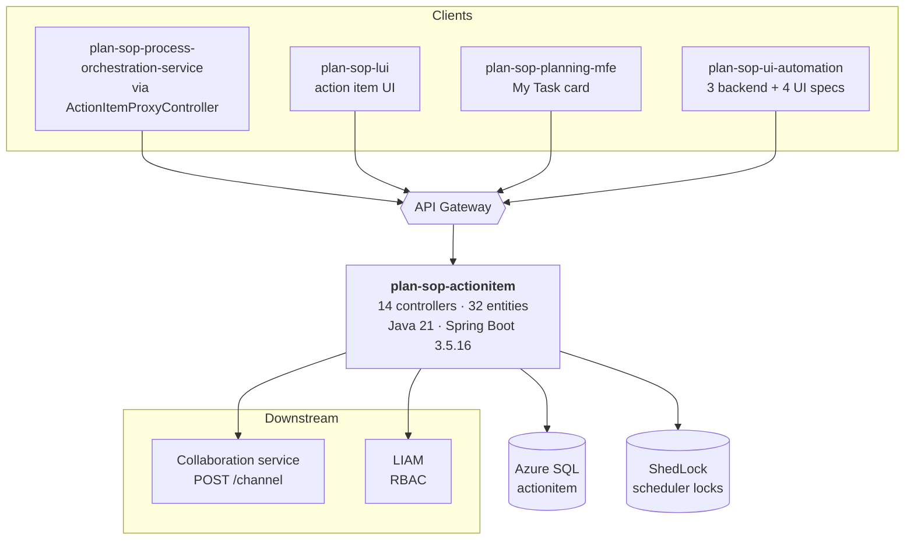
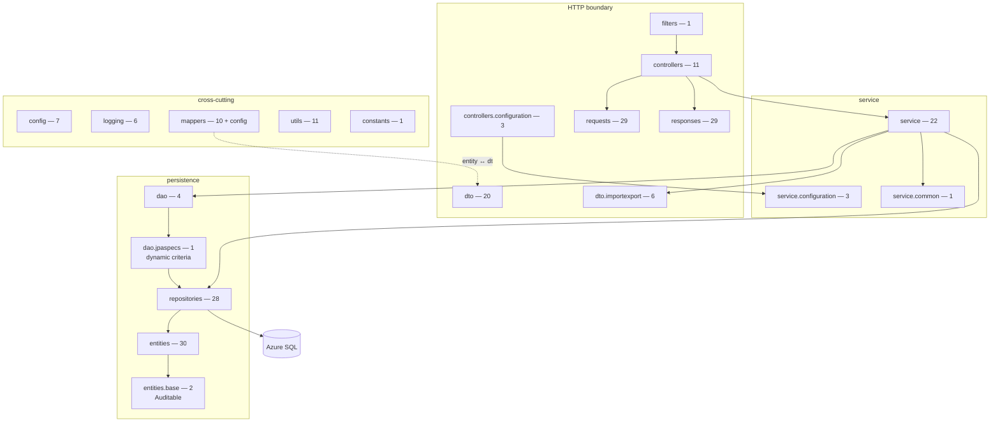
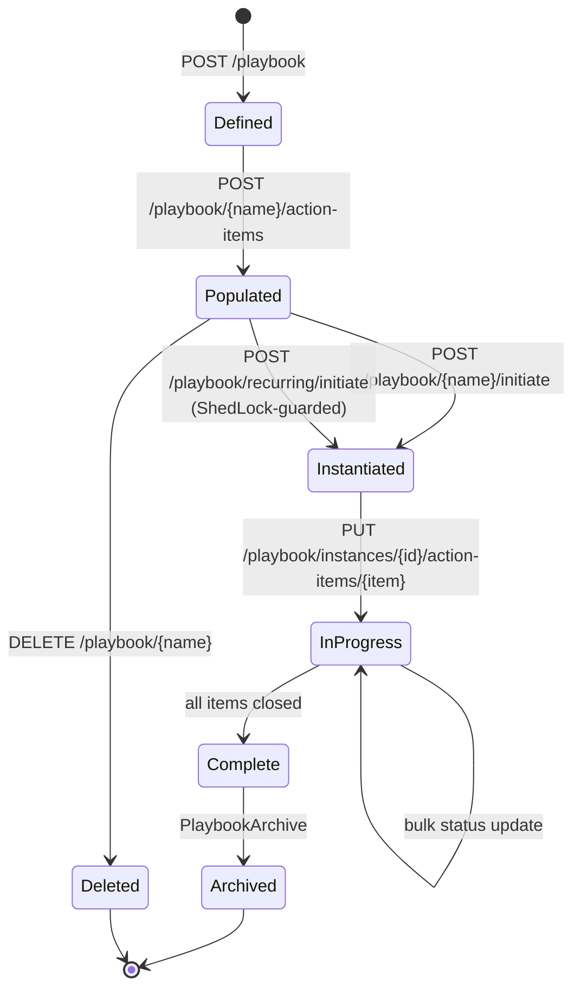
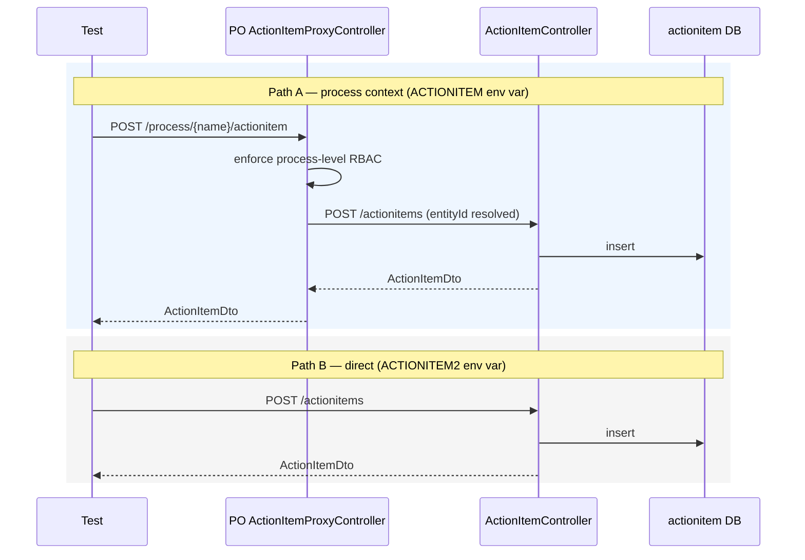
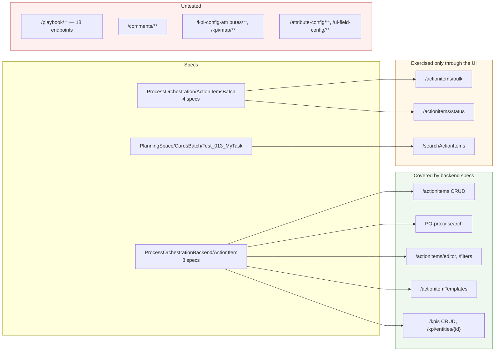

# Architecture — plan-sop-actionitem

## 1. Context

Automation can reach action items by **two different paths** — directly (`ACTIONITEM2`) or through the PO proxy (`ACTIONITEM`). They enforce different permission scopes.

## 2. Internal layering
Packages under `com.blueyonder.actionitem`, with file counts.

`dao.jpaspecs` is the JPA Specification layer behind `POST /searchActionItems` — which is why search is a POST, not a GET.

## 3. Domain model — two distinct clusters

```mermaid
graph TD
    subgraph AICluster["Action items"]
        SE["SourceEntity<br/>process / subprocess / assumption"]
        ITEM["ActionItem<br/>action_items"]
        AM["ActionItemAttrMapping"]
        CM["Comments"]
        TPL["ActionItemTemplate"]
        SE --> ITEM
        ITEM --> AM
        ITEM --> CM
        TPL -.instantiates.-> ITEM
    end

    subgraph PB["Playbooks — 18 endpoints, 0 specs"]
        P["Playbook<br/>definition"]
        PAI["PlaybookActionItem<br/>template items"]
        PI["PlaybookInstance<br/>created by /initiate"]
        PII["PlaybookInstanceItem<br/>per-instance status"]
        PA["PlaybookArchive"]
        P --> PAI
        P -->|initiate| PI
        PI --> PII
        PAI -.copied into.-> PII
        P --> PA
    end

    subgraph CFGC["UI config — duplicated in ui-fields-service"]
        ATTR["Attributes"]
        AV["attribute_values"]
        FLD["ui_fields"]
        FG["ui_fields_groups"]
        FR["ui_fields_rules"]
        PG["pages"]
        UC["ui_components"]
        ATTR --> AV
        ATTR --> FLD
        FG --> FLD
        FLD --> FR
        PG --> FG
        UC --> FLD
    end

    subgraph KPIC["KPIs and notifications"]
        KPI["Kpi"]
        KCA["KpiConfigAttributes"]
        KEM["KpiEntityMap"]
        NE["NotificationEvents"]
        NU["NotifyUser"]
        UN["UserNotification"]
        KPI --> KCA
        KPI --> KEM
        NE --> NU
        NU --> UN
    end
```

Editing a `Playbook` does **not** change existing `PlaybookInstance` rows. That separation is the single most important behaviour in this service, and it has no test coverage.

## 4. Playbook lifecycle

`recurring/initiate` runs cluster-wide under ShedLock. A spec asserting "exactly one instance" can be broken by a concurrent scheduled run.

## 5. Direct call vs. PO proxy

Path B skips process-level permission checks. Use Path A when the behaviour under test is authorization.

## 6. Automation touchpoints

Related: [api-contract.md](api-contract.md) · [test-hooks.md](test-hooks.md) · [automation-coverage.md](automation-coverage.md)
