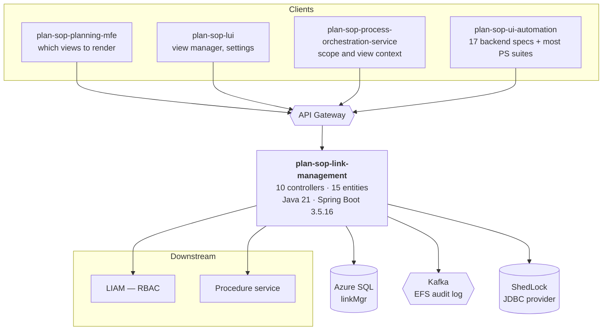
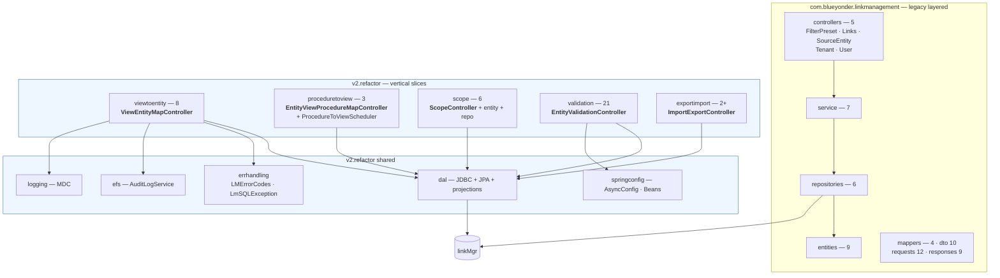
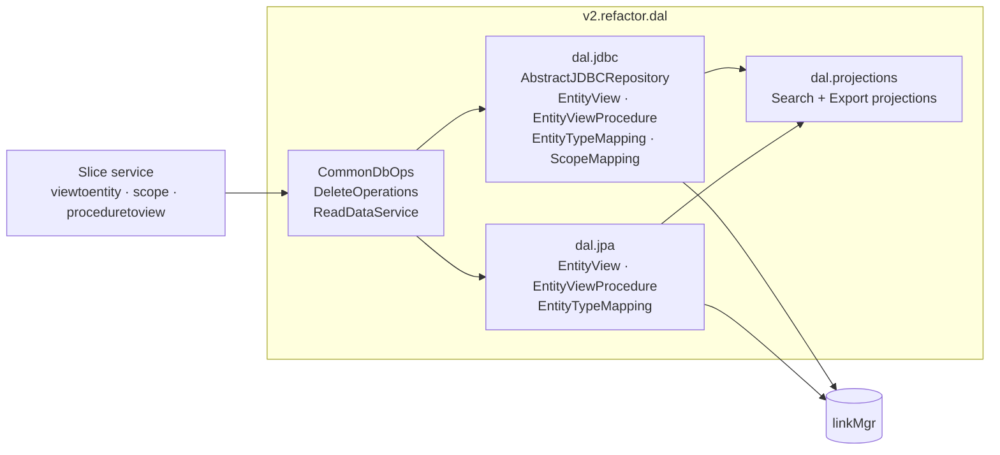
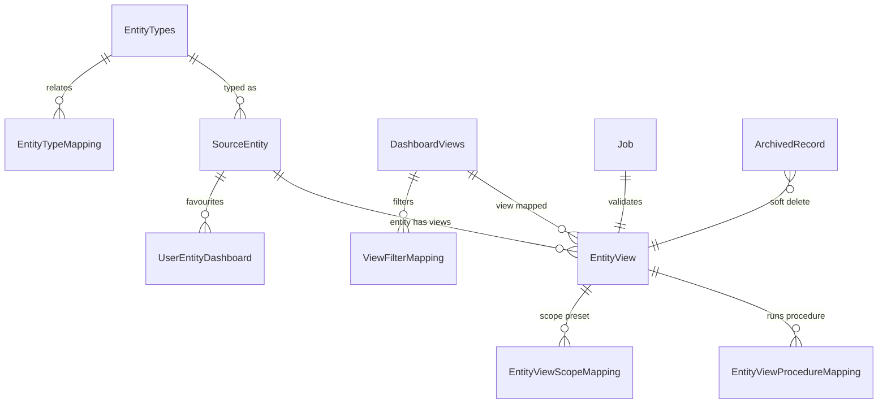
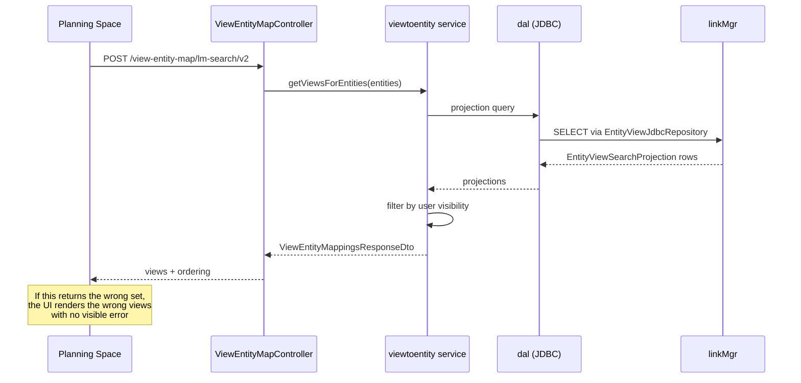
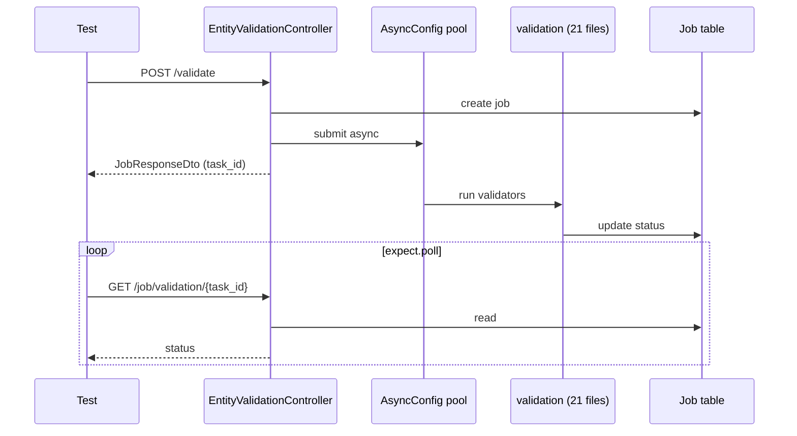
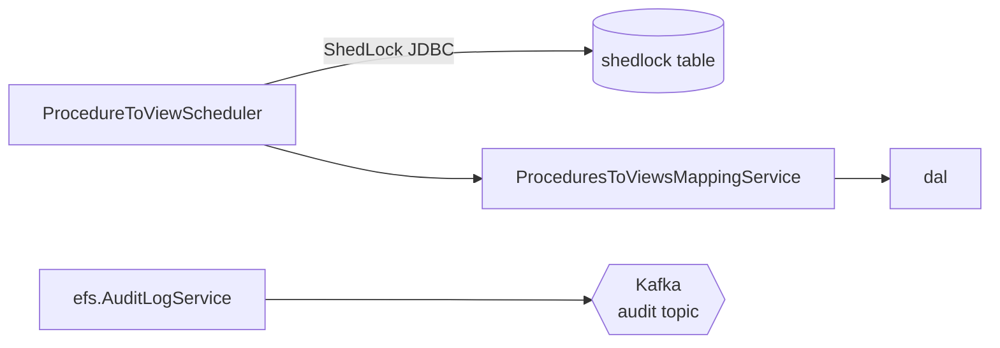
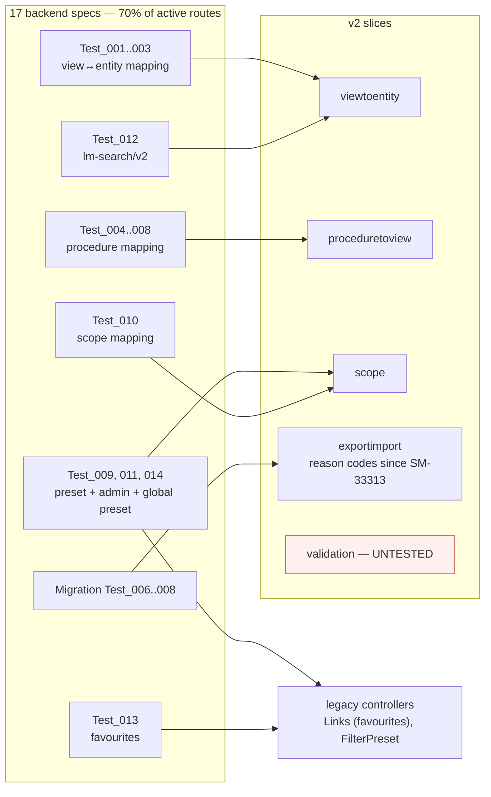

# Architecture — plan-sop-link-management

## 1. Context

## 2. Two architectures in one repo
The repo contains a **legacy v1 layering** and a **v2 vertical-slice refactor**. Every heavily tested endpoint lives in v2.

Practical consequence: when a mapping, scope, or validation endpoint misbehaves, look in `v2/refactor/**`, not in `controllers/` or `service/`.

## 3. The dual data-access layer
v2 deliberately runs JDBC **and** JPA side by side.

Projections (`EntityViewSearchProjection`, `EntityViewProcedureSearchProjection`, and the export variants) are why `POST /view-entity-map/lm-search/v2` returns a narrower shape than the single-entity `search` — the bulk read is projection-backed for volume.

## 4. Domain model

`EntityTypes` holds `process`, `subprocess`, `assumption`. An unrecognised `{type}` returns **400, not 404** — a frequent source of confusing failures.

## 5. View resolution flow
What happens on every Planning Space page load.

## 6. Async validation job

`validation` is the largest v2 slice at 21 files, includes `ActorValidationUtility`, and has **no test coverage**.

## 7. Scheduled work

A scheduled remapping can change view state between two assertions in a spec. Scope assertions by entity and re-read rather than caching a view list.

## 8. Automation touchpoints

Related: [api-contract.md](api-contract.md) · [data-model.md](data-model.md) · [automation-coverage.md](automation-coverage.md)
