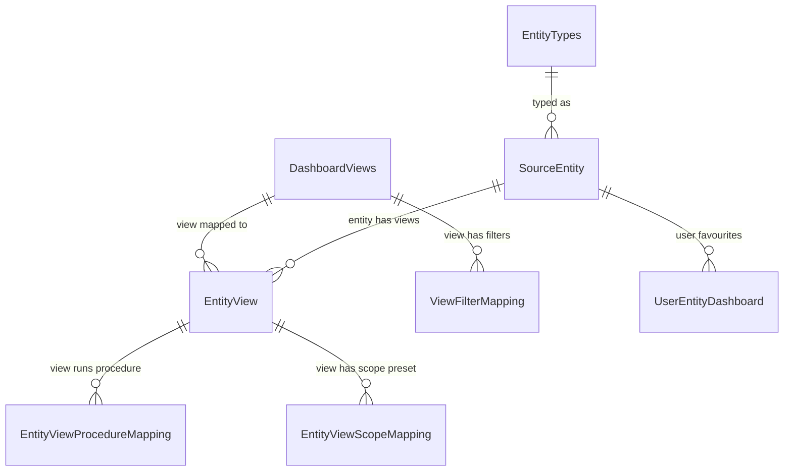

# Data model — plan-sop-link-management

## Persistence
| Aspect | Value |
| --- | --- |
| Database | Azure SQL Server, `${azuresql_lm_database:linkMgr}` |
| Dialect | `org.hibernate.dialect.SQLServer2012Dialect` |
| Migrations | Liquibase, `changelogLockWaitTimeInMinutes: 45` |
| Pool | Hikari, max `LM_DB_MAX_POOL_SIZE:100`, min idle `LM_DB_MIN_IDLE:75` |
| Batch size | `LM_JDBC_BATCH_SIZE:50`, `batch_versioned_data: true` |
| Statistics | `generate_statistics: true` |
| Env vars | `azuresql_host`, `azuresql_port`, `azuresql_lm_database`, `azuresql_lm_user`, `azuresql_lm_password` |

## Entities
| Entity | Table | Purpose |
| --- | --- | --- |
| `EntityView` | `entity_view` | The view ↔ entity mapping — the heart of the service |
| `EntityViewProcedureMapping` | `entity_view_procedure_mapping` | View ↔ procedure association for an entity |
| `EntityViewScopeMapping` | `entity_view_scope_mapping` | Scope/filter preset bound to a view+entity |
| `DashboardViews` | `dashboard_views` | View registry (id, name, type) |
| `UserEntityDashboard` | `user_entity_dashboard` | Per-user favourites and ordering |
| `ViewFilterMapping` | `view_filter_mapping` | Filter preset ↔ view |
| `EntityTypes` | `entity_types` | Lookup: `process`, `subprocess`, `assumption` |
| `EntityTypeMapping` | `entity_type_mapping` | Entity type relationships |
| `SourceEntity` | `source_entity` | Registered planning entity |
| `Job` | `job` | **Async validation job state — backs `GET /job/validation/{task_id}`** |
| `ArchivedRecord` | `archived_records` | Soft-deleted rows |
| `Tenant` | `tenants` | Tenant registry |
| `UnifiedExport` | *(no `@Table`)* | Export projection for ALM |
| `Auditable` | *(mapped superclass)* | Audit columns |

## Key relationships

## Enums and lookups
| Lookup | Values | Notes |
| --- | --- | --- |
| `entity_types` | Seeded (global, `tenant_id='*'`): `Process`, `SubProcess`, `AssumptionType`, `Assumption`, `maasactor`, `SCP-Interactive`, `SCP-Launch-Interactive-Planning`, `scsactor`, `uicacheactor`, `insightactor`, `quickfilter` | The `{type}` path variable in most endpoints. Specs send lowercase (`process`, `subprocess`, `assumptiontype`) and it matches the mixed-case seeds |
| Entity-view-procedure `reason` | `null` (default), `PROCEDURES_NEVER_MAPPED_TO_VIEW`, `PLANNER_WANTS_NO_PROCEDURES` | `EntityViewProcedureDto.Reason`. Since SM-33313 it is included per view in export and honoured on import |

Passing a type the table does not contain returns 400, not 404 — a common source of confusing failures. **Assumption views map with type `assumptiontype`**, not `assumption`. Actor types are `maasactor`, `scsactor`, `insightactor`, `uicacheactor`; the launch procedure type is `SCP-Launch-Interactive-Planning`.

## Identifier conventions
- `viewId` is the `DashboardViews` identifier, not the display name.
- `entity` in the path is the entity's system name; `entityId` in the favourites API is the `SourceEntity` ID.
- Mappings are unique per `(view, type, entity)`. Re-posting the same triple updates rather than duplicating.

## Seed data required by automation
| Object | Notes |
| --- | --- |
| Views | Must exist in `dashboard_views` before mapping |
| Source entity | The process/subprocess/assumption must be registered |
| Procedures | Required for entity-view-procedure mapping specs |
| Filter presets | Required for preset and admin-filter specs |
| Test data JSON | `testdata/<ENV>/ProcessOrchestrationBackend/` |
