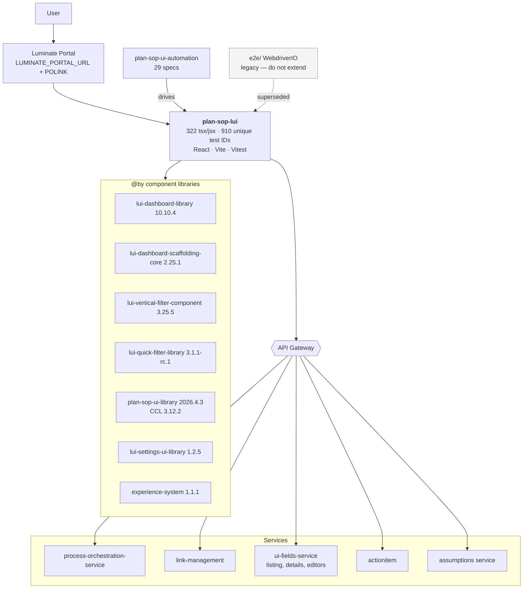
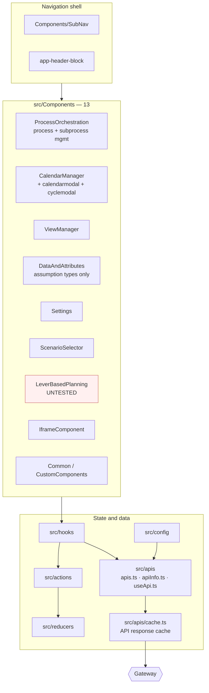
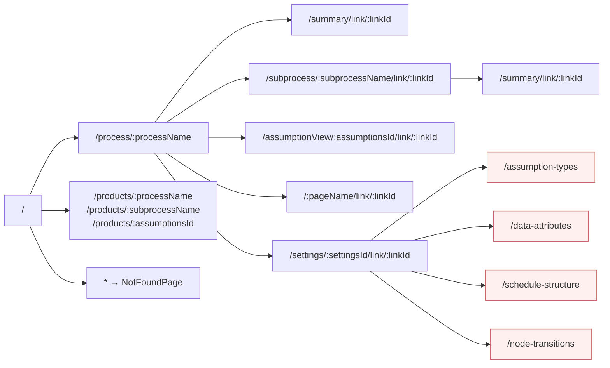
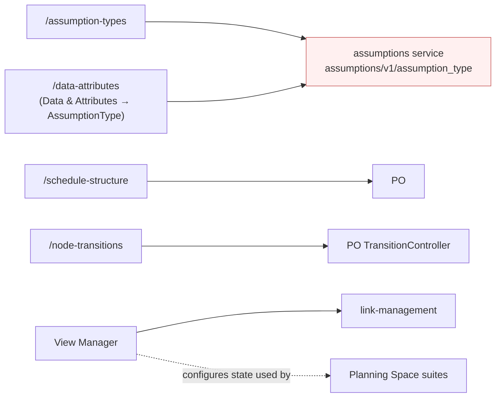
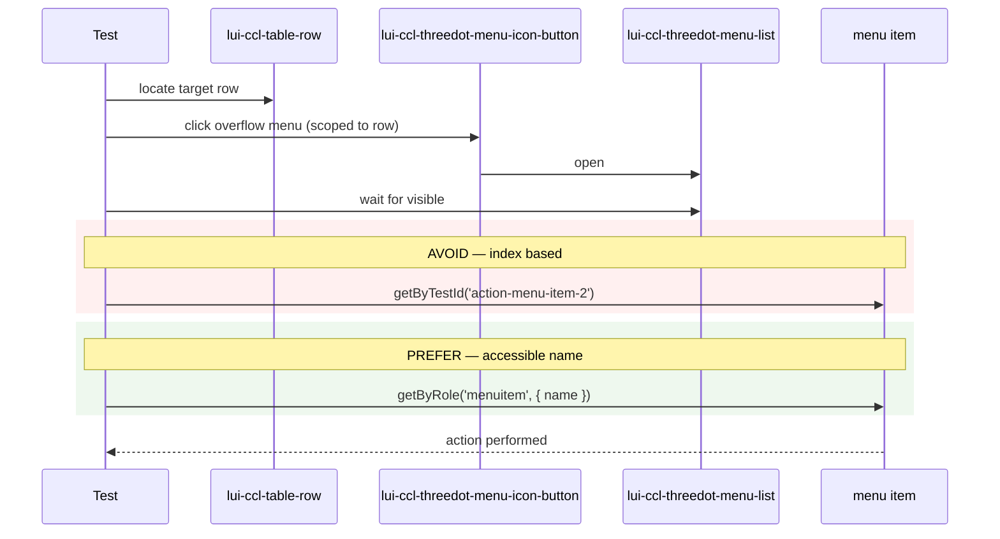
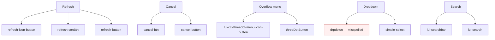
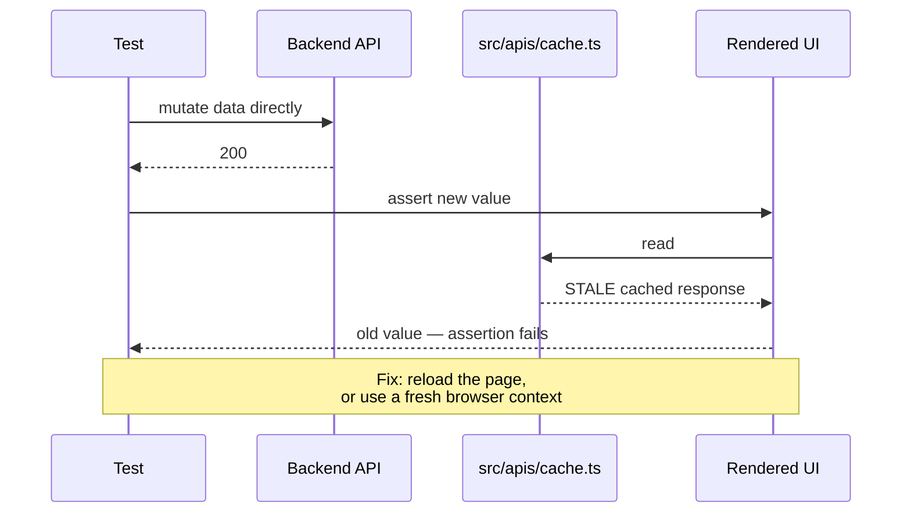
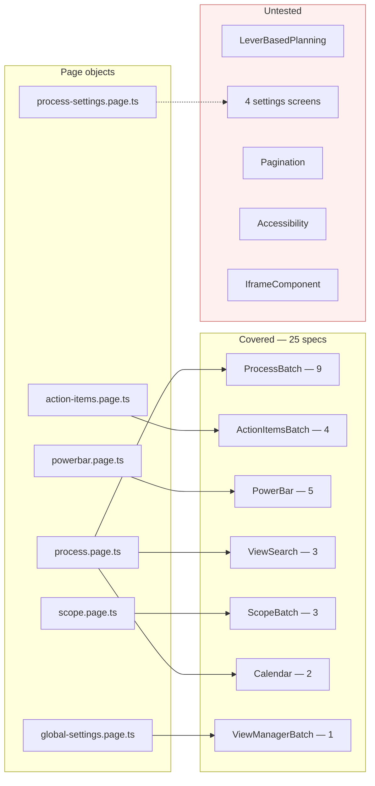

# Architecture — plan-sop-lui

## 1. Context

Most shared libraries are at the **same versions as Planning Space** (`lui-dashboard-library` 10.10.4, `lui-quick-filter-library` 3.1.1-rc.1, `lui-settings-ui-library` 1.2.5, `experience-system` 1.1.1, CCL `lui-common-component-library-mui5` 3.12.2), so most `lui-*` test IDs match across both apps. They are **not** all identical: scaffolding-core/-components, `lui-vertical-filter-component` (3.25.5 vs 3.25.7) and `plan-sop-ui-library` (2026.4.3 vs 2026.4.4) differ, so a `vf-*` or scaffolding locator can break in one app only.

lui is the only frontend that calls **UI Fields** (via `src/config.ts` keys) — for the PO listing, process/subprocess/calendar details and all create/edit forms.

## 2. Internal structure

Unlike Planning Space (which caches configuration in IndexedDB), this app has an explicit **API response cache** module with its own unit tests.

## 3. Route map

The four red settings screens are untested — and they configure state that other suites depend on.

## 4. Settings screens → backing services

Correction (2026-10-05): the Data & Attributes screen (`DATA_AND_ATTRIBUTES_ASSUMPTION` → `AssumptionType`) manages **assumption types** through the assumptions service, not UI Fields. UI Fields is called from the process listing, details and editor flows instead. The settings ids above (`assumption-types`, `data-attributes`, `schedule-structure`, `node-transitions`) appear only in lui unit-test fixtures; confirm the rendered ids in the DOM before locating by them.

## 5. The dominant interaction pattern
`lui-ccl-threedot-menu-icon-button` appears **63 times** — more than any other test ID in the app.

Index-based locators break silently on menu reorder — the failure reads as "clicked the wrong action", not "locator not found".

## 6. Test-ID naming drift

Verify against the live DOM before adding a locator; do not assume the conventional spelling exists.

## 7. Cache behaviour

## 8. Automation touchpoints

Related: [ui-inventory.md](ui-inventory.md) · [test-hooks.md](test-hooks.md) · [automation-coverage.md](automation-coverage.md)
