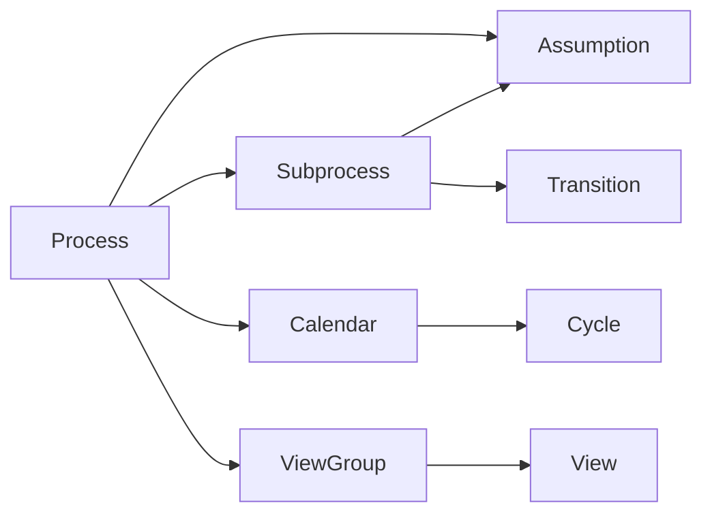

# Data model — plan-sop-lui

A frontend owns no database. What matters is where data comes from and what is cached client-side.

## API layer
| File | Role |
| --- | --- |
| `src/apis/apis.ts` | Endpoint definitions |
| `src/apis/apiInfo.ts` | Service/endpoint metadata |
| `src/apis/useApi.ts` | The hook components call |
| `src/apis/cache.ts` | **Explicit API response cache** (with `cache.test.ts` alongside it) |

Unlike Planning Space, which caches configuration in IndexedDB, this app has a dedicated **API-response cache module**. It is the first thing to check when the UI shows stale data after a backend change.

There is also an `npm run clear-cache` script (`vitest run --reporter=verbose --coverage`) — note that despite the name it clears the *test* cache, not the app's runtime cache.

## Backend sources
| Data | Service |
| --- | --- |
| Processes, subprocesses, templates, start/stop | [`plan-sop-process-orchestration-service`](../plan-sop-process-orchestration-service/api-contract.md) |
| Calendars and cycles | Same — `CalendarController` |
| Supply chain actions | Same — `SupplyChainActionController` |
| Node transitions | Same — `TransitionController` |
| View manager, mappings, presets | [`plan-sop-link-management`](../plan-sop-link-management/api-contract.md) |
| Listing columns/filters, details and editor layouts (process, subprocess, template, calendar, cycle) | [`plan-sop-ui-fields-service`](../plan-sop-ui-fields-service/api-contract.md) — `list-page-config`, `list-page-config-with-filter`, `detail-page-config`, `page/{name}/editor` |
| Data & Attributes (assumption types), assumptions | Assumptions service (`assumptions/v1/...`) |
| UI cache preferences | `${luiURL}/uiConfiguration/v1/configuration` (since SM-40685) |
| Action item list and detail | [`plan-sop-actionitem`](../plan-sop-actionitem/api-contract.md) |

## Client-side state
| Location | Contents |
| --- | --- |
| `src/actions/` | Action creators |
| `src/reducers/` | Redux-style store |
| `src/hooks/` | Derived state and fetch hooks |
| `src/config/` | Runtime config loaded from `public/` at startup |
| `src/apis/cache.ts` | API response cache |

## Settings screens → backing services
The Settings area is where automation performs much of its setup, so knowing which service each screen writes to speeds up triage:

| Settings screen | Path | Backing service |
| --- | --- | --- |
| Assumption Types | `/assumption-types` | Assumptions service (`assumption_type`) |
| Data Attributes | `/data-attributes` | Assumptions service — the Data & Attributes screen renders `AssumptionType` |
| Schedule & Structure | `/schedule-structure` | Process Orchestration (calendar, node schedule) |
| Node Transitions | `/node-transitions` | Process Orchestration (`TransitionController`) |

## Context model
Mirrors the Process Orchestration hierarchy:



## Identifier conventions
| Identifier | Notes |
| --- | --- |
| `processName`, `subprocessName` | System names, matching the PO API |
| `assumptionsId` | Assumption identifier in the route *(note the plural spelling)* |
| `linkId` | Deep-link identifier for a view |
| `settingsId` | Settings screen identifier |
| `pageName` | Generic page identifier |

The route uses `assumptionsId` while Planning Space uses `assumptionID` — worth remembering when writing cross-app navigation helpers.

## Runtime configuration
Generated at startup, not compiled in:

```
.github/envs/<env>.env  --setRuntimeEnv.js-->  public/
```

Same mechanism and same failure mode as [Planning Space](../plan-sop-planning-mfe/environments.md#local-run): a stale `public/` config silently points the app at the wrong backend.

## Seed data required by automation
| Object | Source |
| --- | --- |
| Process/subprocess | PO API (`POST /process/template`) |
| Calendars and cycles | PO API, or `Calendar/Test_001` |
| Views and view groups | Link Management |
| Field/column/editor configuration | UI Fields (tenant-configured; read-only for automation) |
| Assumption types | Assumptions service |
| Roles and users | PO `UserController`; both automation users must exist for authorization specs |
