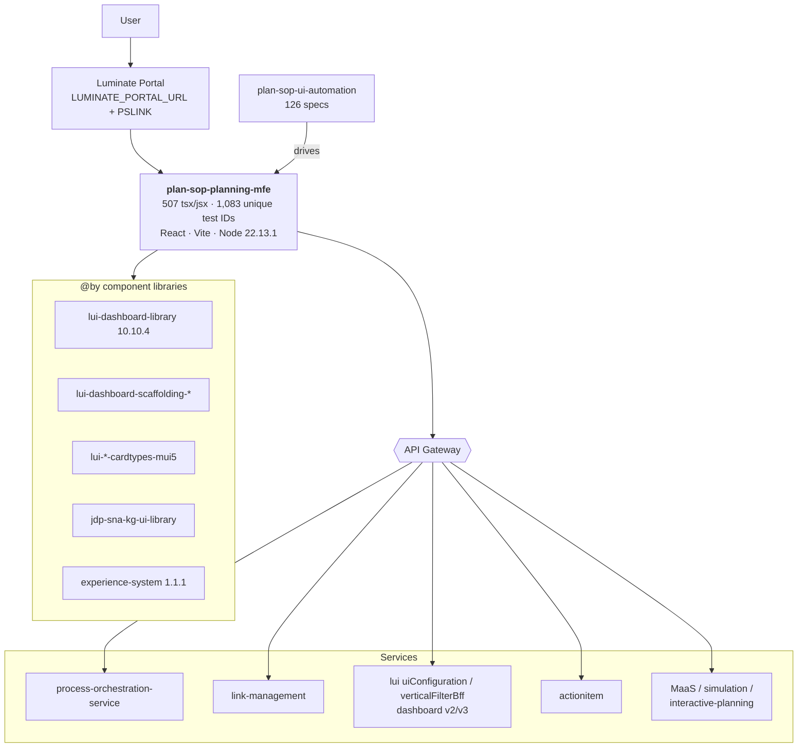
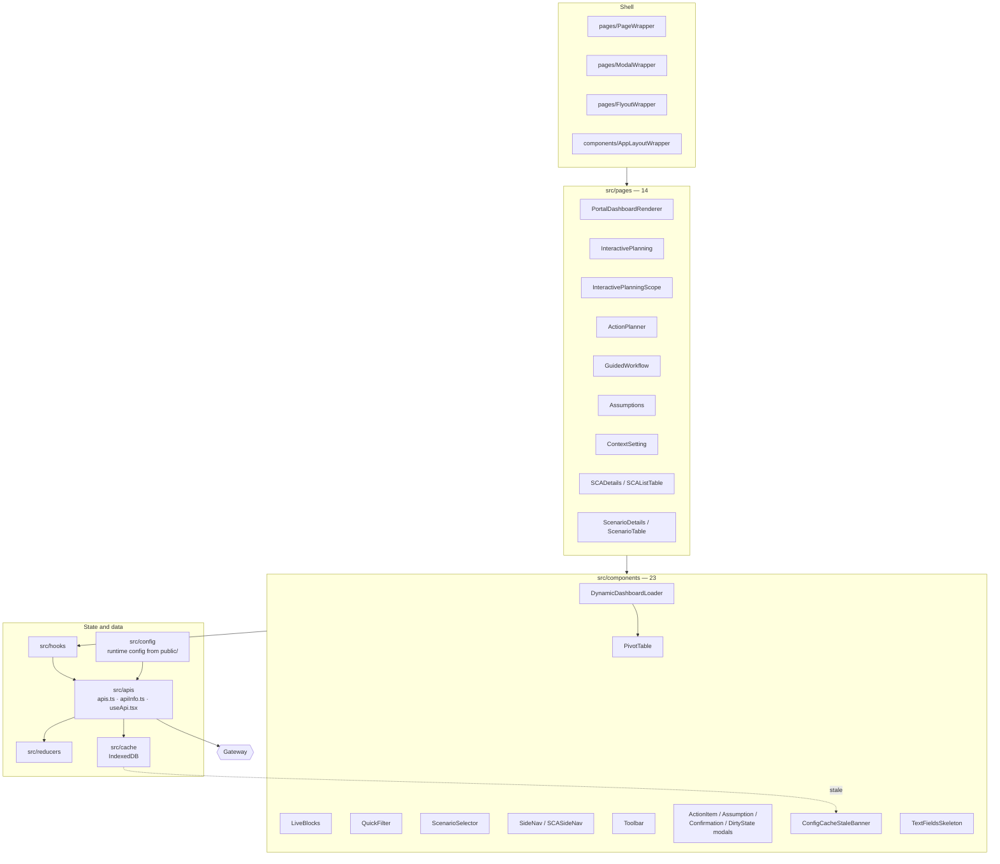
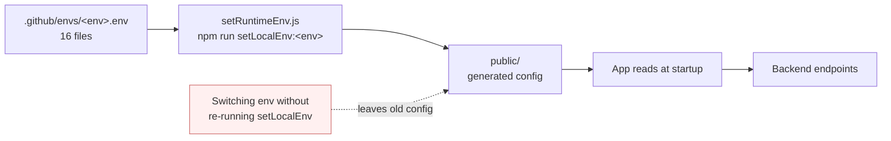
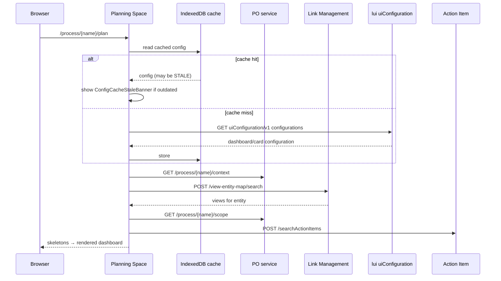
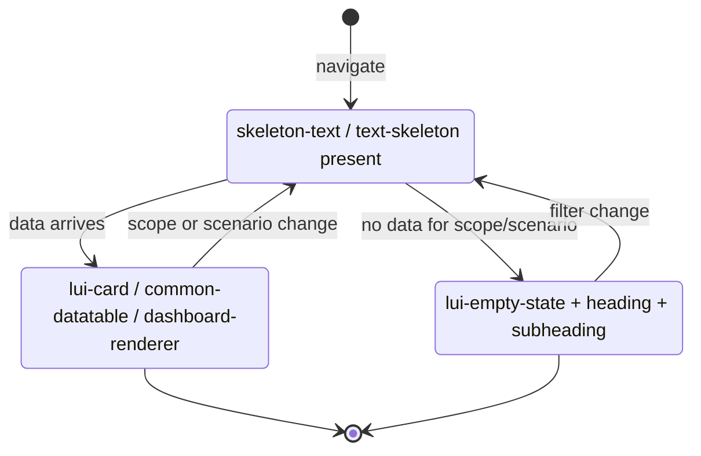
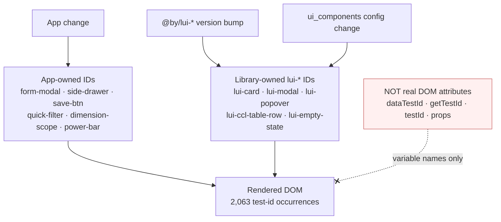
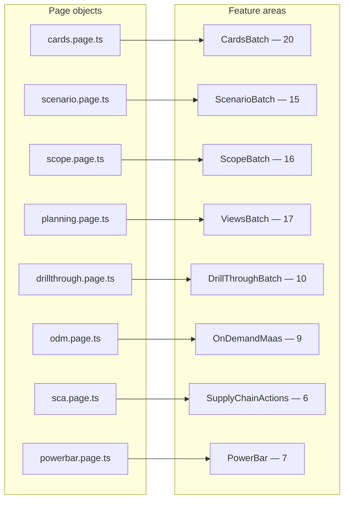

# Architecture — plan-sop-planning-mfe

## 1. Context

## 2. Internal structure

## 3. Runtime configuration — generated, not compiled

This is the usual cause of "the app is pointing at the wrong environment" despite a correct build command.

## 4. Page load sequence

## 5. Loading state machine
The deterministic-wait contract for specs.

Wait for `skeleton-text` to **detach** — never a fixed delay. Both `Rendered` and `Empty` are valid terminal states; asserting only on `Rendered` produces misleading timeouts when the real result is empty.

## 6. Test-ID ownership

If a locator break is confined to `lui-*` IDs, the cause is a dependency bump — not this repo. (Planning Space does not call UI Fields, so a UI Fields component swap cannot explain a Planning Space locator break.)

## 7. Automation touchpoints

Related: [ui-inventory.md](ui-inventory.md) · [test-hooks.md](test-hooks.md) · [data-model.md](data-model.md)
