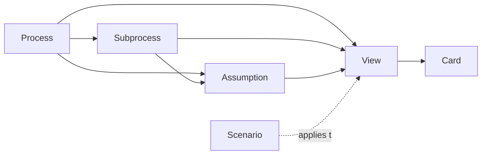

# Data model — plan-sop-planning-mfe

A frontend owns no database. What matters for automation is **where its data comes from, what it caches, and how long stale data survives**.

## API layer
| File | Role |
| --- | --- |
| `src/apis/apis.ts` | Endpoint definitions |
| `src/apis/apiInfo.ts` | Service/endpoint metadata |
| `src/apis/useApi.tsx` | The hook every component calls |

All backend traffic funnels through this layer, which makes it the single place to look when a UI spec needs to know which service produced a value.

## Backend sources
| Data | Service |
| --- | --- |
| Process/subprocess context, scope, SCA | [`plan-sop-process-orchestration-service`](../plan-sop-process-orchestration-service/api-contract.md) |
| Views, favourites, presets, view→procedure mapping | [`plan-sop-link-management`](../plan-sop-link-management/api-contract.md) |
| Dashboard/card configuration, user preferences | lui `uiConfiguration/v1` (cached in IndexedDB), `uiRegistration/v1`, `dashboard/v2`·`v3` |
| Vertical filter panels | lui `verticalFilterBff/v1` |
| Action items, My Task card | [`plan-sop-actionitem`](../plan-sop-actionitem/api-contract.md) |
| Planning instances, simulations, scenarios | Foundation simulation / interactive-planning (`SIMULATION`, `PLANNING_INSTANCE`, `SEARCH_SIMULATION`) |
| On-demand MaaS clusters and calc engines | MaaS (`RESOURCE_POOL_MANAGER`, `MAAS_CONFIG`) |

## Client-side state
| Location | Contents |
| --- | --- |
| `src/reducers/` | Redux-style store — context, scenario selection, scope, dirty state |
| `src/hooks/` | Derived state and data-fetch hooks |
| `src/cache/` | **IndexedDB configuration cache** |
| `src/config/` | Runtime config loaded from `public/` at startup |

## The IndexedDB config cache — read this before debugging a stale UI
The app persists configuration in IndexedDB using an object store keyed on `cacheKey`:

```js
db.createObjectStore(CONFIG_CACHE_META_STORE, { keyPath: 'cacheKey' });
```

There is a dedicated `ConfigCacheStaleBanner` component, which means staleness is an expected, user-visible condition.

Implications for automation:
- Dashboard/card configuration changes (lui `uiConfiguration/v1`) may not appear until the cache refreshes. Planning Space does **not** read UI Fields, so UI Fields changes never explain a Planning Space column/filter difference.
- A fresh browser context per spec avoids inherited cache state; a reused context can carry it across tests.
- If a spec sees old columns or filters after an API change, suspect this cache before the backend.

## Runtime configuration
Runtime config is **generated at start-up, not compiled in**:

```
.github/envs/<env>.env  --setRuntimeEnv.js-->  public/
```

`npm run setLocalEnv` (and each `setLocalEnv:<env>` variant) writes the active environment into `public/`. A stale `public/` config is the usual cause of an app pointing at the wrong environment despite a correct build command.

## Context model
The entity hierarchy mirrors Process Orchestration:



`src/e2eTesting/mfeContext` and `src/e2eTesting/dashboard` contain the repo's own context tests — `DashboardContextFlow.test.tsx`, `planningInstanceId.test.tsx`, `scenarioId.test.tsx`, `targetView.test.tsx`, `sparq.test.tsx` — a useful reference for how context is expected to resolve.

## Identifier conventions
| Identifier | Notes |
| --- | --- |
| `processName`, `subprocessName` | System names, matching the PO API |
| `assumptionID` | Assumption identifier in the route |
| `linkId` | Deep-link identifier for a view |
| `planningInstanceId` | Planning instance |
| `scenarioId` | Scenario — drives scenario comparison and selection |

## Seed data required by automation
| Object | Source |
| --- | --- |
| Process/subprocess/assumption | Created via the PO API |
| View mappings | Created via Link Management |
| Card/dashboard configuration | Portal UI configuration (`uiConfiguration/v1`), tenant-scoped |
| Scenarios | `DataSetupBatch/Scenarios/Test_004_CreateScenarios` |
| Planning instances | `DataSetupBatch/ODM/Test_003_RestartPlanningInstance` |
| MaaS clusters | `DataSetupBatch/ODM/Test_002_RestartMaasCluster` |
