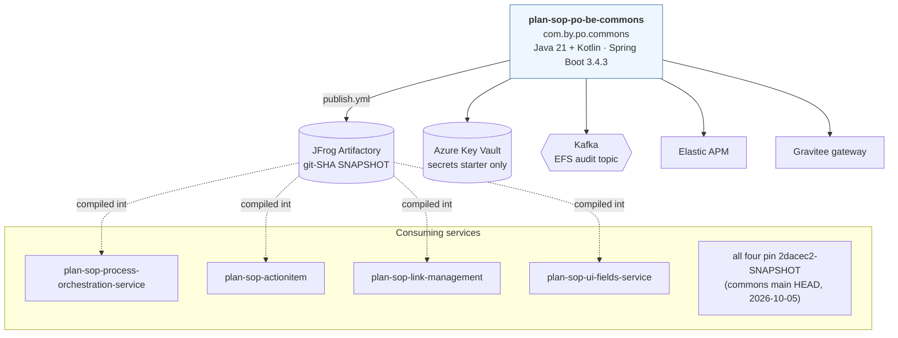
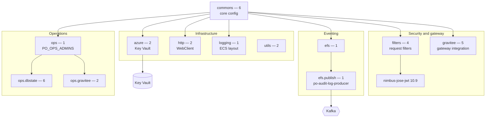
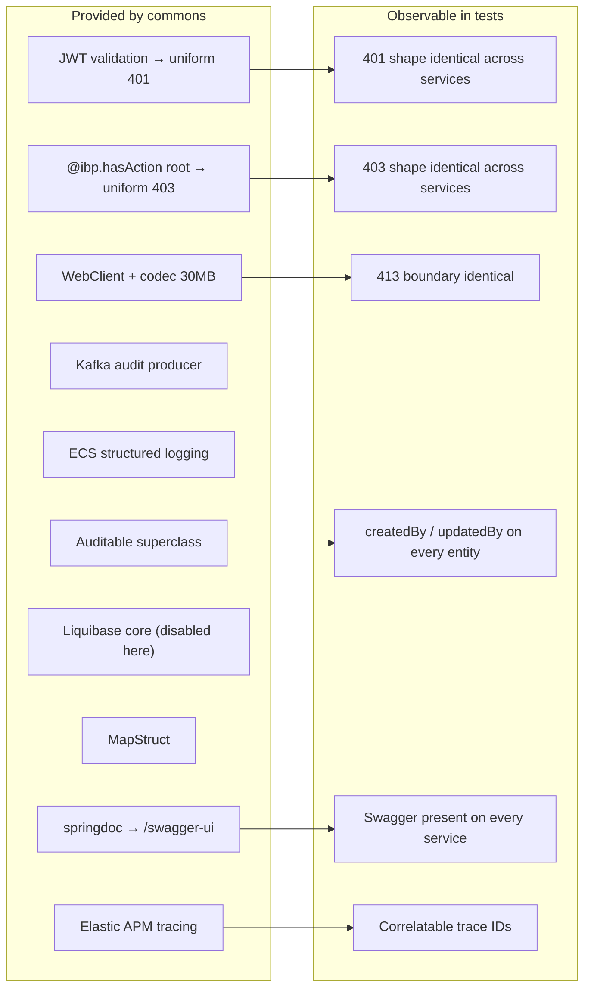
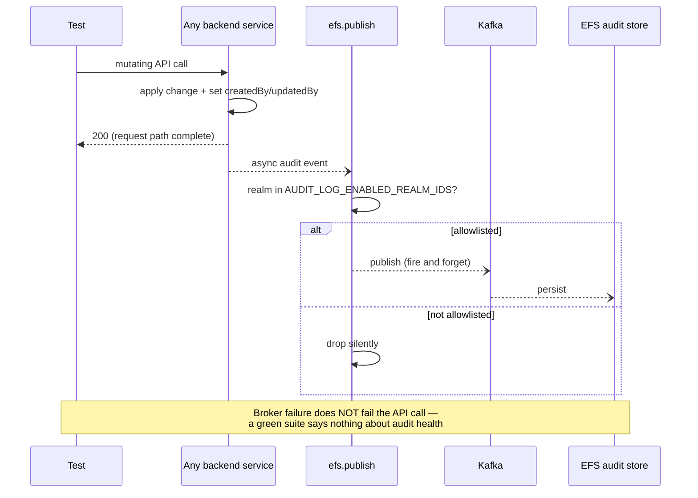
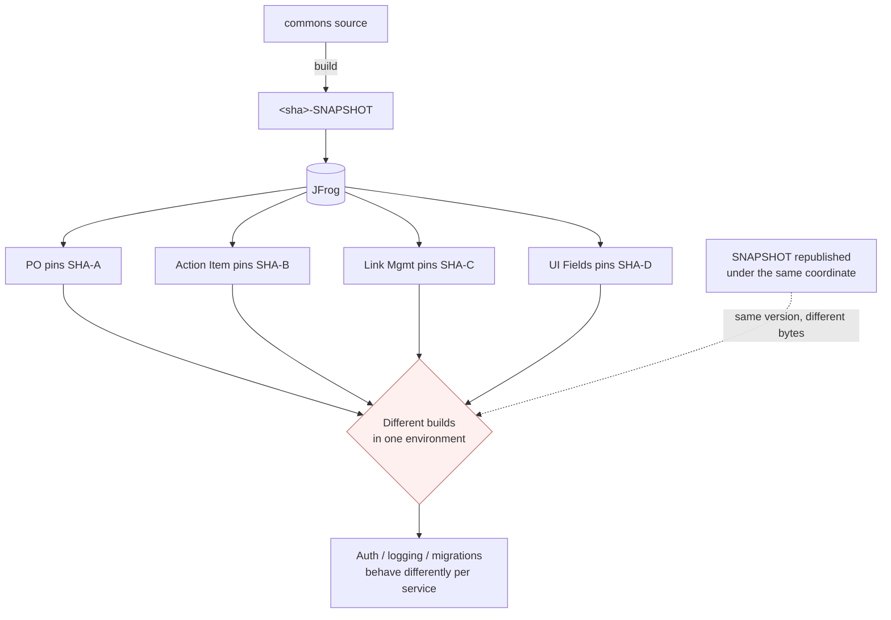
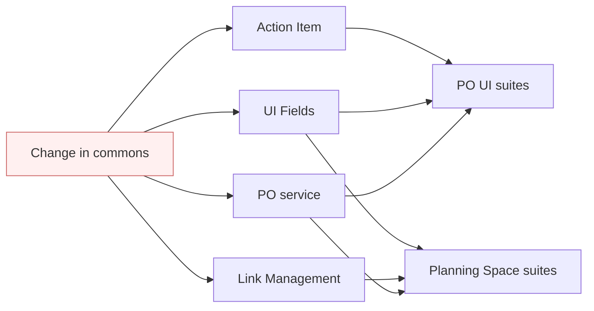
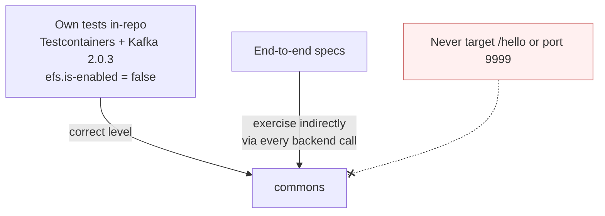

# Architecture — plan-sop-po-be-commons

## 1. Context
Not deployed. Packaged **into** each backend service.

## 2. Internal modules
Packages under `com.by.po.commons`, with file counts.

`ops.dbstate` (6 files) gives central operations visibility into consumer database state — relevant when a service reports healthy but its migrations have not applied.

## 3. What each consumer inherits

## 4. Audit-event flow

Allowlisted realms default to `ca7623d3-b234-431c-a445-4a1d5444668e` and `9beb5e0f-8e95-4979-b438-edbc7b054981`. The first matches `REALM_ID` in `configs/setup.js`, so the INTEROP automation realm **does** emit audit events.

## 5. Version drift — the structural risk

This is the failure mode, not the current state. On 2026-09-16 Link Management pinned `251ccd3` while the other three pinned `aa6e444`; since the ABP-19137 CVE work (2026-09-17) **all four pin `2dacec2-SNAPSHOT`**, which is also the commons `main` HEAD. Nothing enforces that alignment, so the recommended guard is still a CI check that all four consumers pin the same SHA. See [automation-coverage.md](automation-coverage.md#recommended-additions).

## 6. Blast radius

**Diagnostic rule:** a failure appearing in more than one backend service at the same time is a commons change until proven otherwise.

## 7. Test strategy

Related: [api-contract.md](api-contract.md#capabilities-contributed-to-consumers) · [troubleshooting.md](troubleshooting.md) · [platform map](../repo-map.md#blast-radius)
