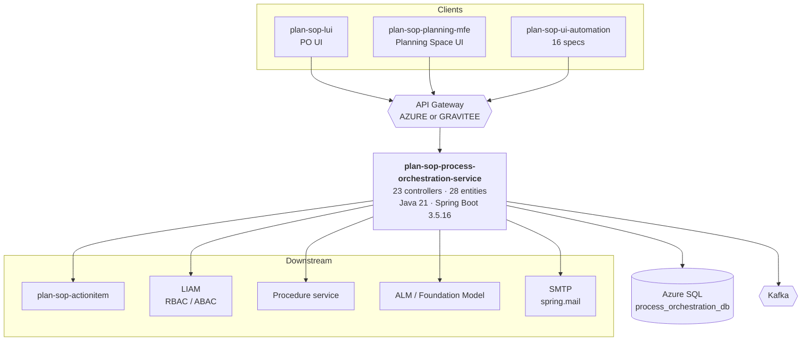
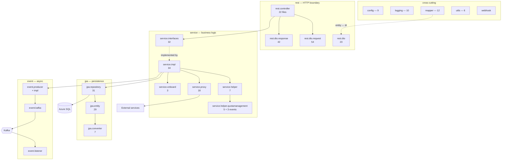
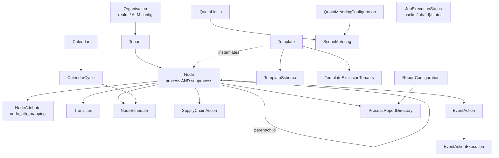
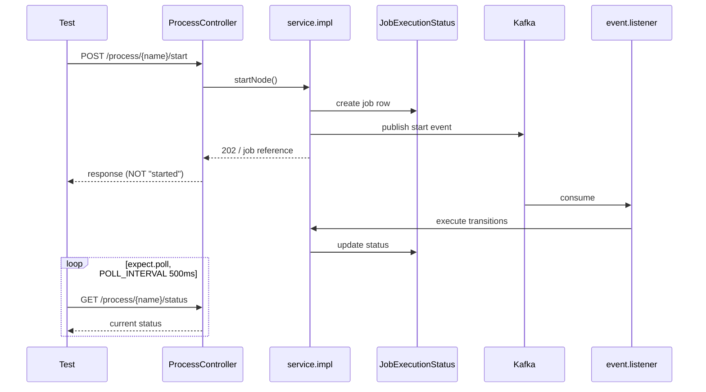
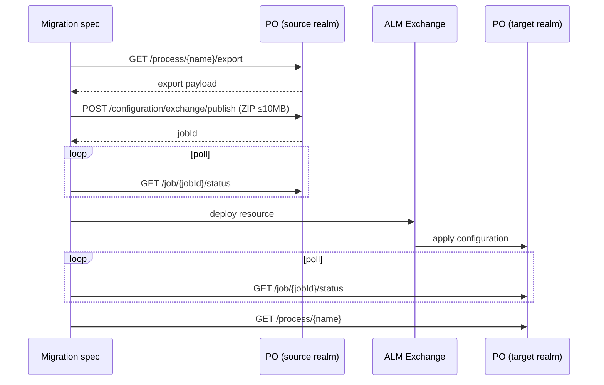
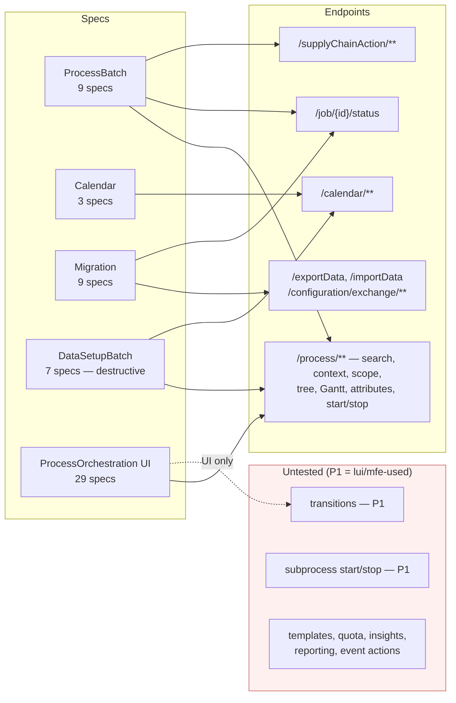

# Architecture — plan-sop-process-orchestration-service

## 1. Context
Where the service sits in the platform.

## 2. Internal layering
Actual packages under `com.blueyonder.po`, with file counts.

`service.proxy` (18 files) is the outbound-call layer — it is what makes `ActionItemProxyController` and `RbacProxyController` work, and why an Action Item or LIAM outage surfaces as a PO failure.

## 3. Domain model

`Node` is the single table behind both processes and subprocesses — the distinction is hierarchy, not type.

## 4. Async flow — process start
The pattern every automation spec must follow.

Asserting on the `POST` response is the single most common source of false passes here.

## 5. ALM migration flow

Multipart ceiling is 10MB (`MULTIPART_MAX_FILE_SIZE`); 12MB request size. Exceeding it returns HTTP 413.

## 6. Automation touchpoints

59 of 144 active routes are exercised by backend specs (2026-10-05).

Related: [api-contract.md](api-contract.md) · [test-hooks.md](test-hooks.md) · [platform map](../repo-map.md)
