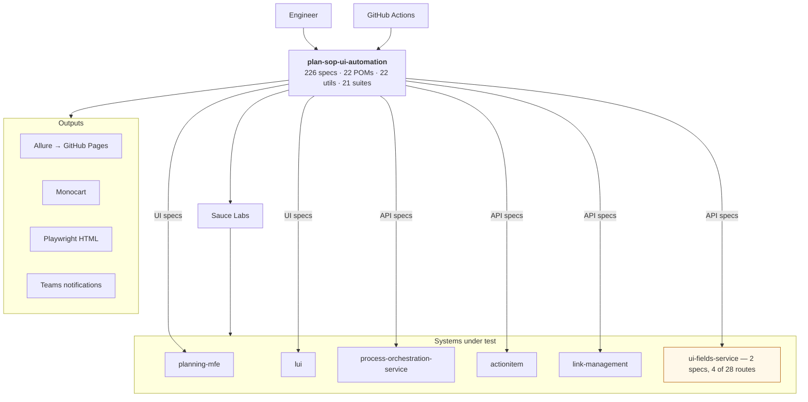
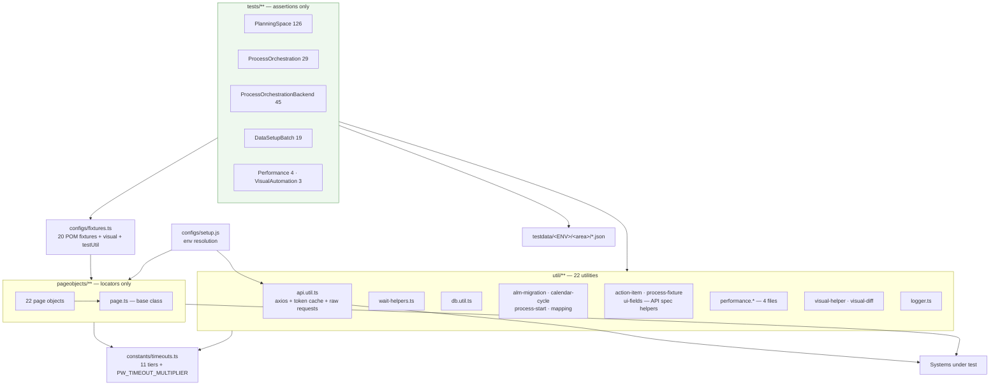
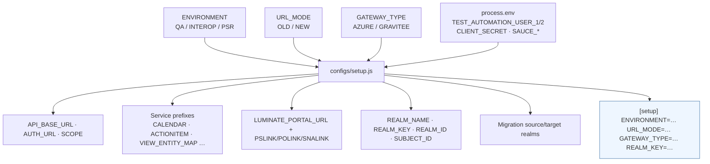
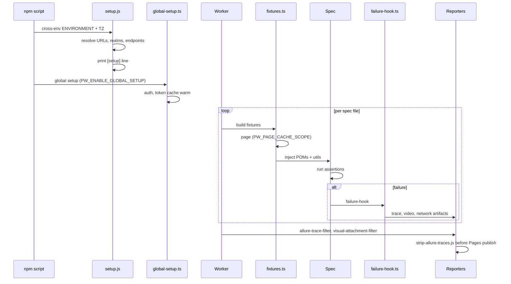
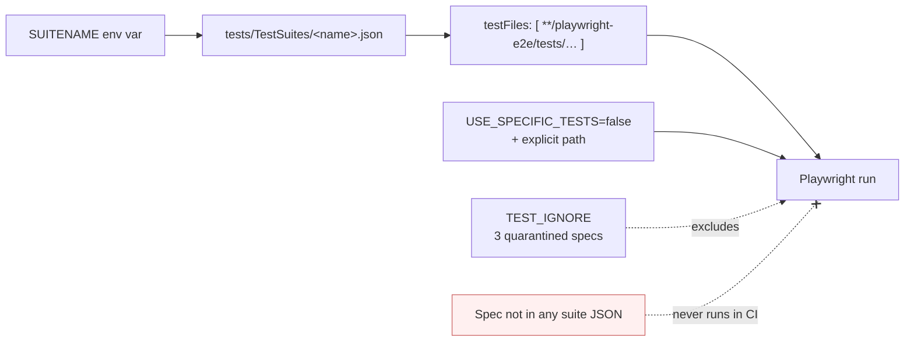
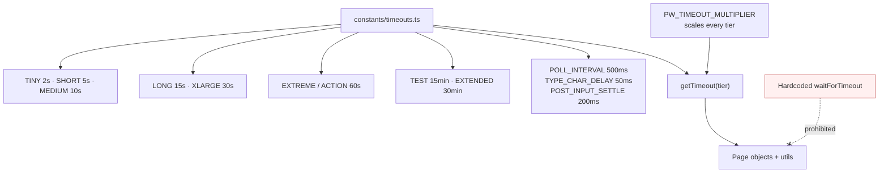
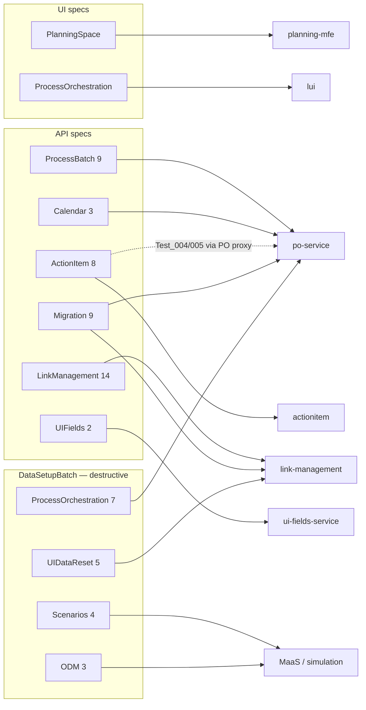
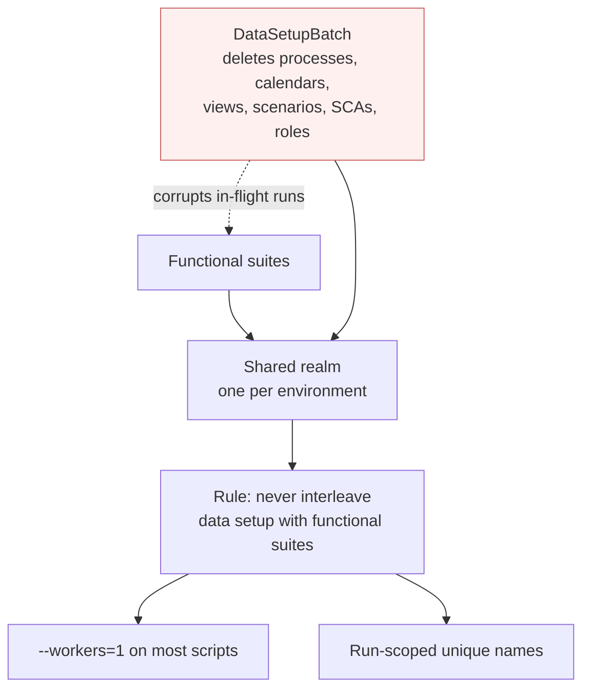

# Architecture — plan-sop-ui-automation

## 1. Context

UI Fields gained its first direct specs in 2026-10 (`POBackendUIFieldsBatch`); it is amber, not red, because only the page-config routes lui uses are covered.

## 2. Framework layering

The rule this diagram encodes: **specs assert, page objects locate, utils call.** A selector in a spec, or an assertion in a page object, breaks the layering.

## 3. Environment resolution

`[setup]` is the first line to read in any triage — most misrouting is visible there.

## 4. Test execution lifecycle

## 5. Suite selection

## 6. Timeout model

Slow environment? Raise `PW_TIMEOUT_MULTIPLIER` — never edit individual tiers.

## 7. Spec-to-service routing

## 8. Isolation model

Related: [framework-reference.md](framework-reference.md) · [test-hooks.md](test-hooks.md) · [environments.md](environments.md) · [platform map](../repo-map.md)
