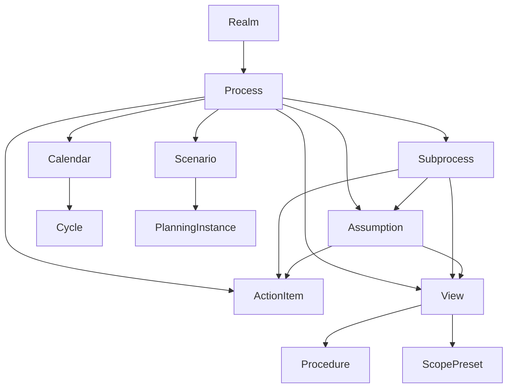

# Data model — plan-sop-ui-automation

The repo's own data structures: test data JSON, suite definitions, and artifact layout.

## Test data layout
```
playwright-e2e/testdata/<ENV>/<area>/<SpecName>.json
```

One JSON file per spec, named to match the spec exactly. Each file carries a `_schema` block documenting its required fields and types (`.github/instructions/testdata.instructions.md`); the `testData` fixture throws if the file is missing or invalid JSON.

| Environment | Areas present |
| --- | --- |
| `INTEROP` | `DataSetupBatch`, `Performance`, `PlanningSpace`, `ProcessOrchestration`, `ProcessOrchestrationBackend`, `VisualAutomation`, `VisualBaseValidations` |
| `QA` | `PlanningSpace`, `ProcessOrchestration`, `ProcessOrchestrationBackend`, `VisualAutomation` |
| `PSR` | `Performance`, `ProcessOrchestrationBackend` |

Example:
```
testdata/INTEROP/ProcessOrchestrationBackend/Calendar/Test_001_CalendarsCRUD.json
testdata/INTEROP/ProcessOrchestrationBackend/ActionItem/Test_001_ActionItemCRUDWithProcess.json
```

INTEROP has the broadest coverage; QA lacks `Performance` and `DataSetupBatch`; PSR only carries `Performance` and backend data (no `UIFields`, and `ActionItem` only for Test_001–003). A spec that runs in INTEROP will fail in PSR if its data file was never created there.

Field configuration is tenant-scoped (see [UI Fields](../plan-sop-ui-fields-service/environments.md)), so **expected columns, filters and labels belong in these files, not in spec literals**. The UI Fields specs keep per-environment baselines here (for example QA lists `processName` instead of `actualStartDate`/`actualEndDate` and has 6 status filter keys); Action Item editor/filter field lists are also tenant-configured.

## Suite definition schema
`tests/TestSuites/<SuiteName>.json`:

```json
{
  "testFiles": [
    "**/playwright-e2e/tests/ProcessOrchestrationBackend/Calendar/Test_001_CalendarsCRUD.spec.ts",
    "**/playwright-e2e/tests/ProcessOrchestrationBackend/Calendar/Test_002_CyclesCRUD.spec.ts"
  ]
}
```

A single `testFiles` array of globs, each prefixed `**/playwright-e2e/`. Selected at runtime via `SUITENAME`.

### The 21 suites
| Suite | Scope |
| --- | --- |
| `CardsBatchA.json`, `CardsBatchB.json` | Planning Space cards, split for runtime |
| `ScenarioBatchA.json`, `ScenarioBatchB.json` | Scenarios, split for runtime |
| `ViewsBatch.json` | Views management |
| `ScopeBatch.json` | Scope and filters |
| `DrillThroughBatch.json` | Drill-through |
| `OnDemandMaasBatch.json` | On-demand MaaS |
| `SupplyChainActionsBatch.json` | Supply chain actions |
| `PowerBarBatch.json` | Power bar (both apps) |
| `ObjectiveQuickLinksViewSearchBatch.json` | Objective bar, quick links, view search |
| `WorkflowFilterAndDuplicateViewsBatch.json` | Workflow filter, duplicate views |
| `PSSmokeBatch.json` | Planning Space smoke |
| `POBackendActionItemBatch.json` | Action item API |
| `POBackendCalendarBatch.json` | Calendar API |
| `POBackendLinkManagementBatch.json` | Link Management API |
| `POBackendMigrationBatch.json` | ALM migration |
| `POBackendProcessBatch.json` | Process API (lifecycle, attributes, search, context/scope, details, SCA) |
| `POBackendUIFieldsBatch.json` | UI Fields page-config and editor contracts |
| `POBackendSmokeBatch.json` | Backend smoke (24-spec cross-service subset) |
| `DataSetup.json` | **Destructive data setup** (9-spec subset) |

**A new spec that is not registered in a suite JSON will never run in CI.**

## Artifact layout
| Path | Contents |
| --- | --- |
| `reports/allure-results` | Raw Allure results |
| `reports/allure-report` | Generated Allure report |
| `reports/html-report` | Playwright HTML |
| `reports/monocart-report` | Monocart single-file report |
| `reports/visual-report` | Visual diff report |
| `test-results/` | Playwright output |
| `test-results/visual/` | Visual artifacts |
| `logs/` | winston logs |
| `testdata/.auth/api-tokens.json` | **Cached Bearer tokens — cleared by `clean-reports`** |
| `network/` | Network artifacts |

`scripts/strip-allure-traces.js` removes trace and video binaries before publishing to GitHub Pages while preserving full artifacts in GitHub Action run artifacts.

## Visual baselines
| Path | Contents |
| --- | --- |
| `testdata/<ENV>/VisualAutomation/` | Per-environment baselines |
| `testdata/INTEROP/VisualBaseValidations/` | Base validations |
| `constants/visual.ts` | Visual thresholds and settings |

Baselines are environment-specific. Regenerate with `npm run test:visual:update`.

## Entity model under test
The domain these specs exercise, assembled from the backend services:



Owning services: `Process`/`Subprocess`/`Calendar`/`Cycle` → [PO service](../plan-sop-process-orchestration-service/data-model.md); `ActionItem` → [Action Item](../plan-sop-actionitem/data-model.md); `View`/`Procedure`/`ScopePreset` → [Link Management](../plan-sop-link-management/data-model.md); field configuration → [UI Fields](../plan-sop-ui-fields-service/data-model.md).
