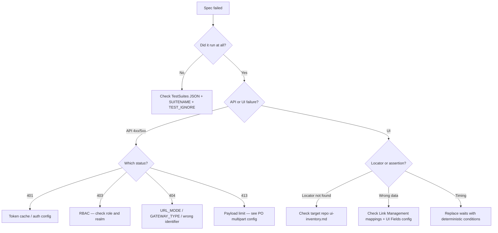

# Troubleshooting — plan-sop-ui-automation

Framework-level failures. For application-specific failures, go to the target repo's `troubleshooting.md`.

## Triage order
1. Read the `[setup] ENVIRONMENT=... URL_MODE=... GATEWAY_TYPE=... REALM_KEY=...` line — most misrouting is visible here.
2. Did the spec ever run? If not, check suite registration.
3. Is it a framework problem (below) or an application problem (target repo's `troubleshooting.md`)?
4. Does it fail in isolation with `--workers=1`? If not, it is shared-state interference.

## Known failure signatures
| Symptom | Likely cause | Check / fix |
| --- | --- | --- |
| Spec never runs in CI | Not registered in a `tests/TestSuites/*.json` | Add the glob; check `SUITENAME` |
| Every API call 404s | Wrong `URL_MODE` or `GATEWAY_TYPE` | Check the `[setup]` line |
| 401 mid-suite | Cached Bearer token, or token expiry | `clearApiTokenCache()`; `npm run clean-reports` removes `testdata/.auth/api-tokens.json` |
| 401 after switching users | Token cached for the previous user | `clearApiTokenCache()` before the switch |
| Cannot read test data | Missing `testdata/<ENV>/<area>/<SpecName>.json` | PSR and QA have sparser data than INTEROP |
| Off-by-one-day date failures | `TZ` not set | Every npm script sets `TZ=Australia/Adelaide`; running `npx playwright` directly loses it |
| Passes alone, fails in a suite | Shared realm state | Run with `--workers=1`; check for a `DataSetupBatch` spec in the same run |
| Everything fails after a data-setup run | `DataSetupBatch` is realm-destructive | Never interleave it with functional suites |
| Flaky only in CI | Slower environment | Raise `PW_TIMEOUT_MULTIPLIER` rather than editing individual timeouts |
| Locator not found after a dependency bump | `@by/lui-*` DOM changed | See the target repo's `ui-inventory.md` |
| TypeScript "duplicate identifier" after a bulk edit | Repeated import insertion | Validate the import block; prefer exact-context replacements |
| `'error' is of type 'unknown'` in a catch | TS strictness | `error instanceof Error ? error.message : String(error)` |
| Allure report bloats the repo | Trace/video binaries published | `scripts/strip-allure-traces.js` strips them for GitHub Pages |
| Visual diffs on unrelated pixels | Baseline from another environment | Baselines are per-environment; `npm run test:visual:update` |
| Sauce run fails but local passes | Sauce credentials or config | `SAUCE_USERNAME` ← `SAUCE_PS_USERNAME`, `SAUCE_ACCESS_KEY` ← `SAUCE_PS_ACCESS_KEY` |
| Stale page state between specs | Page caching | `PW_PAGE_CACHE_SCOPE` (`worker` vs `file-worker`) |
| No network artifacts to debug with | Artifact mode | Set `PW_NETWORK_ARTIFACT_MODE=always` for that run |
| Test-case docs out of date | Specs added or renamed without regeneration | `npm run docs:testcases` |
| Spec in `TEST_IGNORE` silently skipped | Deliberate quarantine | Check the npm script for a `TEST_IGNORE` entry |
| "No tests found" when running a folder | `USE_SPECIFIC_TESTS=true` from local `.env` — the config's hardcoded list wins | Pass `USE_SPECIFIC_TESTS=false` |
| Every Azure-gateway spec fails on the token call with `AADB2C90085` | Transient Azure B2C outage (seen 2026-10-01, cleared within ~1 h) | Re-run later, or switch to `GATEWAY_TYPE=GRAVITEE` meanwhile |
| Every route of one service returns 500 on one gateway | Environment problem (seen on QA Gravitee UI Fields, 2026-10-01) | Not a test defect — confirm other services on the same gateway return 200, then retry |
| Malformed-JSON negative test gets a type error instead of a parse error | `processAPIRequest` JSON-encodes string bodies | Use `ApiUtil.processRawRequest` |
| Write retried and created duplicates | `sendUntilStatus` used for a POST/PUT/DELETE | Use `ActionItemApiHelper.write()`; `sendUntilStatus` is for reads only |
| Secret-dependent client "works" with no secret set | `setup.js` copies unset secrets as the string `"undefined"`, and `ApiUtil` may return a cached token | `npm run clean-reports` to clear `testdata/.auth/api-tokens.json` before trusting the result |
| Backend assertion matches the service but looks wrong | Known service defect | Check `docs/Coverage/PSR-Gap-Plans/ActionItems-UIFields-Defect-Report.html` before changing the assertion |

## Failure decision tree

## Where to look
| Signal | Location |
| --- | --- |
| Resolved env config | `[setup] ...` console line |
| Allure report | `npm run report` |
| Monocart report | `npm run report:monocart` |
| Playwright trace | `npm run trace` |
| Network artifacts | `network/`, gated by `PW_NETWORK_ARTIFACT_MODE` |
| Framework logs | `logs/` (winston) |
| Cached tokens | `testdata/.auth/api-tokens.json` |
| Suite definitions | `tests/TestSuites/*.json` |
| Environment resolution | `configs/env/` (applied by `configs/setup.js`) |

## Flaky areas
| Area | Why | Mitigation |
| --- | --- | --- |
| Shared realm state | Specs mutate the same processes, views and scenarios | `--workers=1`; run-scoped unique names |
| Data setup interleaving | Realm-wide destructive cleanup | Sequence data setup separately |
| Long-running backend jobs | Migration, on-demand MaaS | `EXTENDED` tier + `expect.poll` |
| Date-sensitive specs | Calendars, cycles, due dates | Keep `TZ=Australia/Adelaide` |
| Visual specs | Font and render variance | Per-environment baselines |
| Third-party UI libraries | `@by/lui-*` DOM changes | Track versions; centralise locators in page objects |
| Cloud execution | Sauce network variance | Retries are configurable via CI inputs (default `1`) |

## Escalation
If a failure spans **more than one backend service at once**, it is probably not a test problem — check [`plan-sop-po-be-commons`](../plan-sop-po-be-commons/troubleshooting.md) for a shared-library change before investigating individual services.
