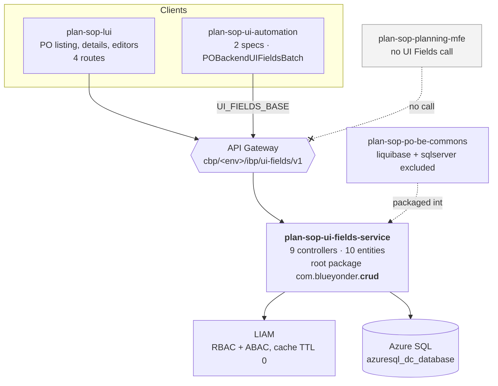
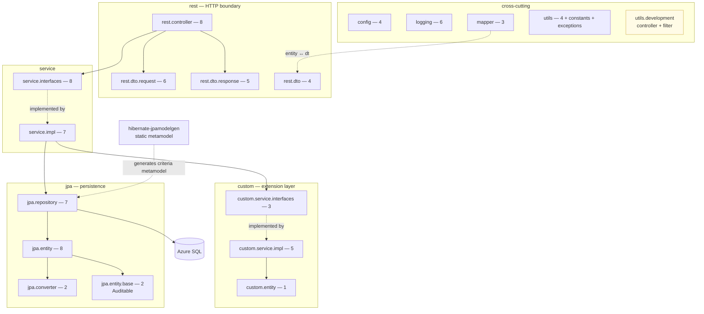
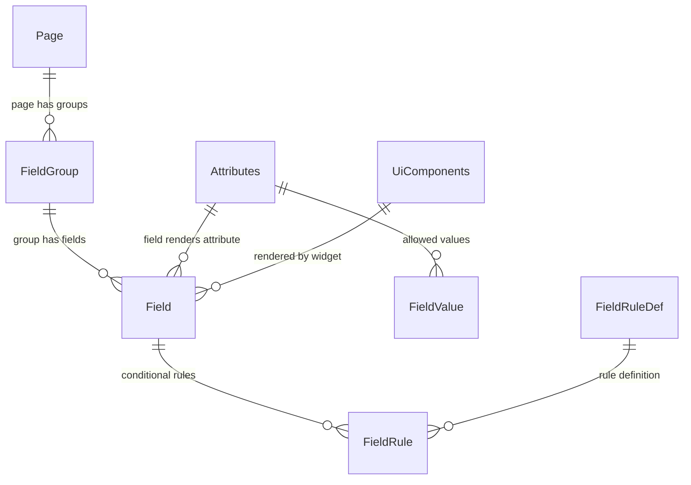
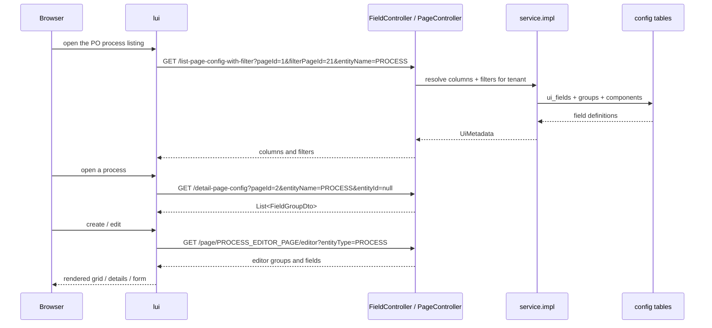
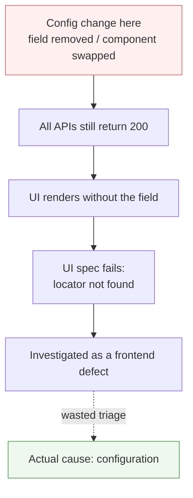
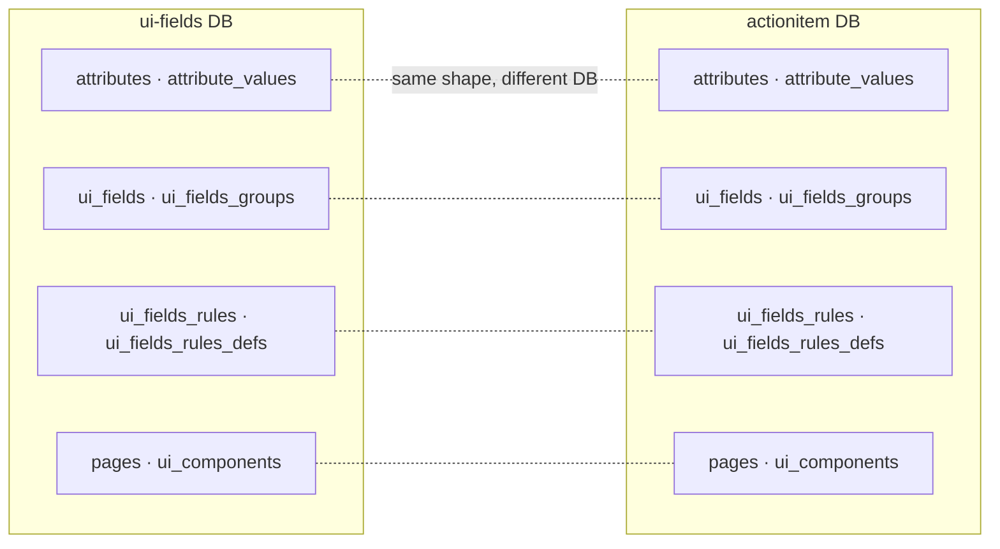
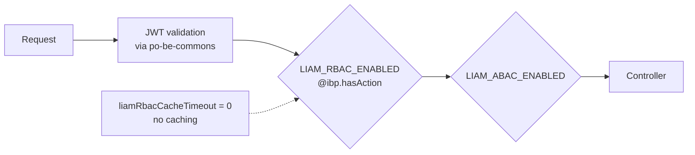
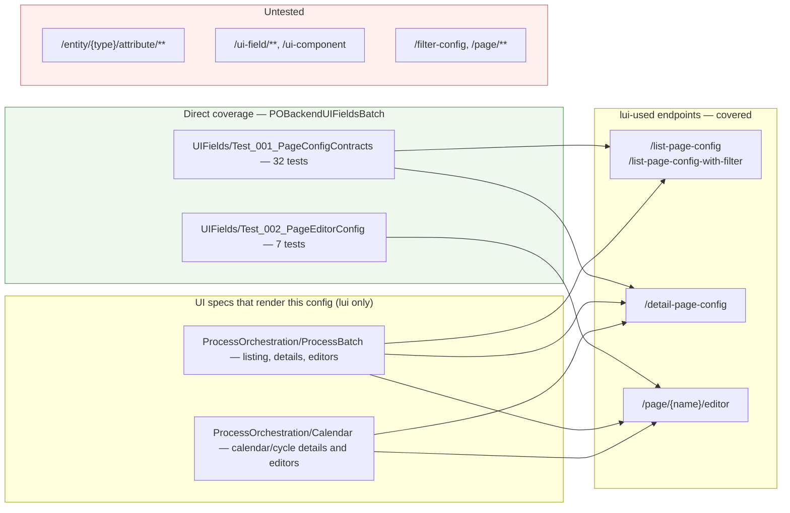

# Architecture — plan-sop-ui-fields-service

## 1. Context

Earlier versions of this page showed Planning Space as a client and lui as unverified. Source shows the reverse: lui calls UI Fields through config keys in `src/config.ts`, and planning-mfe never does.

The root package is `com.blueyonder.crud`, not `uifields` — worth knowing when searching logs or stack traces.

## 2. Internal layering

`utils.development` contains a controller and a filter intended for development only — confirm they are disabled in deployed environments before writing security assertions against this service.

## 3. The configuration model
These eight tables decide what every UI screen renders.

`UiComponents` → `Field` is the link that matters most for automation: **the component determines which widget lui renders for a field**, and so which `data-testid` appears in the DOM. A component swap here can silently break `getByTestId` locators in Process Orchestration page objects.

## 4. How configuration reaches the screen (lui)

Every step returns 200. If a column is missing, nothing errors anywhere — the UI simply renders fewer columns and a UI spec fails on an assertion. `POBackendUIFieldsBatch` now diffs these responses against per-environment baselines so the drift is caught at the API layer. Page ids are global Liquibase seeds — see [data-model.md](data-model.md#page-ids-used-by-lui-and-the-specs).

## 5. Failure propagation — why this repo matters

Short-circuit this with the triage order in [troubleshooting.md](troubleshooting.md#triage-order-for-a-missing-field-failure).

## 6. Duplicated table family

Two services own structurally identical tables. A migration applied to only one produces a field that renders in action items but not elsewhere — see [Action Item data model](../plan-sop-actionitem/data-model.md#configuration--ui-field-entities).

## 7. Security model

Because the RBAC cache TTL defaults to `0`, permission changes here take effect **immediately** — unlike Process Orchestration, which needs `GET /cache/clear`.

## 8. Automation touchpoints

Related: [automation-coverage.md](automation-coverage.md#coverage-gaps) · [troubleshooting.md](troubleshooting.md)
