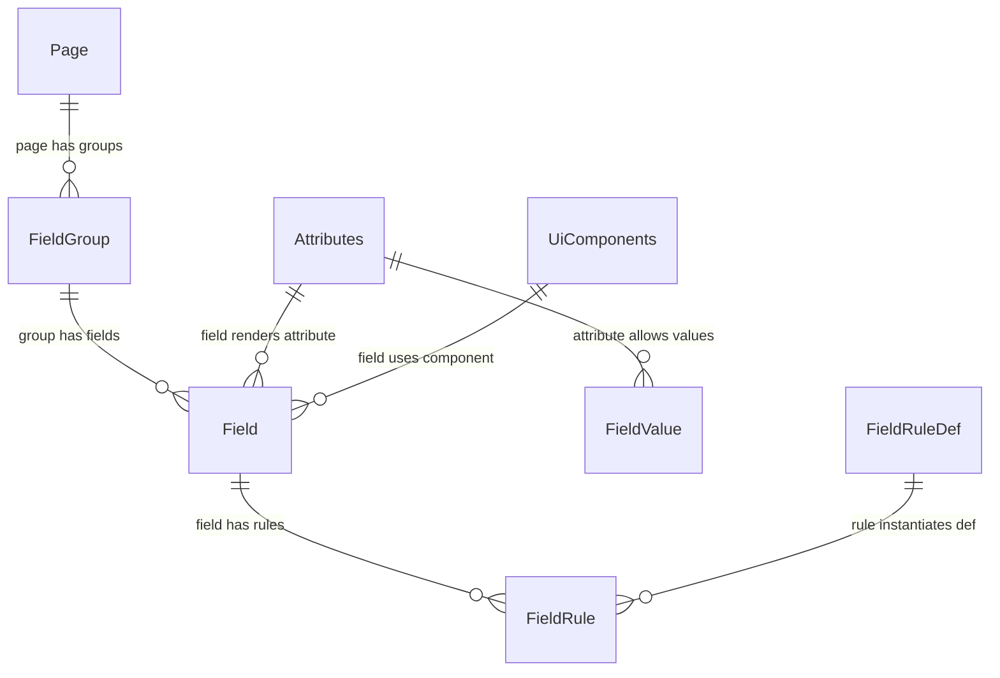

# Data model — plan-sop-ui-fields-service

## Persistence
| Aspect | Value |
| --- | --- |
| Database | Azure SQL Server, `${azuresql_dc_database}` — **no default, must be supplied** |
| Dialect | `org.hibernate.dialect.SQLServer2012Dialect` |
| Migrations | Liquibase — `db/changelog/db.changelog-master.xml` |
| Pool | Hikari, max 50, min idle 5 |
| Batch size | `100` |
| Metamodel | `hibernate-jpamodelgen` — static metamodel for dynamic criteria search |
| Env vars | `azuresql_host`, `azuresql_port`, `azuresql_dc_database`, `azuresql_dc_user`, `azuresql_dc_password` |

## Entities
| Entity | Table | Purpose |
| --- | --- | --- |
| `Attributes` | `attributes` | Attribute definitions per entity type |
| `FieldValue` | `attribute_values` | Allowed values for an attribute |
| `Field` | `ui_fields` | A renderable UI field |
| `FieldGroup` | `ui_fields_groups` | Groups fields into editor sections |
| `FieldRule` | `ui_fields_rules` | Conditional show/hide/require rules |
| `FieldRuleDef` | `ui_fields_rules_defs` | Rule definitions referenced by `FieldRule` |
| `Page` | `pages` | Page registry — `GET /page/{name}` resolves the ID |
| `UiComponents` | `ui_components` | Component registry (which widget renders a field) |
| `Auditable` | *(mapped superclass)* | Audit columns |

## Relationships

## Shared table family
`attributes`, `attribute_values`, `ui_fields`, `ui_fields_groups`, `ui_fields_rules`, `ui_fields_rules_defs`, `pages`, and `ui_components` also exist in
[`plan-sop-actionitem`](../plan-sop-actionitem/data-model.md#configuration--ui-field-entities).

Two services own structurally identical tables in different databases. A schema or seed change applied to only one produces a UI that renders correctly in one area and incorrectly in another — worth checking whenever a field appears in action items but not elsewhere, or vice versa.

## Identifier conventions
- `entityType` scopes attributes — it is a path variable on nearly every attribute endpoint.
- Attributes are addressed by `name`, UI fields by numeric `id`, pages by `name` (with `GET /page/{name}` returning the ID).
- Attribute values are addressed by `(attributeName, name)`.

## Why this matters for locators
`ui_components` determines which widget renders a field, and the widget determines the `data-testid` emitted into the DOM. When a page object's `getByTestId` stops matching, a component swap in this table is a plausible cause — see [the LUI test-id inventory](../plan-sop-lui/ui-inventory.md).

## Seed data required by automation
| Object | Notes |
| --- | --- |
| Pages | Must be registered before editor/list config resolves |
| Attributes + values | Drive filter options and editor dropdowns |
| UI fields + groups | Drive grid columns and form layout |
| UI components | Determine rendered widget and test IDs |
| Field rules | Drive conditional visibility — a hidden field is not a test failure if a rule hid it |

## Page ids used by lui and the specs
Page ids are **global** Liquibase seeds (`src/main/resources/db/changelog/insert_pages.xml`), identical in every tenant. Field configuration per page is tenant-specific.

| Id | Name | Type | Entity |
| --- | --- | --- | --- |
| 1 / 2 | — | LIST / SUMMARY | PROCESS |
| 3 / 4 | — | LIST / SUMMARY | SUBPROCESS |
| 7 / 8 / 15 / 16 | — | LIST / FILTER / SUMMARY / EDITOR | ACTION_ITEMS |
| 17–20 | `INSIGHT_*` | SUBSCRIPTION_FILTER / LIST / SUMMARY / FILTER | INSIGHT |
| 21 | `PROCESS_FILTERS_PAGE` | FILTER | PROCESS — **the process listing filter page is 21, not 1** |
| 22 / 23 | `CALENDAR_LISTING_PAGE` / `CYCLE_LISTING_PAGE` | LIST | CALENDAR / CYCLE |
| 24 / 25 | `CALENDAR_DETAILS_PAGE` / `CALENDAR_EDITOR_PAGE` | SUMMARY / EDITOR | CALENDAR |
| 26 / 27 | `CYCLE_DETAILS_PAGE` / `CYCLE_EDITOR_PAGE` | SUMMARY / EDITOR | CYCLE |
| 29 / 30 | `PROCESS_EDITOR_PAGE` / `SUBPROCESS_EDITOR_PAGE` | EDITOR | PROCESS / SUBPROCESS |
| 31 | `PROCESS_EDITOR_WITH_TEMPLATE_PAGE` | EDITOR | PROCESS |
| 32 | `PROCESS_TRANSITION_SUMMARY_PAGE` | LIST | PROCESS |
