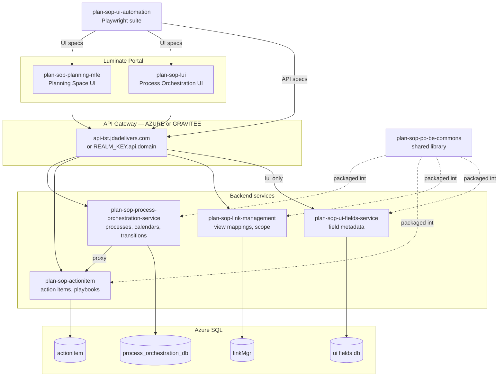
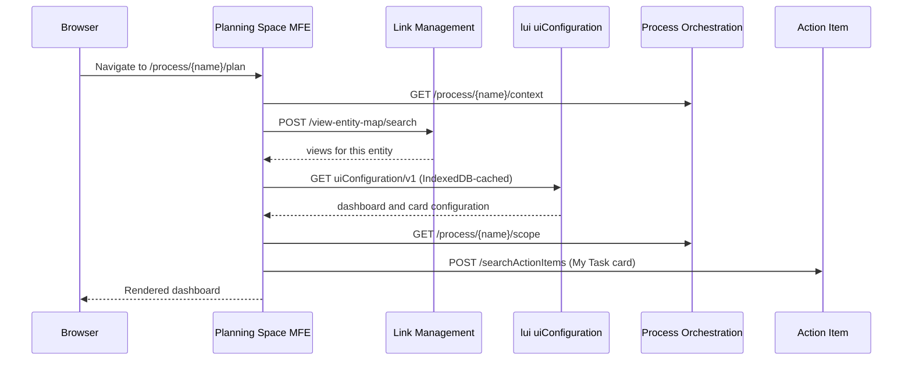
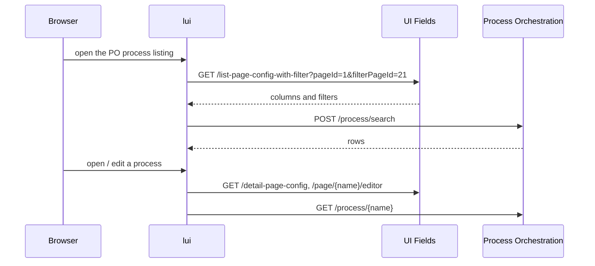

# Repository map

How the eight repositories fit together, and what a change in one does to the others. Last reviewed 2026-10-05.

For the internals of any single repo, see its own `architecture.md` — indexed in [README.md](README.md#architecture-diagrams).

## System view

## Who owns what
| Concern | Owner |
| --- | --- |
| Process, subprocess, node hierarchy | [PO service](plan-sop-process-orchestration-service/data-model.md) |
| Calendars, cycles, node schedules | PO service |
| Transitions, templates, supply chain actions | PO service |
| Quotas, metering, insights, reporting config | PO service |
| ALM publish / deploy / exchange | PO service |
| Action items, comments, playbooks | [Action Item](plan-sop-actionitem/data-model.md) |
| KPI definitions and entity mapping | Action Item |
| View↔entity and view↔procedure mapping | [Link Management](plan-sop-link-management/data-model.md) |
| Favourites, scope, filter presets | Link Management |
| Field, column, filter and editor metadata | [UI Fields](plan-sop-ui-fields-service/data-model.md) |
| UI component registry | UI Fields |
| PO listing columns, detail panes and editor layouts (lui) | UI Fields |
| Dashboard/card configuration and vertical filters (Planning Space) | lui platform services (`uiConfiguration`, `verticalFilterBff`) — outside these repos |
| Security, logging, audit events, Liquibase | [po-be-commons](plan-sop-po-be-commons/data-model.md) |
| Planning UI, cards, scenarios, drill-through | [Planning Space MFE](plan-sop-planning-mfe/ui-inventory.md) |
| Process UI, calendars UI, settings, view manager | [LUI](plan-sop-lui/ui-inventory.md) |

Two services own **structurally identical UI-field tables**: Action Item and UI Fields. Drift between them produces a field that renders in one area and not another.

## Request flow — a Planning Space page load

Reading this sequence in reverse is the fastest way to localise a UI failure: wrong views → Link Management; missing context → PO; stale card/column config → the IndexedDB config cache. Planning Space never calls UI Fields.

## Request flow — a Process Orchestration (lui) listing

In lui, missing columns or form fields → UI Fields configuration (check `POBackendUIFieldsBatch`); wrong rows → PO.

## Gateway prefixes
| Service | QA (OLD / NEW) | INTEROP (OLD / NEW) | PSR (OLD / NEW) |
| --- | --- | --- | --- |
| Process Orchestration | `cbp/qa/ibp/process-orchestration/v1` / `qa/po/api/v1` | `cbp/interop/ibp/process-orchestration/v1` / `po/api/v1` | `cbp/psr/ibp/process-orchestration/v1` / `po/api/v1` |
| Action Item | `cbp/qa/ibp/actionitems/v1` / `qa/ai/api/v1` | `cbp/interop/ibp/actionitems/v1` / `ai/api/v1` | `cbp/psr/ibp/actionitems/v1` / `ai/api/v1` |
| Link Management | `cbp/qa/ibp/links/v1` / `qa/lm/api/v1` | `cbp/interop/ibp/links/v1` / `lm/api/v1` | `cbp/psr/ibp/links/v1` / `lm/api/v1` |
| UI Fields (`UI_FIELDS_BASE`) | `cbp/qa/ibp/ui-fields/v1` / *NEW unconfirmed — OLD path reused* | `cbp/interop/ibp/ui-fields/v1` / *same* | `cbp/psr/ibp/ui-fields/v1` / *same* |

Full matrix: [automation environments](plan-sop-ui-automation/environments.md).

## UI entry points
| App | URL |
| --- | --- |
| Planning Space | `LUMINATE_PORTAL_URL + PSLINK` |
| Process Orchestration | `LUMINATE_PORTAL_URL + POLINK` |
| Semantic Network Architect | `LUMINATE_PORTAL_URL + SNALINK` |

## Blast radius
What to re-test when a repo changes.

| Changed repo | Re-test |
| --- | --- |
| `plan-sop-po-be-commons` | **Everything.** Smoke all four services plus both UIs — auth, logging and migrations all originate here |
| `plan-sop-process-orchestration-service` | All backend suites, all PO UI suites, most Planning Space suites (processes are a prerequisite) |
| `plan-sop-link-management` | `POBackendLinkManagementBatch`, `POBackendMigrationBatch` (Test_006–008), `ViewsBatch`, `ScopeBatch`, `ViewSearch`, `DuplicateView`, `DrillThroughBatch` |
| `plan-sop-actionitem` | `POBackendActionItemBatch`, `ActionItemsBatch`, `CardsBatch/Test_013_MyTask` |
| `plan-sop-ui-fields-service` | `POBackendUIFieldsBatch`, then all `ProcessOrchestration/**` UI suites (lui listing, details, editors). Planning Space is unaffected |
| `plan-sop-planning-mfe` | All `PlanningSpace/**`, `Performance/**`, visual specs |
| `plan-sop-lui` | All `ProcessOrchestration/**`, visual specs; view-manager changes also affect Planning Space |
| `@by/lui-*` dependency bump | Both UIs — `lui-*` test IDs may have changed |

## Shared technical facts
| Fact | Value |
| --- | --- |
| Java version | 21 across all backends |
| Spring Boot | 3.5.16 in all four services (3.4.3 in commons) |
| Commons pin | `2dacec2-SNAPSHOT` in all four services (aligned since 2026-09-17; LM was on `251ccd3` before) |
| Database | Azure SQL Server, Liquibase migrations |
| Node version | 22.13.1 for both frontends (`.nvmrc`) |
| Bundler | Vite for both frontends |
| Design system | `@by/experience-system` 1.1.1 in both frontends |
| Dashboard library | `@by/lui-dashboard-library` 10.10.4 in both frontends |
| CCL | `@jda/lui-common-component-library-mui5` 3.12.2 in both frontends |
| Quick filter | `@by/lui-quick-filter-library` 3.1.1-rc.1 in both frontends |
| Differs between frontends | scaffolding core/components, `lui-vertical-filter-component` (lui 3.25.5, mfe 3.25.7), `plan-sop-ui-library` (lui 2026.4.3, mfe 2026.4.4) |
| Auth | OAuth2 Bearer, B2C client-credentials or Gravitee OAuth |
| RBAC | LIAM, `@ibp.hasAction(resource, {action})` |
| Timezone in tests | `Australia/Adelaide` |

Because both frontends pin mostly identical `@by/lui-*` versions, most `lui-*` test IDs are consistent across them — and a bump moves both at once. The libraries listed as differing above can break one app only.

## Quality gates
| Repo | Gates |
| --- | --- |
| PO service | CodeQL, Codacy, 42Crunch, BlackDuck, SonarQube, Spotless |
| Action Item | CodeQL, Codacy, 42Crunch, BlackDuck, SonarQube, Spotless |
| Link Management | CodeQL, Codacy, 42Crunch, BlackDuck, SonarQube, Spotless |
| UI Fields | CodeQL, Codacy, 42Crunch, BlackDuck, Spotless |
| po-be-commons | JFrog Xray, Spotless, Testcontainers |
| Planning Space MFE | BlackDuck, CodeQL, Vitest, ESLint, Prettier |
| LUI | BlackDuck, CodeQL, Vitest, ESLint, Prettier |

## Structural risks
| Risk | Why it matters |
| --- | --- |
| **UI Fields coverage is narrow** | 2 specs cover the 4 routes lui uses (4 of 28); attributes, UI-field CRUD and RBAC are untested |
| **commons is pinned by git SHA, not semver** | Services can silently run different builds of the shared library; aligned today only by convention |
| **23 UI-used endpoints have no backend test** | Mostly PO transitions, subprocess start/stop, AI bulk — see `docs/Coverage/backend-api-coverage-dashboard.html` |
| **Duplicated UI-field tables** | Action Item and UI Fields own the same table family in separate databases |
| **`DataSetupBatch` is realm-destructive** | Interleaving it with functional suites corrupts a whole run |
| **Async operations across services** | Start/stop, migration, validation all require polling, never read-after-write |
| **Test data thinner in QA and PSR** | A spec that runs in INTEROP may have no data elsewhere |
