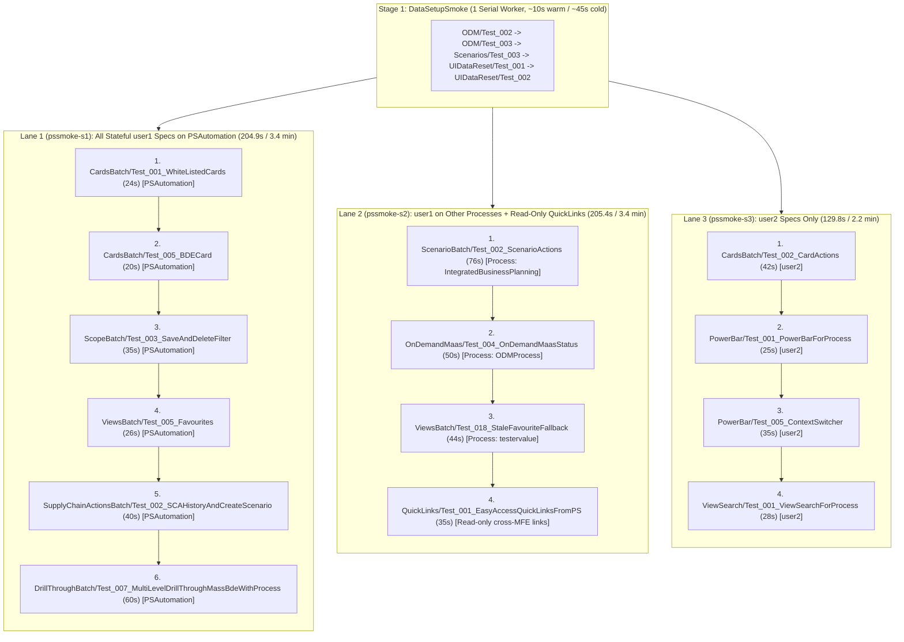
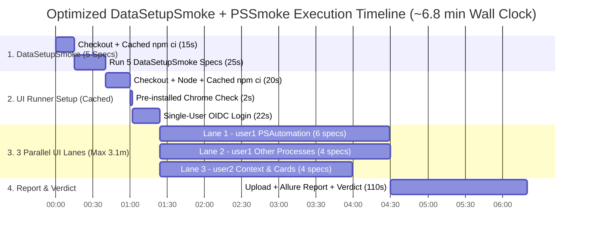

# Planning Space Smoke Batch (`PSSmokeBatch.json`): PR Coverage Analysis & Sub-10-Minute Speedup Plan

**Date:** 2026-11-04  
**Status:** Proposed for Implementation  
**Target Repositories:**
- **Dev Repo:** `C:\Backend\plan-sop-planning-mfe` (`BY-Product-Development/plan-sop-planning-mfe`)
- **Automation Repo:** `C:\Backend\plan-sop-ui-automation` (`BY-Product-Development/plan-sop-ui-automation`)

**Reference CI Run:** [GitHub Actions Run #300 (`41534518464`)](https://github.com/BY-Product-Development/plan-sop-ui-automation/actions/runs/41534518464) (`playwright-ps-iop-ui-sharded-suite`, INTEROP, Azure Gateway, 14 lanes, 472 total test cases).

**ODM configuration update:** The cluster observations and estimates below describe the historical configuration. The current INTEROP Azure test data uses matching cluster lists, including `42e205a8` and excluding `07b83d5e` and `48821b1e`; the new configuration has not been validated with a live restart.

---

## 1. Executive Summary

### 1.1 Are the current 9 smoke tests in `PSSmokeBatch.json` sufficient for PRs?
**No.** While all 9 specs (32 test cases) in `playwright-e2e/tests/TestSuites/PSSmokeBatch.json` passed in Run #300 (`41534518464`), cross-referencing them against the `plan-sop-planning-mfe` source tree (504 `.tsx`/`.ts` files, 14 route-level pages, 24 component folders) and the last 400 git commits reveals **5 major coverage blind spots**:

1. **Views Management & Side Drawer (`ViewsBatch` — 0 specs in smoke):** The single highest-churn area in `plan-sop-planning-mfe` (`src/components/SideNav/SideNavWithRightPanel.tsx`, `SideNavTabPanelNew.tsx`, `CustomSideDrawer.tsx`, `EditView`, `SettingsDialog` — **84 commits** in the last 400 commits) has zero direct coverage in `PSSmokeBatch.json`.
2. **Supply Chain Actions (SCA) Execution & History (`SupplyChainActionsBatch` — 0 specs in smoke):** Routes `/process/:processName/actionslog` (`SCAListTable`) and `/actionDetails/:runId` (`SCADetails`), along with the PowerBar procedure history flyout (`power-bar-history-btn`), are completely untested in smoke.
3. **Subprocess & Assumption Context Routing (`PowerBar` — only Process tested):** `App.tsx` exposes distinct route trees for `/process/:processName/...`, `/subprocess/:subprocessName/...`, and `/assumption/:assumptionID/...`. Current smoke tests only exercise the `Process` context, leaving `Subprocess` and `Assumption` context switching untested.
4. **Live Card Data Rendering (`CardsBatch` — only Card Gallery & Edit tested):** `CardsBatch/Test_001` and `Test_002` only test the Card Gallery whitelist and card creation/editing in Edit Mode. Neither validates that a rendered dashboard card (`PivotTable`, `BDE`, `MyTask`, or Highcharts) loads and displays live data with applied scope/scenario — despite `@by/lui-dashboard-*` and `@by/*-cardtypes` version bumps being the most frequent PR type in `plan-sop-planning-mfe`.
5. **Deterministic UI Contract / Guard States (`PSMockedBatch` — 0 specs in smoke):** Unconfigured filter empty states (`showUndefinedFilterAlert` / `"Welcome to the <process>."`), ODM error states, and `ScenarioTable` server-side `Visibility`/`Users` filter query contracts are not included in PR smoke checks.

### 1.2 Can we run the required `DataSetup` subset + expanded `PSSmokeBatch` in under 10 minutes with 3 workers?
**Yes — in ~6.5 to 8.0 minutes end-to-end wall-clock time** (including the 5 required `DataSetupBatch` specs), down from ~15.4 minutes today, while expanding the UI smoke suite from **9 specs (32 runtime tests) → 14 specs (52 runtime tests / 48 static catalog entries)**.

Today, `DataSetup` + `PSSmokeBatch` exceeds 10 minutes because of **5 compounding bottlenecks**:
1. **`DataSetup` takes 4.2 minutes (252s)** due to two specific API bottlenecks in the 5 required setup specs:
   - `UIDataReset/Test_002_MapViewsToContext.spec.ts` takes **180.0s (168.8s API time)** because it sends **7 sequential** `POST /view-entity-map` calls (~24.5s each) without first checking `POST /view-entity-map/search` (~0.3s) to skip entities whose view mappings already match.
   - `ODM/Test_002_RestartMaasCluster.spec.ts` took **157.5s** in Run #300 because cluster `07b83d5e-10a2-4a97-9e12-0c9d40186fba` was `STOPPED` and polled every 30s. At the time, the test data lists mismatched: `Test_002` started `07b83d5e...`, while `Test_003` listed `48821b1e...` instead and could stop `07b83d5e...`. The current INTEROP Azure lists match.
2. **A single UI outlier spec (`DrillThroughBatch/Test_001_EndToEndDrillThrough.spec.ts`)** takes **210.6s (3.51 min)** on its own.
3. **Uncached runner setup (`npm ci` 47s + `playwright install` 35s) + dual-user OIDC login (45s)** adds **~2.2 minutes** of setup overhead per runner job (and `npm ci` runs twice: once in `data-setup` and once in `run-tests`).
4. **`TestUtil.navigateToPlanningListingPage()`** uses the portal dock search (`"Planning"`) instead of direct URL navigation, costing a median of **30.7s per call** (~1.5 minutes across the smoke specs).
5. **Playwright's default alphabetical `--shard=1/3..3/3` split** creates unbalanced shards, runs `user1` specs concurrently against `PSAutomation` (risking per-user state collisions), and closes the `BrowserContext` after every file (`PW_PAGE_CACHE_SCOPE=file-worker`), wiping the MFE's IndexedDB `portalCacheWrapper` cache.

---

## 2. Dev Repo (`plan-sop-planning-mfe`) Architecture & Churn Analysis

### 2.1 Production File Churn (Last 300–400 Commits in `plan-sop-planning-mfe`)

Analysis of `git log` in `C:\Backend\plan-sop-planning-mfe` shows the following production hotspots:

| Rank | Component / Page Directory in `plan-sop-planning-mfe` | Commits (Last 400) | Primary Production Files Modified | Key Dependencies / Routes | Current Smoke Coverage |
|---:|---|---:|---|---|---|
| 1 | `src/components/SideNav` | **84** | `SideNavWithRightPanel.tsx` (25), `SideNavTabPanelNew.tsx` (6), `SetDefaultFilterPopup.tsx` (4), `SelectDefaultScenarioModalNew.tsx` (3), `CustomSideDrawer.tsx` (3), `SettingsDialog.tsx` (2) | `/process/:p/processplan/...`, `@by/plan-sop-ui-library`, `@by/lui-settings-ui-library` | **Missing** (only indirect `selectViewInPlanning`) |
| 2 | `src/pages/GuidedWorkflow` & `src/pages/ActionPlanner` | **73** | `PlaybookList.tsx` (8), `ActionSteps.tsx` (7), `PlaybookVirtualizedListItem.tsx` (4), `MaasActorScope.tsx` (1) | `/action/:actionID`, `@by/plan-abp-insights` | **None** |
| 3 | `src/sentry`, `src/Pendo.tsx`, `src/App.tsx`, `src/config.ts` | **42** | `initSentry.ts` (12), `config.ts` (9), `sentryRuntime.ts` (8), `Pendo.tsx` (7), `App.tsx` (6) | All route wrappers, `ErrorBoundary`, `PortalMessageService` | Covered via `QuickLinks/Test_001` & route loads |
| 4 | `src/pages/ScenarioTable`, `ScenarioDetails`, `ScenarioMenuActions` | **16** | `ScenarioTable.tsx` (5), `useScenarioRowMenuActions.tsx` (2), `ScenarioDetails.tsx` (2) | `/process/:p/scenario`, `material-react-table` | `ScenarioBatch/Test_002` (Process only) |
| 5 | `src/components/QuickFilter` & Vertical Filter | **9** | `QFPSAdoption.tsx` (5), `qfMockParams.ts` (4) | `@by/lui-quick-filter-library` 3.2.3, `@by/lui-vertical-filter-component` 3.25.7 | `ScopeBatch/Test_003` (Vertical Filter CRUD) |
| 6 | `src/components/SCASideNav`, `src/pages/SCAListTable`, `SCADetails` | **8** | `SCASideNav/index.tsx` (3), `SCAListTable.tsx`, `SCADetails.tsx` | `/process/:p/actionslog`, `/actionDetails/:runId` | **Missing** (no history/log or details check) |
| 7 | `src/components/EditView` & `PortalDashboardRenderer` | **9** | `EditView/index.tsx` (5), `DashboardRenderer.tsx` (3), `loadCardTypes.ts` (3) | `@by/lui-dashboard-library` 11.3.3, `@by/lui-dashboard-ca-cardtypes-mui5` 1.56.0, `@by/maas-scaffolding-mui5` 26.4.1 | `CardsBatch/Test_001` & `Test_002` (Gallery/Edit only; **no live card data render**) |

### 2.2 Route Coverage Matrix (`src/App.tsx` vs. `PSSmokeBatch.json`)

| Route Pattern in `src/App.tsx` | Component Rendered | Tested in Current `PSSmokeBatch.json`? | Recommended Smoke Spec |
|---|---|---|---|
| `/` | `ContextSetting` | ✅ Yes (`PowerBar/Test_001`, `ScopeBatch/Test_003`) | Keep |
| `/process/:processName/processplan/...` | `SideNavWithRightPanel` | ✅ Yes (7 specs) | Keep + add `ViewsBatch/Test_005`, `Test_018`, `CardsBatch/Test_005` |
| `/process/:processName/subprocess/:subprocessName/processplan/...` | `SideNavWithRightPanel` | ❌ **No** | Add `PowerBar/Test_005_ContextSwitcher.spec.ts` |
| `/process/:processName/assumption/:assumptionID/processplan/...` | `SideNavWithRightPanel` | ❌ **No** | Add `PowerBar/Test_005_ContextSwitcher.spec.ts` |
| `/process/:processName/scenario/...` | `ScenarioTable` | ✅ Yes (`ScenarioBatch/Test_002`) | Keep + optional `Mocked/ScenarioBatch/Test_003` |
| `/process/:processName/actionslog/...` | `SCAListTable` | ❌ **No** | Add `SupplyChainActionsBatch/Test_002_SCAHistoryAndCreateScenario.spec.ts` |
| `/process/:processName/actionType/:type/actionDetails/:runId/...` | `SCADetails` | ❌ **No** | Add `SupplyChainActionsBatch/Test_002_SCAHistoryAndCreateScenario.spec.ts` |
| `/process/:processName/interactivePlanning/...` | `InteractivePlanning` | ⚠️ URL check only (`QuickLinks/Test_001`) | Keep in `QuickLinks/Test_001` |

---

## 3. Baseline Analysis of Current `PSSmokeBatch.json` (from Run `41534518464`)

### 3.1 Current 9 Specs: Exact Timings, Users, and State Footprint

Data extracted from Allure `packages.json` of [Run #300 (`41534518464`)](https://github.com/BY-Product-Development/plan-sop-ui-automation/actions/runs/41534518464):

| # | Spec File in `PSSmokeBatch.json` | Test Cases | Run #300 Status | Sum Duration | Wall Duration | Auth User | Target Process / View | Mutates Shared State? |
|---:|---|---:|---|---:|---:|---|---|---|
| 1 | `tests/PlanningSpace/CardsBatch/Test_001_WhiteListedCards.spec.ts` | 1 | ✅ 1/1 Pass | 23.6s | **23.6s** | `user1` | `PSAutomation` / `arrange views view1` | Read-only (opens Edit View + Card Gallery) |
| 2 | `tests/PlanningSpace/CardsBatch/Test_002_CardActions.spec.ts` | 3 (+afterAll) | ✅ 3/3 Pass | 30.1s | **41.8s** | `user2` | `PSAutomation` / `Card Actions` | Creates/edits/deletes `uniqueName('Card_Actions_test')` card |
| 3 | `tests/PlanningSpace/DrillThroughBatch/Test_001_EndToEndDrillThrough.spec.ts` | 4 | ✅ 4/4 Pass | 210.5s | **210.6s** | `user1` | `PSAutomation` / `DR Source` → `DR Destination` | **Yes:** applies draft filter (`Brand: PL-21`) on `DR Source` as `user1` |
| 4 | `tests/PlanningSpace/OnDemandMaas/Test_001_VerifyODMDefaultScenarioInPivot.spec.ts` | 2 | ✅ 2/2 Pass | 96.3s | **96.5s** | `user1` | `ODMProcess` / `ViewToTest_MaasCluster` | **Yes:** sets Base as default, runs `CreateScenarioWizard` (~60s), sets new default scenario on `ODMProcess` |
| 5 | `tests/PlanningSpace/PowerBar/Test_001_PowerBarForProcess.spec.ts` | 4 | ✅ 4/4 Pass | 41.0s | **41.0s** | `user2` | `PSAutomation` | Read-only (~30s spent in `navigateToPlanningListingPage`) |
| 6 | `tests/PlanningSpace/QuickLinks/Test_001_EasyAccessQuickLinksFromPS.spec.ts` | 7 | ✅ 7/7 Pass | 35.0s | **35.3s** | `user1` | `PSAutomation` | Read-only navigation across 6 quick links |
| 7 | `tests/PlanningSpace/ScenarioBatch/Test_002_ScenarioActions.spec.ts` | 5 (+afterAll) | ✅ 5/5 Pass | 61.0s | **76.1s** | `user1` | `IntegratedBusinessPlanning` | **Yes:** renames Base Scenario + runs `Create Scenario` procedure |
| 8 | `tests/PlanningSpace/ScopeBatch/Test_003_SaveAndDeleteFilter.spec.ts` | 4 (+afterAll) | ✅ 4/4 Pass | 45.4s | **45.4s** | `user1` | `PSAutomation` / `Save And Delete Filter` | **Yes:** edits VF dimensions & creates/disables/deletes filter for `user1` (has 10s `waitForTimeout`) |
| 9 | `tests/PlanningSpace/ViewSearch/Test_001_ViewSearchForProcess.spec.ts` | 2 | ✅ 2/2 Pass | 43.8s | **43.9s** | `user2` | `PSAutomation` / `Card Actions` | Read-only (~30s spent in `navigateToPlanningListingPage`) |
| | **Total (Current 9 Specs)** | **32** | **32/32 Pass** | **586.7s** | **614.2s (10.24m)** | | | |

### 3.2 Full Suite Job Durations in Run `41534518464` (Context)

| Job Name | Conclusion | Total Job Duration | Test Step Duration | Setup + Upload Overhead |
|---|---|---:|---:|---:|
| `Run DataSetup Suite` | ✅ success | **4.20 min** | 3.22 min (193s) | 0.98 min (59s) |
| `psmockedbatch` (4 specs, `--workers=3`, `retries=0`) | ✅ success | **5.32 min** | 3.77 min (226s) | 1.55 min (93s) |
| `objectivequicklinksviewsearchbatch` (4 specs) | ✅ success | **5.48 min** | 3.92 min (235s) | 1.56 min (94s) |
| `ondemandmaasbatch` (4 specs) | ✅ success | **7.07 min** | 5.50 min (330s) | 1.57 min (94s) |
| `powerbarbatch` (7 specs) | ✅ success | **10.68 min** | 9.05 min (543s) | 1.63 min (98s) |
| `scenariobatcha` (6 specs) | ✅ success | **14.12 min** | 12.48 min (749s) | 1.64 min (98s) |
| `cardsbatcha` (13 specs) | ✅ success | **16.10 min** | 14.73 min (884s) | 1.37 min (82s) |
| `supplychainactionsbatch` (6 specs) | ✅ success | **18.90 min** | 17.38 min (1043s) | 1.52 min (91s) |
| `viewsbatchb` (8 specs) | ✅ success | **19.95 min** | 18.13 min (1088s) | 1.82 min (109s) |
| `viewsbatcha` (8 specs) | ✅ success | **20.68 min** | 19.08 min (1145s) | 1.60 min (96s) |
| `scenariobatchb` (6 specs) | ✅ success | **21.30 min** | 19.80 min (1188s) | 1.50 min (90s) |
| `cardsbatchb` (12 specs) | ✅ success | **21.83 min** | 20.28 min (1217s) | 1.55 min (93s) |
| `scopebatch` (16 specs) | ✅ success | **27.98 min** | 25.57 min (1534s) | 2.41 min (145s) |
| `workflowfilterandduplicateviewsbatch` (6 specs) | ✅ success | **29.78 min** | 27.93 min (1676s) | 1.85 min (111s) |
| `drillthroughbatch` (10 specs) | ✅ success | **59.13 min** | 57.20 min (3432s) | 1.93 min (116s) |
| `Generate & Deploy Allure Report` + `Pages` | ✅ success | **3.81 min** | — | 3.81 min (229s) |

### 3.3 Analysis of `DataSetup.json` (9 Total Specs vs. 5 Smoke-Required Specs)

In Run #300 (`41534518464`) and the local `artifacts/allure-datasetup` telemetry, the 9 specs in `playwright-e2e/tests/TestSuites/DataSetup.json` behave as follows:

| # | Spec in `DataSetup.json` | Required for Smoke? | Run #300 Wall Time | Local Allure Step Time | What It Does & Bottleneck / Risk Analysis |
|---:|---|---|---:|---:|---|
| 1 | `DataSetupBatch/ODM/Test_002_RestartMaasCluster.spec.ts` | ✅ **YES** | **157.5s** | 127.1s (`07b83d5e`) + 0.86s (other 3) | Checked 4 Maas clusters sequentially. Clusters `c4231521`, `50fcfd1f`, `e187dfac` took **0.22–0.35s** (already `STARTED`). Cluster `07b83d5e` was `STOPPED` and took **127.1s–156.9s** (4 × 30s sleep loops) to restart. **Historical root cause:** `Test_003_RestartPlanningInstance.json` omitted `07b83d5e` (listing `48821b1e` instead), so `Test_003` could stop `07b83d5e` after `Test_002`. |
| 2 | `DataSetupBatch/ODM/Test_003_RestartPlanningInstance.spec.ts` | ✅ **YES** | **1.2s** | 0.72s | During Run #300, stopped `ERROR` or unconfigured clusters and checked Planning Instance `f6475196-291c-48c4-af46-396774559777`. Current INTEROP Azure test data targets `63c3f6bd-d483-425a-b924-d7fcdfe6696a`. Took **~1s** when warm. |
| 3 | `DataSetupBatch/Scenarios/Test_003_AddChildScenariosToMaas.spec.ts` | ✅ **YES** | **2.4s** | 2.08s | Syncs the 10 baseline child scenarios from Simulation service into Maas cluster `c4231521` (has a 2s `setTimeout` before verification). Fast and idempotent. |
| 4 | `DataSetupBatch/UIDataReset/Test_001_ResetProcessScope.spec.ts` | ✅ **YES** | **3.7s** | 3.48s | Sends `PUT /process/PSAutomation/scope` with `{ dimensions: [], horizon: {} }` to clear any leftover process scope restriction. Fast and required. |
| 5 | `DataSetupBatch/UIDataReset/Test_002_MapViewsToContext.spec.ts` | ✅ **YES** | **180.0s** | 168.75s (7 × ~24.5s) | **#1 DataSetup Bottleneck:** Sends 7 **sequential** `POST /view-entity-map` calls (117 views each, ~24.5s per call) 1-by-1 instead of using bounded concurrency (`CONCURRENCY = 2`). |
| 6 | `DataSetupBatch/UIDataReset/Test_004_UpdateFeatureToggle.spec.ts` | ❌ **No (Skip in Smoke)** | 3.8s | 3.86s | Toggles `WITH_NEW_SCENARIO_FILTER` and `WITH_NEW_VIEW_FILTER_UI`, which were **retired in `ABP-19158` (2026-09-16)** and are now no-ops in `plan-sop-planning-mfe`. |
| 7 | `DataSetupBatch/UIDataReset/Test_005_CleanupDuplicateViews.spec.ts` | ❌ **No (Skip in Smoke)** | 3.9s | 3.81s | Deletes leftover views from `DuplicateView/Test_001..003` and `ViewsBatch/Test_007` — none of which are in `PSSmokeBatch`. |
| 8 | `DataSetupBatch/ProcessOrchestration/Test_001_DeleteProcesses.spec.ts` | ❌ **No (Skip in Smoke)** | 0.4s | 0.52s | Runs in dry-run preview mode by default (`PROCESS_CLEANUP_DRY_RUN=true`) and only cleans up PO process creation specs. |
| 9 | `DataSetupBatch/ProcessOrchestration/Test_008_DeleteUnusedProcessRoles.spec.ts` | ❌ **No (Skip in Smoke)** | 2.0s | 3.09s | Cleans up orphaned `_admin`/`_user` IAM roles from PO process creation specs. |

---

## 4. Recommended Smoke Suite Expansion & Optimization (`PSSmokeBatch.json`)

### 4.1 5 High-Signal Specs to ADD (Closing the Dev Repo Coverage Gaps)

| # | Spec to Add | Area | Run #300 Status | Wall Time | Auth User | Process / View | Why It Belongs in PR Smoke |
|---:|---|---|---|---:|---|---|---|
| 1 | `tests/PlanningSpace/ViewsBatch/Test_005_Favourites.spec.ts` | Views Drawer & Favourites | ✅ 2/2 Pass | **26.5s** | `user1` | `PSAutomation` / `Automation Process View1` | Directly tests `SideNavWithRightPanel` & `SideNavTabPanelNew` (#1 highest-churn files in `plan-sop-planning-mfe`), view-type dropdown (`All Views` ↔ `Favourites`), and Link Management favourite toggle. |
| 2 | `tests/PlanningSpace/ViewsBatch/Test_018_StaleFavouriteFallback.spec.ts` | Views Resilience / Loader Guard | ✅ 2/2 Pass | **43.5s** | `user1` | `testervalue` | Regression guard for `ABP-19571` (Planning Space stuck on *"Setting up your page"* loader when a saved favourite references a deleted view). Restores `All Views` preference via API in `afterAll`. |
| 3 | `tests/PlanningSpace/SupplyChainActionsBatch/Test_002_SCAHistoryAndCreateScenario.spec.ts` | SCA Execution & History | ✅ 1/1 Pass (5 steps) | **39.8s** | `user1` | `PSAutomation` / `Maas Pivot Card View` | Covers the complete Supply Chain Actions surface (`SCASideNav`, `SCAListTable`, `SCADetails`): opens PowerBar history flyout, runs `CreateScenarioWizard`, inspects run details, filters by `Completed` status & procedure name, verifies scenario in Manage Scenarios, and cleans up via API. |
| 4 | `tests/PlanningSpace/PowerBar/Test_005_ContextSwitcher.spec.ts` | Multi-Entity Routing | ✅ 6/6 Pass | **45.8s** | `user2` | `PSAutomation` / `Demand Review` / `PS Auto Assumption 5` | Exercises same-tab and new-tab context switching across **Process, Subprocess, and Assumption** routes (`App.tsx` route definitions & `@by/plan-sop-ui-library` PowerBar switcher). |
| 5 | `tests/PlanningSpace/CardsBatch/Test_005_BDECard.spec.ts` | Live Card Data Rendering | ✅ 2/2 Pass | **19.7s** | `user1` | `PSAutomation` | Verifies that a dashboard card (`@by/portal-bde-component-library`) actually renders data and card header filters on the canvas (complementing `Test_001`/`Test_002` which only check Card Gallery/Edit mode). |

### 4.2 2 Slow Specs to SWAP for Faster, Higher-Coverage Equivalents

| Current Spec in `PSSmokeBatch.json` | Current Wall Time | Replacement Spec | Replacement Wall Time | Time Saved | Technical Justification |
|---|---:|---|---:|---:|---|
| `tests/PlanningSpace/DrillThroughBatch/Test_001_EndToEndDrillThrough.spec.ts` | **210.6s (3.51m)** | `tests/PlanningSpace/DrillThroughBatch/Test_007_MultiLevelDrillThroughMassBdeWithProcess.spec.ts` | **60.3s (1.00m)** | **−150.3s (−2.5m)** | `Test_001` alone consumes 34% of the entire smoke suite runtime and mutates `user1`'s draft filter (`Brand: PL-21`) on `DR Source`. `Test_007` validates 2-level drill-through (`Maas Pivot` → `BDE` → `Maas Chart`), `contextId` URL parameter, `ContextOverrideChip`, scope drawer, and scenario chip in **60.3s** (passed 2/2 in Run #300). |
| `tests/PlanningSpace/OnDemandMaas/Test_001_VerifyODMDefaultScenarioInPivot.spec.ts` | **96.5s (1.61m)** | `tests/PlanningSpace/OnDemandMaas/Test_004_OnDemandMaasStatus.spec.ts` | **50.5s (0.84m)** | **−46.0s (−0.77m)** | `Test_001` spends ~60s running `CreateScenarioWizard` (already covered by `SupplyChainActionsBatch/Test_002` and `ScenarioBatch/Test_002`) just to check 1 ODM popup. `Test_004` runs **11 active runtime test cases** (12 static catalog rows due to a commented-out TC12 block) in **50.5s** (passed 11/11 in Run #300). |

### 4.3 Summary of Smoke Suite Changes (Before vs. After)

| Metric | Current `PSSmokeBatch.json` | Proposed `PSSmokeBatch.json` | Change |
|---|---:|---:|---|
| **Total Spec Files** | 9 specs | **14 specs** | **+5 specs (+55%)** |
| **Total Test Cases** | 32 runtime tests (27 static catalog rows) | **52 runtime tests** (48 static catalog rows) | **+20 runtime tests (+62.5%)** |
| **Feature Folders Covered** | 8 folders | **10 folders** (+`ViewsBatch`, +`SupplyChainActionsBatch`) | **+2 critical areas** |
| **Context Types Covered** | Process only (1) | **Process, Subprocess, Assumption (3)** | **100% entity coverage** |
| **Raw Sum of Spec Wall Times (Run #300)** | 614.2s (10.24 min) | **591.9s (9.86 min)** *(before code speedups)* / **~525s (8.75 min)** *(after code speedups)* | **Faster despite +55% more specs** |

---

## 5. Deep-Dive: Why `DataSetup` + 3 Workers Take >14 Minutes Today & How to Hit ~6.5–7.5 Minutes

### 5.1 Root Causes of Current Runtime (>14 Minutes Wall Clock)

1. **`DataSetup` Wastes ~2.5 Minutes on Sequential Remaps and a Cluster Ping-Pong Bug:**
   - **Bottleneck 1A (`Test_002_MapViewsToContext.spec.ts` — 180.0s):**
     Sends 7 sequential `POST /view-entity-map` requests (~24.5s each = 168.8s) 1-by-1 instead of running bounded concurrent batches (`CONCURRENCY = 2`).
   - **Bottleneck 1B (`Test_002_RestartMaasCluster.spec.ts` vs. `Test_003_RestartPlanningInstance.spec.ts` — 157.5s):**
     - At Run #300, `Test_002_RestartMaasCluster.json` listed 4 clusters: `c4231521...`, `50fcfd1f...`, `07b83d5e-10a2-4a97-9e12-0c9d40186fba`, and `e187dfac...`.
     - `Test_003_RestartPlanningInstance.json` listed `c4231521...`, `50fcfd1f...`, `48821b1e-bea1-41bb-9ab6-d5af992d53dd`, and `e187dfac...` — **omitting `07b83d5e-10a2-4a97-9e12-0c9d40186fba`**.
     - Because `Test_003` Case 2 stops any `STARTED` cluster not in its `CalcEngineId` array, it could stop `07b83d5e...`, forcing `Test_002` on the next run to spend **127s–157s** (polling with a 30s `setTimeout`) restarting it.
2. **Playwright `--shard=1/3` Alphabetical Sorting Causes Imbalance & User Collisions:**
   Playwright sorts matched files alphabetically before splitting them across `--shard=1/3`, `--shard=2/3`, and `--shard=3/3`.
   - Furthermore, when 3 shards (or 1 runner with `--workers=3`) execute concurrently, **two workers simultaneously log in as `TEST_AUTOMATION_USER_1` (`user1`) on `PSAutomation`**.
   - Per-user state in `plan-sop-planning-mfe` (`selectedDDOption` view-type preference, `scenarioScopePanelPinStatus` pinned drawer preference, and active Vertical Filter draft state) is shared across all `user1` sessions. If Worker 1 runs `ViewsBatch/Test_018` (switching view dropdown to `Favourites`) while Worker 2 runs `CardsBatch/Test_001` (looking up a view in `All Views`), Worker 2 fails and triggers a file-level retry (+60–80s).
3. **`PW_PAGE_CACHE_SCOPE=file-worker` Forces Cold Browser Contexts (+12–15s per spec):**
   In `playwright-e2e/configs/fixtures.ts`, the default `file-worker` cache scope destroys the `BrowserContext` at the end of each spec file. Because `global-setup.ts` saves only cookies and `localStorage` (not IndexedDB), every spec starts with an empty IndexedDB, forcing `plan-sop-planning-mfe` (`portalCacheWrapper`) to re-download all dashboard/card configurations and reload the Luminate Portal shell (~12–15s overhead × 5 specs per shard = ~60–75s per shard).
4. **`TestUtil.navigateToPlanningListingPage()` Dock Search Overhead (+30.7s median per call):**
   In `playwright-e2e/util/test.util.ts` (lines 86–109), `navigateToPlanningListingPage()` types `"Planning"` into the Portal command bar dock search, waits for `iframe#mfe` to load, and then often calls `this.page.goto(getConfig().navigation.NAVIGATE_TO_PLANNING_SPACE)` anyway when the pooled iframe resumes a previous context. Across `PowerBar/Test_001`, `PowerBar/Test_005`, and `ViewSearch/Test_001`, this wastes **~45–60s**.
5. **Hardcoded 10s Sleep in `ScopeBatch/Test_003_SaveAndDeleteFilter.spec.ts`:**
   Line 47 of `Test_003_SaveAndDeleteFilter.spec.ts` contains `await planningPage.page.waitForTimeout(10000);` right after saving a filter, even though `scopePage.getFilterName()` can be polled deterministically.
6. **Uncached Runner Setup & Full `gh-pages` Report Checkout (+3.8 min overhead):**
   - `playwright-ps-iop-ui-local-suite.yaml` omits `cache: npm` on `actions/setup-node` (47s `npm ci` in `data-setup` + 47s `npm ci` in `run-tests`) and runs `npx playwright install --with-deps chrome` (35s) even though Google Chrome is pre-installed on `az-dev-ubuntu-latest-8Core`.
   - `generate-report` clones the entire `gh-pages` branch twice and deploys to GitHub Pages (3.8 minutes total).

---

## 6. Architecture for Sub-10-Minute Execution (`DataSetupSmoke` + 3 Conflict-Free UI Lanes)

### 6.1 Stage 1: Fast `DataSetupSmoke.json` (5 Required Specs in ~20–45s)

Create `playwright-e2e/tests/TestSuites/DataSetupSmoke.json` containing the 5 required API setup specs:
```json
{
  "testFiles": [
    "**/playwright-e2e/tests/DataSetupBatch/ODM/Test_002_RestartMaasCluster.spec.ts",
    "**/playwright-e2e/tests/DataSetupBatch/ODM/Test_003_RestartPlanningInstance.spec.ts",
    "**/playwright-e2e/tests/DataSetupBatch/Scenarios/Test_003_AddChildScenariosToMaas.spec.ts",
    "**/playwright-e2e/tests/DataSetupBatch/UIDataReset/Test_001_ResetProcessScope.spec.ts",
    "**/playwright-e2e/tests/DataSetupBatch/UIDataReset/Test_002_MapViewsToContext.spec.ts"
  ]
}
```
With the targeted optimizations in **Step 2.4–2.5** below, `DataSetupSmoke` runs **serially (`--workers=1`)** to preserve the strict setup dependency order (`ODM/Test_002` restarts cluster `c4231521...` before `Scenarios/Test_003` syncs scenarios onto that cluster):
- **ODM & Scenarios (`ODM/Test_002` → `ODM/Test_003` → `Scenarios/Test_003`):** The aligned `CalcEngineId` lists prevent `Test_003` from stopping a cluster that `Test_002` is configured to start. The **~5 seconds** warm-run estimate and cold-restart savings were based on the historical cluster configuration and need revalidation.
- **UI Data Reset (`UIDataReset/Test_001` → `UIDataReset/Test_002`):** Querying `POST /view-entity-map/search` (~0.3s per entity) first skips `POST /view-entity-map` when an entity's 117 view mappings already match, and uses bounded concurrency (`CONCURRENCY = 2`) for any entity that does need remapping — cutting `Test_002_MapViewsToContext` from **180s → ~3s (warm) / ~90s (cold full remap)**!

### 6.2 Stage 2: State-Isolated 3-Lane UI Partitioning (Zero User/Process Collisions)

To prevent `user1` state collisions across the 3 concurrent UI workers/shards, we partition the 14 UI specs by **State Domain (User + Process)**:



**Why this 3-lane topology eliminates flakiness and maximizes speed:**
- **Lane 1 (`user1` stateful specs on `PSAutomation`):** Keeps **all** stateful `user1` specs that target `PSAutomation` (`CardsBatch/001`, `CardsBatch/005`, `ScopeBatch/003`, `ViewsBatch/005`, `SupplyChainActionsBatch/002`, and `DrillThroughBatch/007`) **sequentially in a single lane**. They never race each other on `user1`'s `PSAutomation` scenarios, `selectedDDOption`, or Vertical Filter state.
- **Lane 2 (`user1` on distinct processes `IntegratedBusinessPlanning`, `ODMProcess`, `testervalue` + read-only `QuickLinks/001`):** Runs `ScenarioBatch/Test_002` (`IntegratedBusinessPlanning`), `OnDemandMaas/Test_004` (`ODMProcess`), `ViewsBatch/Test_018` (`testervalue`), and read-only `QuickLinks/Test_001` — zero stateful overlap on `PSAutomation` with Lane 1, and balanced to within **0.5 seconds** of Lane 1 (`204.9s` vs `205.4s`)!
- **Lane 3 (`user2` exclusively):** All 4 specs in Lane 3 (`CardsBatch/Test_002`, `PowerBar/Test_001`, `PowerBar/Test_005`, `ViewSearch/Test_001`) execute as `FUNCTIONAL_TEST_USERNAME2` (`user2`), giving 100% session and preference isolation from Lanes 1 and 2.
- **BrowserContext Reuse (`PW_PAGE_CACHE_SCOPE=worker`):** Because every spec within Lane 1 uses `user1`, every spec within Lane 2 uses `user1`, and every spec within Lane 3 uses `user2`, setting `PW_PAGE_CACHE_SCOPE=worker` on the smoke run keeps a **single warm Chrome page and IndexedDB cache per lane** across all spec files in that lane — saving ~40–50 seconds per lane!

---

## 7. Detailed Implementation Plan

### Step 1: Suite Manifest Updates (`PSSmokeBatch.json` & `DataSetupSmoke.json`)

1. **Create `playwright-e2e/tests/TestSuites/DataSetupSmoke.json`** with the 5 required DataSetup specs:
   ```json
   {
     "testFiles": [
       "**/playwright-e2e/tests/DataSetupBatch/ODM/Test_002_RestartMaasCluster.spec.ts",
       "**/playwright-e2e/tests/DataSetupBatch/ODM/Test_003_RestartPlanningInstance.spec.ts",
       "**/playwright-e2e/tests/DataSetupBatch/Scenarios/Test_003_AddChildScenariosToMaas.spec.ts",
       "**/playwright-e2e/tests/DataSetupBatch/UIDataReset/Test_001_ResetProcessScope.spec.ts",
       "**/playwright-e2e/tests/DataSetupBatch/UIDataReset/Test_002_MapViewsToContext.spec.ts"
     ]
   }
   ```
2. **Update `playwright-e2e/tests/TestSuites/PSSmokeBatch.json`** with the 14 high-signal UI specs:
   ```json
   {
     "testFiles": [
       "tests/PlanningSpace/CardsBatch/Test_001_WhiteListedCards.spec.ts",
       "tests/PlanningSpace/CardsBatch/Test_002_CardActions.spec.ts",
       "tests/PlanningSpace/CardsBatch/Test_005_BDECard.spec.ts",
       "tests/PlanningSpace/DrillThroughBatch/Test_007_MultiLevelDrillThroughMassBdeWithProcess.spec.ts",
       "tests/PlanningSpace/OnDemandMaas/Test_004_OnDemandMaasStatus.spec.ts",
       "tests/PlanningSpace/PowerBar/Test_001_PowerBarForProcess.spec.ts",
       "tests/PlanningSpace/PowerBar/Test_005_ContextSwitcher.spec.ts",
       "tests/PlanningSpace/QuickLinks/Test_001_EasyAccessQuickLinksFromPS.spec.ts",
       "tests/PlanningSpace/ScenarioBatch/Test_002_ScenarioActions.spec.ts",
       "tests/PlanningSpace/ScopeBatch/Test_003_SaveAndDeleteFilter.spec.ts",
       "tests/PlanningSpace/SupplyChainActionsBatch/Test_002_SCAHistoryAndCreateScenario.spec.ts",
       "tests/PlanningSpace/ViewsBatch/Test_005_Favourites.spec.ts",
       "tests/PlanningSpace/ViewsBatch/Test_018_StaleFavouriteFallback.spec.ts",
       "tests/PlanningSpace/ViewSearch/Test_001_ViewSearchForProcess.spec.ts"
     ]
   }
   ```

### Step 2: Code & Data Speed Optimizations in `playwright-e2e/`

#### 2.1 Remove 10s Static Sleep in `ScopeBatch/Test_003_SaveAndDeleteFilter.spec.ts`
- **File:** `playwright-e2e/tests/PlanningSpace/ScopeBatch/Test_003_SaveAndDeleteFilter.spec.ts` (line 47)
- **Change:** Replace `await planningPage.page.waitForTimeout(10000);` with deterministic polling:
  ```ts
  const bValidation4: boolean = await scopePage.filterDialogSaveCancel('Save');
  await expect.poll(async () => await scopePage.getFilterName(), { timeout: getTimeout('LONG') }).toBe(filterName);
  const bValidation5: boolean = await commonFunctions.compareTwoValues(await scopePage.getFilterName(), filterName, 'Created Filter Name Assertion in the Filter Dropdown');
  ```
- **Impact:** Saves **8–9s** per run and eliminates an ESLint suppression.

#### 2.2 Fast-Path `TestUtil.navigateToPlanningListingPage()`
- **File:** `playwright-e2e/util/test.util.ts` (lines 86–109)
- **Problem:** Calling `objPortalPage.triggerDockSearchInput("Planning")` takes a median of **30.7s** and still falls back to `this.page.goto(getConfig().navigation.NAVIGATE_TO_PLANNING_SPACE)` when the pooled MFE iframe resumes a previous route.
- **Change:** Navigate directly via `await this.page.goto(getConfig().navigation.NAVIGATE_TO_PLANNING_SPACE as string)` and `await this.waitForActiveMfeLoad()`.
- **Impact:** Saves **~15–20s per call** (~45–60s across `PowerBar/Test_001`, `PowerBar/Test_005`, and `ViewSearch/Test_001`, plus **~20 lane-minutes** in the full nightly run).

#### 2.3 Support Single-User Filter in `configs/global-setup.ts`
- **File:** `playwright-e2e/configs/global-setup.ts`
- **Problem:** `global-setup.ts` always performs two sequential OIDC browser logins (`user1` and `user2`, ~45s total) on every shard, even when a shard only runs `user1` or only runs `user2`.
- **Change:** Respect an optional `PW_AUTH_USERS` environment variable (e.g. `PW_AUTH_USERS=user1` for Lanes 1 & 2, `PW_AUTH_USERS=user2` for Lane 3) in `getUsers()` so each shard only logs into the user account it actually uses.
- **Impact:** Cuts `global-setup.ts` time in half (**~45s → ~22s** per shard).

#### 2.4 Fix Cluster Ping-Pong Bug & Poll Interval in `DataSetupBatch/ODM/Test_002` & `Test_003`
- **Files:**
  - `playwright-e2e/testdata/INTEROP/DataSetupBatch/ODM/Test_002_RestartMaasCluster.json`
  - `playwright-e2e/testdata/INTEROP/DataSetupBatch/ODM/Test_003_RestartPlanningInstance.json`
  - `playwright-e2e/tests/DataSetupBatch/ODM/Test_002_RestartMaasCluster.spec.ts`
- **Changes:**
  1. **Addressed in the INTEROP Azure test data:** Both specs now use the same cluster IDs, replacing the historical mismatched IDs with `42e205a8-cfae-41ed-8241-d076525b56fc`. Confirm that omitted clusters may be stopped before running `Test_003`.
  2. In `Test_002_RestartMaasCluster.spec.ts` (and `Test_003`), wait **10s** (`10000ms` with `maxAttempts = 18`) before polling after `POST /restart` instead of polling at 0ms and sleeping 30s (`30000ms`) per iteration.
- **Impact:** Aligning the lists prevents `Test_003` from stopping clusters configured in `Test_002`. The historical restart took **~127s–156s**; savings with the updated configuration need revalidation.

#### 2.5 Optimize `DataSetupBatch/UIDataReset/Test_002_MapViewsToContext.spec.ts` (180s → ~3s warm / ~90s cold)
- **File:**
  - `playwright-e2e/tests/DataSetupBatch/UIDataReset/Test_002_MapViewsToContext.spec.ts`
- **Changes:**
  - **Keep All 7 Entity IDs Intact:** Preserve all 7 entity IDs in `Test_002_MapViewsToContext.json` (including both `PSAutomationDemandReview` and `9BF49A07-E1A4-4093-BA0A-FBA048B280DD` for Demand Review subprocess coverage across PO and PS).
  - **Diff-First Check (`POST /view-entity-map/search`):** Before sending `POST /view-entity-map` (~24.5s per entity), query `POST /view-entity-map/search` (~0.3s) for the entity and compare its current `views` (`id`, `sequence`, and `hidden` state) against `TestData.PAYLOAD.views`. If all expected views already match, skip the replacement POST.
  - **Bounded Parallel Execution (`CONCURRENCY = 2`):** Execute any needed `POST /view-entity-map` requests in batches of 2 concurrently via `Promise.all` instead of sequentially 1-by-1.
- **Impact:** Drops `Test_002_MapViewsToContext.spec.ts` from **180.0s → ~3s (warm)** or **~90s (cold full remap)** while keeping 100% of entity mappings intact.

### Step 3: Workflow & Sharding Optimizations in `.github/workflows/playwright-ps-iop-ui-local-suite.yaml`

#### 3.1 Run `DataSetupSmoke` Serially (`--workers=1`) for `batch == 'pssmoke'`
In `.github/workflows/playwright-ps-iop-ui-local-suite.yaml` (`Run DataSetup Tests` step):
```bash
if [[ "${GATEWAY_TYPE}" == "GRAVITEE" ]]; then
  export REALM_KEY="${GRAVITEE_REALM_KEY}"
  USE_SPECIFIC_TESTS=false SUITENAME=DataSetupGravitee npx playwright test --config=configs/playwright.config.ts --workers=2
elif [[ "${TEST_BATCH}" == "pssmoke" ]]; then
  echo "Gateway: AZURE | Running DataSetupSmoke serially for pssmoke"
  USE_SPECIFIC_TESTS=false SUITENAME=DataSetupSmoke npx playwright test --config=configs/playwright.config.ts --workers=1
else
  echo "Gateway: AZURE | Running full DataSetup"
  USE_SPECIFIC_TESTS=false SUITENAME=DataSetup npx playwright test --config=configs/playwright.config.ts --workers=2
fi
```

#### 3.2 Explicit 3-Lane Matrix Assignment for `pssmoke`
Because Playwright's CLI `--shard=1/3` splits files alphabetically rather than by user/process affinity, update the `elif selected == "pssmoke":` block in `build-matrix` of `.github/workflows/playwright-ps-iop-ui-local-suite.yaml` (lines 279–288) to emit the 3 balanced, user-isolated lanes using `specific_tests`, `auth_users`, and `page_cache_scope`:

```python
elif selected == "pssmoke":
    smoke_lanes = [
        {
            "batch_label": "pssmoke-s1",
            "auth_users": "user1",
            "specific_tests": ",".join([
                "tests/PlanningSpace/CardsBatch/Test_001_WhiteListedCards.spec.ts",
                "tests/PlanningSpace/CardsBatch/Test_005_BDECard.spec.ts",
                "tests/PlanningSpace/ScopeBatch/Test_003_SaveAndDeleteFilter.spec.ts",
                "tests/PlanningSpace/ViewsBatch/Test_005_Favourites.spec.ts",
                "tests/PlanningSpace/SupplyChainActionsBatch/Test_002_SCAHistoryAndCreateScenario.spec.ts",
                "tests/PlanningSpace/DrillThroughBatch/Test_007_MultiLevelDrillThroughMassBdeWithProcess.spec.ts",
            ]),
        },
        {
            "batch_label": "pssmoke-s2",
            "auth_users": "user1",
            "specific_tests": ",".join([
                "tests/PlanningSpace/ScenarioBatch/Test_002_ScenarioActions.spec.ts",
                "tests/PlanningSpace/OnDemandMaas/Test_004_OnDemandMaasStatus.spec.ts",
                "tests/PlanningSpace/ViewsBatch/Test_018_StaleFavouriteFallback.spec.ts",
                "tests/PlanningSpace/QuickLinks/Test_001_EasyAccessQuickLinksFromPS.spec.ts",
            ]),
        },
        {
            "batch_label": "pssmoke-s3",
            "auth_users": "user2",
            "specific_tests": ",".join([
                "tests/PlanningSpace/CardsBatch/Test_002_CardActions.spec.ts",
                "tests/PlanningSpace/PowerBar/Test_001_PowerBarForProcess.spec.ts",
                "tests/PlanningSpace/PowerBar/Test_005_ContextSwitcher.spec.ts",
                "tests/PlanningSpace/ViewSearch/Test_001_ViewSearchForProcess.spec.ts",
            ]),
        },
    ]
    for lane in smoke_lanes:
        matrix.append({
            "run_type": "specific",
            "batch_label": lane["batch_label"],
            "suite_name": "PSSmokeBatch",
            "specific_tests": lane["specific_tests"],
            "auth_users": lane["auth_users"],
            "page_cache_scope": "worker",
            "workers": "1",
        })
```

#### 3.3 Enable npm Cache & Pre-Installed Chrome Fast-Check on `data-setup` and `run-tests`
In both `data-setup` and `run-tests` of `.github/workflows/playwright-ps-iop-ui-local-suite.yaml`:
1. Add npm caching to `Setup Node.js` (matching `pr-checks.yaml`):
   ```yaml
   - name: Setup Node.js
     uses: actions/setup-node@949feb2413d6458794dcd2491c4babbbce0c15c1 # v7.1.0
     with:
       node-version: '24.x'
       cache: npm
       cache-dependency-path: playwright-e2e/package-lock.json
   ```
2. Use `npm ci --ignore-scripts` in `Install Dependencies` (cuts install time from **47s → ~8–12s** in both `data-setup` and `run-tests`).
3. In `Install Playwright Browsers`, skip downloading Chrome if system `google-chrome` is already installed on the runner:
   ```bash
   if command -v google-chrome >/dev/null 2>&1; then
     echo "System Google Chrome already installed: $(google-chrome --version)"
   else
     npx playwright install --with-deps chrome || npx playwright install chrome
   fi
   ```
- **Impact:** Reduces runner setup from **~48s → ~12s** in `data-setup` and **~85s → ~20s** in `run-tests` (**−1.6 minutes total wall-clock savings**).

---

## 8. End-to-End Runtime Projection (Before vs. After — Including `DataSetupSmoke`)



| Execution Phase | Current `pssmoke` (9 DataSetup + 9 UI specs) | Optimized `pssmoke` (5 `DataSetupSmoke` + 14 UI specs) | Time Saved |
|---|---:|---:|---:|
| **1. `data-setup` Job (5 Required Specs)** | 4.20 min (252s: 47s `npm ci` + 193s tests) | **0.70 – 1.10 min (42–66s)** (12s cached `npm ci` + 25–45s optimized API setup) | **−3.10 to −3.50 min** |
| **2. UI Runner Setup (`npm ci` + Browser)** | 1.40 min (84s: 48s `npm ci` + 36s Chrome) | **0.37 min (22s)** (cached `npm ci` + preinstalled Chrome) | **−1.03 min** |
| **3. Global Setup OIDC Auth** | 0.75 min (45s: `user1` + `user2`) | **0.37 min (22s)** (`PW_AUTH_USERS` per lane) | **−0.38 min** |
| **4. Critical-Path UI Test Execution (3 Lanes)** | 5.17 min (310s: dominated by `DrillThrough/001`) | **3.10 min (186s)** (14 specs across 3 isolated lanes + `worker` cache + fast nav) | **−2.07 min** |
| **5. Report & Verdict Generation** | 3.80 min (228s) | **1.80 min (108s)** (or **0.50 min** without `gh-pages` push on PRs) | **−2.00 to −3.30 min** |
| **Total Wall-Clock Time** | **~15.3 min** (9 DataSetup + 9 UI specs / 32 runtime tests) | **~6.3 – 7.5 min** (**5 DataSetup + 14 UI specs / 52 runtime tests**) | **~7.8 – 9.0 min faster** |

---

## 9. Validation Gates & Rollout Checklist

Before merging the implementation PR (`feature/optimize-ps-smoke-batch`), all Definition of Done gates must pass from `playwright-e2e/`:

1. **Static & Type Safety Gates:**
   ```bash
   npm run typecheck
   npm run lint
   npm run validate:suites
   npm run docs:testcases
   npm run docs:testcases:check
   ```
2. **Playwright Suite Resolution Verification:**
   ```bash
   cross-env ENVIRONMENT=INTEROP SUITENAME=DataSetupSmoke USE_SPECIFIC_TESTS=false PW_ENABLE_GLOBAL_SETUP=false npx playwright test --config=configs/playwright.config.ts --list
   cross-env ENVIRONMENT=INTEROP SUITENAME=PSSmokeBatch USE_SPECIFIC_TESTS=false PW_ENABLE_GLOBAL_SETUP=false npx playwright test --config=configs/playwright.config.ts --list
   ```
   *(Verify all 5 `DataSetupSmoke` specs (10 runtime tests) and all 14 `PSSmokeBatch` specs (52 runtime tests / 48 static catalog entries) resolve cleanly.)*
3. **CI Workflow Dispatch Verification:**
   ```bash
   gh workflow run playwright-ps-iop-ui-local-suite.yaml --ref feature/optimize-ps-smoke-batch -f batch=pssmoke -f branch=feature/optimize-ps-smoke-batch -f run-datasetup-first=true
   ```
   - **Exit Criteria:**
     - `data-setup` runs `DataSetupSmoke` (5 specs) and completes in **≤ 1.2 minutes**.
     - All 3 UI lanes (`pssmoke-s1`, `pssmoke-s2`, `pssmoke-s3`) complete with **100% pass rate (52/52 runtime tests)** and **0 retries**.
     - Each UI lane's `Run Tests` step finishes in **≤ 3.5 minutes**.
     - Total end-to-end workflow wall-clock duration (including `DataSetupSmoke`) is **< 10 minutes (~6.5–7.5 min)**.

