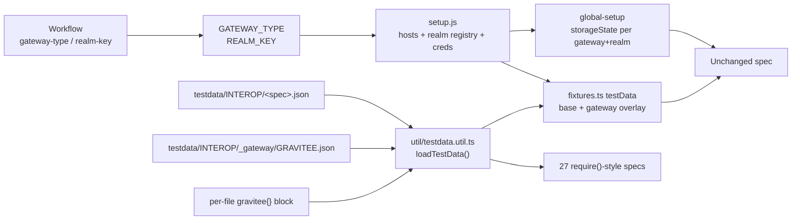

# Plan: Run PS and PO UI suites on both Azure and Gravitee gateways

> The test-data approach in this plan is superseded by [gravitee-dual-gateway-ui-plan-v2.md](gravitee-dual-gateway-ui-plan-v2.md) (per-file `GRAVITEE` block).

| Item | Value |
|---|---|
| Scope | `tests/PlanningSpace/**` (126 specs), `tests/ProcessOrchestration/**` (29 specs), `tests/DataSetupBatch/**` (19 specs) |
| Environment | INTEROP (QA and PSR follow the same pattern later) |
| Azure realm | `cbp-interop-ps-automation-2` (portal `bylumuiportalpltna.azureedge.net`, B2C login) |
| Gravitee realm key | `pspoat-test1` (portal `https://pspoat-test1.portal.interop.na.blueyonder.dev/`) |
| Out of scope | `ProcessOrchestrationBackend/**`, which already runs on both gateways. Performance, VisualAutomation and PagesAndBlocks are also out of scope. |
| Guiding rule | The same spec file runs unchanged on both gateways. Gateway differences are handled in `setup.js`, the fixtures and the test data, not in specs. |

---

## 1. Current state (findings)

### 1.1 What already works for Gravitee
- `configs/setup.js` switches API, auth and portal hosts from `GATEWAY_TYPE` + `REALM_KEY`. The Gravitee host pattern is `https://<realmKey>.{api|auth|portal}.interop.na.blueyonder.dev/`.
- `util/api.util.ts` drops `realmId`/`scope` for Gravitee. Its token cache key already includes the gateway and auth URL.
- `util/oidc-login.helper.ts` has a Gravitee login branch (email, password, Sign In, then redirect to `.portal.`).
- `pageobjects/login.page.ts` has Gravitee locators (`tfldGraviteeEmail`, `tfldGraviteePassword`, `btnGraviteeSignIn`).
- `util/user-token.util.ts` keys the user-token cache by `REALM_KEY` on Gravitee.
- The PO Backend workflow already maps cron entries to `GATEWAY_TYPE` and has `gateway-type`/`realm-key` inputs. Reuse this pattern.

### 1.2 Gaps that block the UI suites on Gravitee

| # | Area | Gap | Where |
|---|---|---|---|
| G1 | Workflows | The PS and PO UI workflows never set `GATEWAY_TYPE`, `REALM_KEY` or any `GRAVITEE_*` secret, so they always run on Azure. | `playwright-ps-iop-ui-local-suite.yaml`, `playwright-po-iop-ui-local-suite.yaml`, `playwright-po-iop-suite.yaml`, `.sauce/*.yml` |
| G2 | Credentials | On INTEROP + GRAVITEE, `setup.js` always uses `GRAVITEE_CLIENT_ID/SECRET`, which is the `cbpf-test23` backend client. `pspoat-test1` needs its own machine client for API setup and cleanup calls. | `setup.js` Gravitee INTEROP block |
| G3 | Realm identity | `REALM_NAME`, `REALM_ID` and `SUBJECT_ID` stay on the Azure values when Gravitee is selected. | `setup.js` INTEROP block |
| G4 | Test data | 154 of 161 UI data files hard-code `"REALM_NAME": "cbp-interop-ps-automation-2"`. Several also hold realm-specific GUIDs (`REALM_ID`, `SUBJECT_ID`, `CALC_ENGINE_ID`, `PARENT_SCENARIO_ID`, `ASSUMPTION_ID`). There is no gateway overlay mechanism. | `testdata/INTEROP/**` |
| G5 | Test data loading | Two loading paths exist: the `testData` fixture (most specs) and a direct `require('testdata/' + PSENV + ...)` call (27 specs, e.g. CardsBatch, ObjectiveBar, QuickLinks, ActionItemsBatch, DataSetup). Any overlay has to cover both. | `configs/fixtures.ts`, the 27 specs |
| G6 | Auth storage state | The storageState path is `.auth/<slug(REALM_NAME)>/<user>.json` and has no gateway in it, so Azure and Gravitee states could collide. `global-setup` also builds its realm list from `REALMS`/`REALM_NAME`. | `fixtures.ts#resolveAuthStatePathForTest`, `global-setup.ts` |
| G7 | Login helpers | `signOut()` falls back to waiting for the Azure *Enter realm* field. `enterRealmAndCompleteOidcPopup()` is Azure-only (realm field plus B2C popup). The Gravitee check in `oidc-login.helper.ts` also uses a `cbpf-` prefix heuristic, which `pspoat-` does not match. | `util/test.util.ts`, `util/oidc-login.helper.ts` |
| G8 | Hard-coded hosts | These specs hard-code the Azure host `api-tst.jdadelivers.com`: `SupplyChainActionsBatch/Test_005_PublishScenario` (token URL hint) and `DataSetupBatch/UIDataReset/Test_003_CleanupProcess`, which also hard-codes a `cbp/qa/...` path. | the specs listed |
| G9 | Env leakage | `DynConstraints/Test_001` overwrites `REALM_KEY`, `LUMINATE_PORTAL_URL` and `API_BASE_URL` to `augtwo-test1` and never restores them, which leaks into later specs on the same worker. | the spec |
| G10 | Other realms | 6 specs are pinned to other Azure realms: `AddLanePopup/*` (`cbp-test-interop-5`), `NPI/Test_001` (`cdp-interop-npi`), `OnDemandMaas/Test_006` and `PO ProcessBatch/Test_002` (`cbp-interop-po-ps-1`), and `DynConstraints/Test_001` (`ibp-iop-aug-02` / `augtwo-test1`). | test data |
| G11 | Reporting | The Allure history folders (`PW-PO-UI-INTEROP-LOCAL`, PS equivalent) and artifact names have no gateway in them, so Gravitee runs would overwrite Azure history. | workflow `generate-report` jobs |
| G12 | Realm data | `pspoat-test1` is a new realm. None of the processes, views, filters, scenarios, calendars, SCAs, procedures or MAAS artifacts the specs expect exist there yet. | platform / data setup |

> The committed storage state for `cbp-interop-ps-automation-2` contains `realm_key: cbpf-test24`. That suggests the Azure realm already has a Gravitee key. Confirm whether `pspoat-test1` is a separate tenant, which needs seeding (this plan assumes it is), or a Gravitee alias of an existing tenant, which would make Workstream 6 mostly unnecessary.

---

## 2. Target design



### Design decisions
1. **One switch.** `GATEWAY_TYPE` (`AZURE` or `GRAVITEE`) plus `REALM_KEY` choose everything. Specs never branch on the gateway, except the few that are gateway-specific by nature (see §4.4).
2. **Realm registry in `setup.js`.** Non-secret realm identity (`REALM_NAME`, `REALM_ID`, `SUBJECT_ID`) is keyed by realm key, the same way `setup.js` already holds Azure IDs. Secrets stay in `process.env`.
3. **Overlay test data, don't copy it.** Keep one base JSON per spec. Gravitee differences come from:
   - a realm-level defaults file, `testdata/<ENV>/_gateway/GRAVITEE.json`, which replaces keys such as `REALM_NAME`/`REALM_ID` for every spec;
   - an optional per-file `"gravitee": { ... }` block for spec-specific GUIDs and names. The backend already uses this shape in `LinkManagement/Test_011_AdminFilterManagement.json`.
4. **Mirror the data.** Seed `pspoat-test1` with the same process, view, filter and scenario names as the Azure realm. Most specs then need no per-file overrides. Only GUID-bearing fields change.
5. **Gateway in every cache key.** This applies to storageState folders, Allure history paths and artifact names.

---

## 3. Workstreams and file-level changes

### WS0: Prerequisites (platform/realm owners, no code)

| # | Item | Owner | Output |
|---|---|---|---|
| P1 | Provision `TEST_AUTOMATION_USER_1` and `_2` in `pspoat-test1` with the same roles as the Azure realm (Admin, process roles, PS view-edit rights) | Realm admin | Users can log in to `https://pspoat-test1.portal.interop.na.blueyonder.dev/` |
| P2 | Create a machine client (client-credentials grant) for `pspoat-test1` with the same API permissions as `cbp-interop-ps-automation-2` | Realm admin | Repo secrets `GRAVITEE_CLIENT_ID_PSPOAT_TEST1`, `GRAVITEE_CLIENT_SECRET_PSPOAT_TEST1` |
| P3 | Capture realm identity: realm display name, tenant/realm ID (`tid` claim), and the machine subject ID | QA | Values for the realm registry (§3 WS1) |
| P4 | Confirm the app namespaces on the Gravitee portal (`ibppsintegration/`, `pointegration/`, `semantic-network-architect-interop/`, `identityaccess/`) | QA (manual login) | Confirmed `PSLINK`/`POLINK`/`SNALINK` or Gravitee overrides |
| P5 | Confirm that the non-PO API prefixes resolve on the Gravitee API host: `cbp/foundation-simulation/v1ioptst`, `cbp/interop/foundation/sna-bff/v1`, `cbp/interop/ibp/assumptions/v1`, `cbp/interop/ibp/featuretoggle/v1`, `cbp/interop/maas/*`, `iam/realm/v1/roles`, `lui/uiRegistration/v1/realmSettings` | QA (curl/Postman with the P2 token) | A list of paths that need Gravitee-specific values in `setup.js` |
| P6 | Match the LaunchDarkly/feature flags between the realms (e.g. SCA toggle, LiveBlocks, ODM) | Realm admin | Same flag set on both realms |
| P7 | Deploy the same solution package (process models, cognitive model, views and cards, SNA actors and procedures, MAAS models and calc engines) to `pspoat-test1` | Platform / ALM | Realm ready for seeding (WS6) |

### WS1: `configs/setup.js`
1. Add a Gravitee realm registry (non-secret values only):
   ```js
   const GRAVITEE_REALMS = {
     'cbpf-test23':  { realmName: '<TBD>', realmId: '<TBD>' },            // PO Backend
     'pspoat-test1': { realmName: '<TBD P3>', realmId: '<TBD P3>', subjectId: '<TBD P3>' }, // PS/PO UI
   };
   ```
2. In the INTEROP Gravitee block:
   - Pick credentials per realm key and fall back to the current secret:
     ```js
     const keyEnv = realmKey.toUpperCase().replace(/[^A-Z0-9]/g, '_'); // PSPOAT_TEST1
     const clientId = process.env[`GRAVITEE_CLIENT_ID_${keyEnv}`] || process.env.GRAVITEE_CLIENT_ID;
     const clientSecret = process.env[`GRAVITEE_CLIENT_SECRET_${keyEnv}`] || process.env.GRAVITEE_CLIENT_SECRET;
     ```
     Update the fail-fast error message to name both variables.
   - When the registry has an entry, override `REALM_NAME`, `REALM_ID` and `SUBJECT_ID` from it. `global-setup`, `fixtures.ts` and specs that read `process.env.REALM_NAME` then pick up the Gravitee realm.
   - If P4/P5 find different values, set Gravitee-specific `PSLINK`/`POLINK` and foundation paths here.
3. Remove the duplicate portal override inside the INTEROP section (current lines ~157–160). The shared Gravitee block below it already sets `LUMINATE_PORTAL_URL`.
4. Extend the `[setup]` log line with `REALM_NAME` and the resolved client source (`GRAVITEE_CLIENT_ID_PSPOAT_TEST1` vs `GRAVITEE_CLIENT_ID`). Print no values.
5. Default `REALM_KEY` stays `cbpf-test23` so PO Backend is unaffected. The UI workflows pass `pspoat-test1` explicitly.

### WS2: Auth and login flows
| File | Change |
|---|---|
| `util/gateway.util.ts` (new, small) | Export `isGravitee()` and `getAuthRealmKey()`, which returns `GRAVITEE:<REALM_KEY>` or `AZURE:<REALM_NAME>`. Use these in the files below instead of repeating `(process.env.GATEWAY_TYPE ...)` inline. |
| `util/oidc-login.helper.ts` | Decide Gravitee vs Azure from `isGravitee()` only and drop the `realmName.startsWith('cbpf-')` heuristic. Keep `realmName` for logging. |
| `util/test.util.ts` → `signOut()` | On Gravitee, the fallback after sign-out waits for `tfldGraviteeEmail` (or a `.auth.` URL) instead of `tfldEnterRealm`. |
| `util/test.util.ts` → `enterRealmAndCompleteOidcPopup()` | On Gravitee, skip the realm entry and popup and complete the Gravitee credential form on the current page. It is used by `LastAccessedContext/Test_001` and `Test_002`. Add a new method rather than changing the signature (POM rule). |
| `configs/global-setup.ts` | On Gravitee, the realm list is `[REALM_KEY]`. The portal is realm-scoped, so `REALMS` with several values is not supported there. Output folder: `.auth/<slug(getAuthRealmKey())>/<user>.json`. |
| `configs/fixtures.ts` → `resolveAuthStatePathForTest` | Build the slug from `getAuthRealmKey()` with the same function as global-setup, so both sides agree. |
| `.gitignore` | Confirm `testdata/.auth/**` is ignored. A storage state for `cbp-interop-ps-automation-2` is currently in the workspace. |

### WS3: Test data overlay
1. **New `util/testdata.util.ts`** with a single `loadTestData(relativeSpecPath)`:
   - Base: `testdata/<ENV>/<area>/<Spec>.json`, as today.
   - When `isGravitee()`:
     1. Apply `testdata/<ENV>/_gateway/GRAVITEE.json`, **only for keys the base file already has**, so `REALM_ID` is not added to files that don't use it.
     2. Deep-merge the file's own `gravitee` block on top.
     3. Remove the `gravitee` key from the result.
   - The result is cached per worker, as `loadTestDataCached` does today.
2. **`configs/fixtures.ts`**: the `testData` fixture and `resolveAuthStatePathForTest` both call the new loader. Keep `resolveTestDataPath`.
3. **Migrate the 27 `require('../../../testdata/' + PSENV + ...)` specs** to the `testData` fixture where they already use fixtures, otherwise to `loadTestData()`. No other change to their logic.
4. **New file `testdata/INTEROP/_gateway/GRAVITEE.json`**:
   ```json
   {
     "_schema": {
       "REALM_NAME": "string (required) Gravitee realm display name for pspoat-test1",
       "REALM_ID": "string (optional) tenant id used by ODM/admin-filter specs"
     },
     "REALM_NAME": "<TBD P3>",
     "REALM_ID": "<TBD P3>"
   }
   ```
5. **Per-file `gravitee` blocks**: add them only where values differ after seeding. Known candidates:

   | Spec data | Keys |
   |---|---|
   | `CardsBatch/Test_002`, `Test_008`, `Test_010` | `CALC_ENGINE_ID` |
   | `DrillThroughBatch/Test_005`, `Test_006` | `PARENT_SCENARIO_ID` |
   | `ViewsBatch/Test_008` | `ASSUMPTION_ID` |
   | `OnDemandMaas/Test_004`, `Test_007` | `REALM_ID` (covered by the defaults file) |
   | `ProcessOrchestration/ProcessBatch/Test_001` | `SUBJECT_ID` |
   | `DataSetupBatch/Scenarios/Test_003` | `CALC_ENGINE_ID` |
   | All ODM DataSetup files | planning-instance and cluster IDs |

   Document each new key in the file's `_schema` block, e.g. `"gravitee": "object (optional, applied when GATEWAY_TYPE=GRAVITEE)"`, following the backend `Test_011` example.
6. **Update the `testdata.instructions.md` rules** to cover `_gateway/<GATEWAY>.json` and the `gravitee` block. Do this in the same PR as the loader.

### WS4: Spec-level fixes (minimal)
| Spec | Fix |
|---|---|
| `SupplyChainActionsBatch/Test_005_PublishScenario` | Build the token hint from `process.env.API_BASE_URL + 'lui/uiRegistration/v1/realmSettings'` (or a path-only hint). `expectedRealm` already comes from `REALM_NAME`, so WS1 covers it. |
| `DataSetupBatch/UIDataReset/Test_003_CleanupProcess` | Use `API_BASE_URL` + `DELETE_PROCESS` / `ASSIGN_ROLE_TO_USER` instead of the hard-coded host and the `cbp/qa/...` path. This is an existing bug on INTEROP Azure as well. |
| `DynConstraints/Test_001` | Save and restore the overridden env vars in `afterAll` (G9). Keep it pinned to `augtwo-test1` on both gateways. |
| `LastAccessedContext/Test_001`, `Test_002` | Switch to the gateway-aware realm re-entry method from WS2. |
| `ProcessOrchestration/ProcessBatch/Test_001`, `Test_002` | Role lookup matches `role.realmName === testData.REALM_NAME`. Confirm that the IAM roles API returns the Gravitee realm name (P3/P5). |
| Specs pinned to other realms (G10) | Keep them Azure-only for now through the Gravitee ignore list (§4.3), each with a documented reason. Bring them in later if Gravitee equivalents of those realms are created. |

### WS5: Workflows
Use the backend-suite pattern (cron → gateway, dispatch input → gateway) for both UI workflows.

**`playwright-ps-iop-ui-local-suite.yaml` and `playwright-po-iop-ui-local-suite.yaml`**
1. New `workflow_dispatch` inputs:
   ```yaml
   gateway-type:
     description: Choose Gateway (AZURE or GRAVITEE)
     type: choice
     default: 'AZURE'
     options: [AZURE, GRAVITEE]
   realm-key:
     description: Gravitee realm key for UI suites
     type: string
     default: 'pspoat-test1'
   ```
2. Schedule: add a second cron per workflow for Gravitee, staggered so the two gateways don't compete for runners or shared users. Example for PS: `00 22 * * *` stays Azure and a new `00 23 * * *` runs Gravitee.
   ```yaml
   GATEWAY_TYPE: ${{ (github.event_name == 'schedule' && github.event.schedule == '00 23 * * *') && 'GRAVITEE' || github.event.inputs['gateway-type'] || 'AZURE' }}
   REALM_KEY: ${{ github.event.inputs['realm-key'] || 'pspoat-test1' }}
   GRAVITEE_CLIENT_ID_PSPOAT_TEST1: ${{ secrets.GRAVITEE_CLIENT_ID_PSPOAT_TEST1 }}
   GRAVITEE_CLIENT_SECRET_PSPOAT_TEST1: ${{ secrets.GRAVITEE_CLIENT_SECRET_PSPOAT_TEST1 }}
   ```
3. Pass `GATEWAY_TYPE` and `REALM_KEY` into the `env:` of the **data-setup** and **run-tests** steps, in the same place as `ENVIRONMENT`.
4. Include the gateway in names:
   - artifacts: `allure-results-${{ env.GATEWAY_TYPE }}-${{ matrix.batch_label }}`, and the same for the assets, monocart and html artifacts. Update the `generate-report` download `pattern` to match.
   - Allure history: `PW-PS-UI-INTEROP-${GATEWAY_TYPE}` and `PW-PO-UI-INTEROP-LOCAL-${GATEWAY_TYPE}`. Copy the existing Azure history once into the `-AZURE` path so trends continue, or keep the Azure path unchanged and add a suffix for Gravitee only.
   - Run name, Teams card and report title: add the gateway and realm key. `playwright.config.ts` already sends `Gateway`/`RealmKey` to Allure `environmentInfo`, so that part is done.
   - `concurrency.group`: add `-${{ env.GATEWAY_TYPE }}` so an Azure run doesn't block or cancel a Gravitee run.
5. Add a "Print configuration" step, as in the backend workflow, that echoes the gateway, realm key and which client secret name is set (without the value).

**`playwright-po-iop-suite.yaml` (Sauce) and `.sauce/config.yml` / `.sauce/po-ui-suite.yml`**
- Add `GATEWAY_TYPE`, `REALM_KEY`, `GRAVITEE_CLIENT_ID_PSPOAT_TEST1` and `GRAVITEE_CLIENT_SECRET_PSPOAT_TEST1` to the `env:` passthrough, including the dynamic config heredoc.

**`playwright-custom-tests.yaml`** (optional): add the same two inputs so one spec can be run ad hoc on Gravitee.

**`package.json`** (optional convenience for local runs):
```json
"test:target:gvt": "cross-env ENVIRONMENT=INTEROP GATEWAY_TYPE=GRAVITEE REALM_KEY=pspoat-test1 TZ=Australia/Adelaide npx playwright test --config=configs/playwright.config.ts --workers=1"
```

**Local `.env`** (not committed): `GATEWAY_TYPE=GRAVITEE`, `REALM_KEY=pspoat-test1`, `GRAVITEE_CLIENT_ID_PSPOAT_TEST1=...`, `GRAVITEE_CLIENT_SECRET_PSPOAT_TEST1=...`.

### WS6: Seed `pspoat-test1` (data parity)
Seed once, then keep it current with the existing DataSetup suite.

1. **Inventory.** Generate the list of realm artifacts the specs need from the INTEROP test data: `PROCESS_NAME`, `SUB_PROCESS_NAME`, assumption names, `*_VIEW_NAME`, view groups, filter names, calendar names, SCA/procedure names, scenario names and calc engines. A one-off script over `testdata/INTEROP/{PlanningSpace,ProcessOrchestration}/**` is enough; don't commit it unless it will be reused.
2. **Platform content** (P7): ALM-deploy the same package as the Azure realm.
3. **PO and LM content:** reuse the existing migration flow. Run `exportData` against `cbp-interop-ps-automation-2` and `importData` into `pspoat-test1`, then run the view-entity-map and entity-view-procedure-map migrations. `ProcessOrchestrationBackend/Migration/*` already exercises this path. Alternatively, recreate the data through the UI or API with the DataSetup specs.
4. **Scenarios and ODM:** run `DataSetupBatch` with `GATEWAY_TYPE=GRAVITEE`. This covers `Scenarios/Test_004_CreateScenarios`, `Test_003_AddChildScenariosToMaas`, the ODM restarts, and UIDataReset.
5. **Capture GUIDs** that differ (calc engines, parent scenario, assumption, subject) into the per-file `gravitee` blocks (WS3.5).
6. **Parity check:** run `PSSmokeBatch` on both gateways. Every failure is either missing data (fix the seed) or a real gateway defect (log a bug).

### WS7: Docs, suites and learnings
- `tests/TestSuites/*.json`: no change. The same suites run on both gateways.
- Add a Gravitee ignore list for the specs in G10, e.g. `tests/TestSuites/GraviteeExclusions.json`, with a reason for each. The workflow feeds it to `TEST_IGNORE` only when `GATEWAY_TYPE=GRAVITEE`. This is an explicit exclusion rather than a silent skip, and it should be reviewed every sprint.
- `.agents/learnings.md`, "Environment and setup" section: add one line each for the realm registry, the per-realm-key client secret naming, the test-data overlay precedence and the storageState key format.
- `README.md` (playwright-e2e): add a short "Running on Gravitee" section with the env vars.
- If the suite docs mention the gateway, run `npm run docs:testcases`.

---

## 4. Rollout phases

| Phase | Content | Exit criteria |
|---|---|---|
| **0: Discovery** | WS0 P1–P6. Log in to the Gravitee portal manually as both users. Get a machine token and call one PO, LM, simulation and IAM endpoint. | Realm name, realm ID, subject ID, namespaces and path deltas recorded. Secrets created. |
| **1: Plumbing** (`feature/gravitee-ui-dual-gateway`) | WS1, WS2, WS3.1–3.3 (loader, fixture, 27 `require()` migrations). | The Azure nightly is unchanged (compare pass counts). On Gravitee, a local run of `PlanningSpace/ScopeBatch/Test_001_CheckScopeComponent` gets through login and data loading. |
| **2: Seed + data** | WS6 and WS3.4–3.5. | `PSSmokeBatch` passes on Gravitee at the same rate as Azure, or has only logged product defects. |
| **3: PO UI on Gravitee** | WS4 PO items, WS5 for `playwright-po-iop-ui-local-suite.yaml`. | All six PO batches run on the Gravitee cron, with separate Allure history. |
| **4: PS UI on Gravitee** | Remaining WS4 items, WS5 for the PS sharded workflow, including the DataSetup job. | All 12 PS JSON shards run on the Gravitee cron. The exclusions list is documented. |
| **5: Hardening** | Triage flakes (Gravitee login latency and redirect timing), WS7 docs and learnings. Extend to QA (`cbpf-test27` or a new QA UI realm) if needed. | Two consecutive green nightlies per gateway with parity within the agreed tolerance. |

---

## 5. Risks and mitigations

| Risk | Mitigation |
|---|---|
| Realm data drift between Azure and Gravitee makes results hard to compare | Run DataSetup before every run (already default for PS). Seed with identical names. Run the parity check every week. |
| Both gateways share the same test users, so user-level state (last accessed, favourites, recent views) is shared across realms | State is usually per realm. Keep the crons staggered, and create realm-specific users if cross-talk shows up. |
| Gravitee login redirect is slower or flakier | The Gravitee branch already waits for the `.portal.` URL. Use `getTimeout()` tiers only, and add `PW_TIMEOUT_MULTIPLIER` for the Gravitee workflow if needed. |
| Hidden Azure-only assumptions in page objects (host checks, request-URL hints) | After Phase 2, grep `api-tst.jdadelivers.com`, `azureedge`, `b2clogin` and `enterRealm` and fix them in WS4. `util/performance.test.utils.ts` filters on the Azure API host, which matters only if Performance is later brought into scope. |
| `setup.js` throws when `GATEWAY_TYPE=GRAVITEE` and no client is set | This is intended fail-fast behavior. The workflow print step shows which secret is missing. |
| Runner capacity doubles | Use separate crons, not a matrix cross-product. Run Gravitee at lower frequency at first (e.g. PSSmoke nightly and the full suite twice a week). |

---

## 6. Open questions (need answers before Phase 1 closes)
1. What is the display name of realm `pspoat-test1`, and its tenant/realm ID? (It becomes `REALM_NAME`/`REALM_ID` in the registry.)
2. Is `pspoat-test1` a new tenant, or a Gravitee alias of an existing Azure realm (compare `cbp-interop-ps-automation-2` ↔ `cbpf-test24`)?
3. Will the machine client for `pspoat-test1` be separate from `GRAVITEE_CLIENT_ID` (`cbpf-test23`)? The plan assumes yes.
4. Are `ibppsintegration/` and `pointegration/` the right MFE namespaces on the Gravitee portal?
5. Should the six realm-pinned specs (G10) get Gravitee equivalents, or stay Azure-only?
6. Nightly cadence for Gravitee: full parity from day one, or smoke-first?

---

## 7. Definition of Done (per the workflow instructions)
- [ ] No spec branches on the gateway, apart from the documented exceptions in WS4.
- [ ] All test data loads through `loadTestData()` / the `testData` fixture. `_schema` blocks document the `gravitee` overrides.
- [ ] No secrets in test data or `setup.js`. Client IDs and secrets come only from `process.env`.
- [ ] No TypeScript errors. The targeted specs pass in isolation with `--workers=1` on both gateways.
- [ ] Both UI workflows run on both gateways, with separate artifacts, Allure history and Teams notifications.
- [ ] `.agents/learnings.md` and `testdata.instructions.md` are updated.
